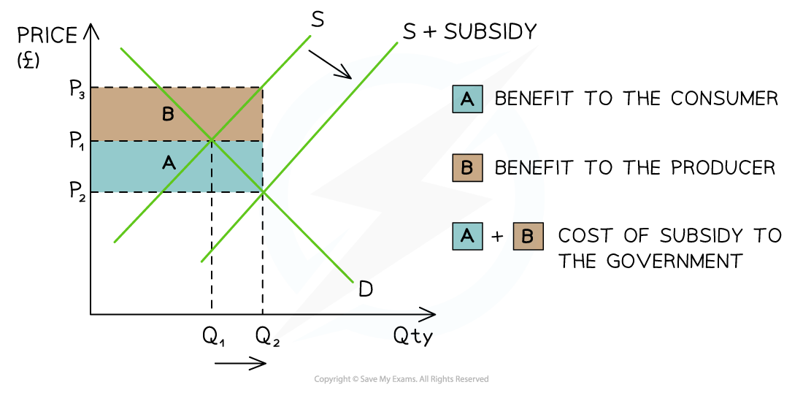

# Types of Trade Restrictions

## 1. Tariffs 

> **Spec point** — `spcpt_X62TBP5SZZGw3tJd` · "• tariffs
• import quotas
• subsidies
• embargoes
advantages and disadvantages of restricting free trade"

## 1. Tariffs

- **A tariff is a tax on imported goods or services (customs duty)**
- With the price of imports higher, domestic firms find it easier to compete and increase their market share as consumers switch from buying imports to buying domestically produced goods and services
- Less **efficient domestic firms **are now producing at the expense of **more efficient international firms**

*A tariff increases the costs of production for domestic firms, resulting in a shift of the supply curve from S1 → S2*

#### Diagram analysis

- The **pre-tariff** market equilibrium for plantains is seen at P1Q1
- **After the tariff **is imposed, costs of production for domestic firms increase (as they pay the tariff when the plantains enter the country) - the supply curve shifts from** *****S******1****** → S******2***
- The **new market equilibrium** is seen at P2Q2

#### Evaluating the use of tariffs to protect domestic firms

- **Tariffs** are one of the most widely used forms of protectionism and their impact on different stakeholders can be evaluated

| **Stakeholder** | **Explanation** |
|---|---|
| **Domestic producers supported by the tariff** *(e.g. local steel manufacturers)* | - Before the tariff, these firms struggled to compete with cheaper imports - After the tariff, foreign goods become more expensive, allowing domestic firms to increase their output and market share - Higher demand for local production may lead to **more jobs** in that industry and **lower unemployment** |
| **Domestic producers affected by higher input costs** *(e.g. car manufacturers using imported steel)* | - These producers rely on imported goods as raw materials - The tariff raises their **costs of production**, which can lead to **lower output**, **higher prices for final goods**, and possibly **job losses** in dependent industries |
| **Foreign producers** | - Tariffs reduce their price advantage, making them less competitive in the domestic market - Export volumes fall, reducing their revenues - From a global perspective, resources may now be **allocated less efficiently**, as more efficient producers are being restricted |
| **Domestic consumers** | - Before the tariff, consumers had access to cheaper imported goods - After the tariff, prices rise and **consumer choice is reduced** - Real income falls and **standards of living decline**, particularly affecting **low-income households** |
| **The government** | - The government earns **tax revenue** from the tariff on each imported unit. - However, there may be **political pressure** if the policy raises consumer prices or causes tensions with trade partners - Tariffs can also risk **retaliatory measures** from affected countries |

## Subsidies

> **Spec point** — `spcpt_nVWBRRmtQfGMcJ7W` · Subsidies: definition, drawing and interpretation of diagrams, advantages and disadvantages

## 2. Subsidies

- A **subsidy** is an amount of money paid to the firm by the government for each unit produced, which lowers the cost of production for domestic firms

  - They can increase output and **lower prices**
  - With lower prices their goods and services are **more competitive** internationally
  - The level of exports increases
  - The increased output may result in **increased domestic employment**

*The use of subsidies to protect domestic firms*

### Diagram analysis

- The original **equilibrium** is at **P****1****Q****1**
- The **subsidy** shifts the supply curve from **S → S + subsidy**:

  - This **increases the QD **in the export market from **Q****1 ****→ Q****2**
  - The **new** market **equilibrium** is P2Q2
  - This is a **lower price **and **higher QD** in the export market

#### Evaluating the use of subsidies to protect domestic firms

| **Stakeholder** | **Explanation** |
|---|---|
| **Domestic producers** | - Subsidies **reduce costs of production**, allowing firms to produce more at lower prices - Output increases, and firms become **more competitive** both domestically and internationally |
| **Foreign producers** | - Face **stronger competition** from domestic firms with lower prices due to subsidies - May lose market share and struggle to export to the subsidising country |
| **Consumers** | - Benefit from **lower prices**, as subsidies help firms reduce selling prices - **Greater affordability** means consumers can buy more with their income |
| **Government** | - Subsidies represent a **cost to the government budget** - There is an **opportunity cost** — the money could be used for other public services like healthcare or education |
| **Standards of living** | - **Improves**, especially for lower-income households, as goods become more affordable and jobs may be protected in supported industries |
| **Equality** | - Subsidies help **level the playing field** for domestic firms competing with foreign producers who may have cost advantages or government support of their own |

## Quotas

> **Spec point** — `spcpt_2BVvFTfZt6Q5PbJq` · Quotas: definitions, advantages and disadvantages

## 3. Quotas

- **A quota is a physical limit on imports **e.g. in June 2022 the UK extended their quota on **steel imports** for a further two years in order to protect employment in the domestic steel industry
- This limit is usually set **below the free market** level of imports

  - As cheaper imports are limited, a quota **raises the market price**
  - As cheaper imports are limited, a quota **may create shortages**
- Some domestic firms benefit, as they are able to **supply more** due to the lower level of imports

  - This may increase the level of employment for domestic firms

#### Evaluating the use of quotas to protect domestic firms

| **Stakeholder** | **Explanation** |
|---|---|
| **Domestic producers** | - Able to increase output as they face less competition from imports - Higher market prices raise their revenue - May lead to increased investment and job creation |
| **Foreign producers** | - Face reduced access to the domestic market, lowering total output - However, those that do export under the quota can benefit from **higher prices** than under a tariff system |
| **Consumers** | - Suffer from **higher prices** and **reduced choice** - Real income is affected by the increased cost of goods, lowering living standards |
| **Government** | - Does **not earn tariff revenue** from the quota itself - Might gain some ***corporation tax*** later if domestic firms grow and report higher profits |
| **Standards of living** | - Likely to **fall for consumers**, as more income is spent on fewer or more expensive goods |
| **Equality** | - Helps **domestic firms compete more fairly**, especially if foreign producers are highly efficient or subsidised |

## 4. Embargoes

> **Spec point** — `spcpt_CQPSVshYWqZRzWGf` · "• tariffs
• import quotas
• subsidies
• embargoes
advantages and disadvantages of restricting free trade"

## 4. Embargoes

- **An embargo is a complete ban on trade with a certain country, usually as the result of political fallout**

  - E.g. the USA ran an embargo for many decades on Cuban products

#### Evaluating the use of embargoes to protect domestic firms

| **Stakeholder** | **Explanation** |
|---|---|
| **Domestic producers** | - Increases output due to less foreign competition |
| **Foreign producers** | - They are unable to legally trade with the country running the embargo - They lose sales and profits - They may go out of business or need to reduce their number of workers |
| **Consumers** | - Prices will rise – and in some cases the product may no longer be available at all |
| **Government** | - The government has to spend money enforcing the embargo |
