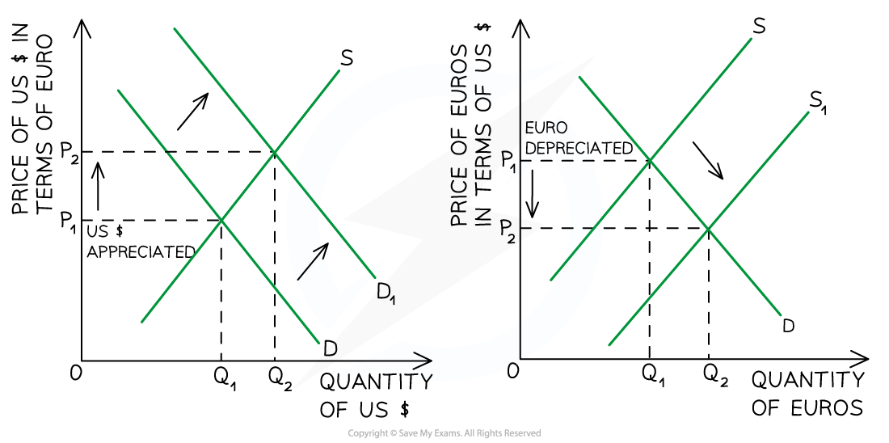

# Floating Exchange Rates

## Key exchange rate definitions

> **Spec point** — `spcpt_T73pjqYYfXtM3wj6` · "definitions of floating exchange rate, appreciation and depreciation 
• the demand for and supply of a currency
"

## Key exchange rate definitions

- A floating exchange rate is one that is **determined by the forces of demand and supply** in the foreign exchange market, without direct government or central bank control
- **Appreciation** occurs when the value of a currency **rises** compared to another currency in a floating system (e.g. £1 = \$1.25 → £1 = \$1.35)
- A **depreciation **occurs when the value of a currency **falls** compared to another currency in a floating system (e.g. £1 = \$1.25 → £1 = \$1.10)

## Determination of the foreign exchange rate

> **Spec point** — `spcpt_QRGs6WbjqpV2zHGV` · • the determination of the equilibrium foreign exchange rate

## Determination of the foreign exchange rate

- Different currencies can be bought and sold, just like any other product
- The **equilibrium exchange rate** is where the **quantity of a currency demanded equals the quantity supplied**

  - At this rate, the market is in balance — there is no shortage or surplus of the currency
  - If demand increases or supply decreases, the currency **appreciates**
  - If demand decreases or supply increases, the currency **depreciates**

### Demand for a currency comes from:

- Foreigners buying the country’s **exports**
- Tourists visiting the country
- Foreign investors buying **assets**, shares or property
- Speculators who expect the currency to appreciate

### The supply of a currency increases when:

- Citizens **import** more foreign goods and services
- Tourists travel abroad and need foreign currency
- Investors send money abroad
- Speculators sell the currency expecting it to fall in value

*The relationship between the US$ and the Euro shows that as Europeans demand the $ it appreciates but by supplying their own currency it depreciates*

#### Diagram analysis

- The Euro/US\$ market is shown by **two market diagrams **- one for the USD market on the left and one for the Euro market on the right
- The initial **exchange rate equilibrium** is found at P1Q1 in both markets
- When Europeans visit the USA, they demand US\$ and supply Euros

  - The **increased demand for the US\$ **shifts the demand curve to the right, which results in the value of the \$ ***appreciating*** from P1 → P2 in the USD market and a new market equilibrium forms at P2Q2
  - The **increased supply of the Euro** shifts the supply curve to the right which results in the value of the Euro ***depreciating*** from P1 → P2  and a new market equilibrium forms at P2Q2**  **

## Causes of foreign exchange rate fluctuations

> **Spec point** — `spcpt_77T3WhYQndZQFZz6` · "• causes of foreign exchange rate fluctuations
– changes in demand for exports and imports
– changes in the interest rate
– speculation"

## Causes of foreign exchange rate fluctuations

- Several factors cause exchange rates to change. Three of the most common include:

| **Cause** | **Explanation** |
|---|---|
| **Changes in demand for exports and imports** | - If a country’s **exports rise**, demand for its currency increases, **causing appreciation** - If **imports rise**, more of the home currency is sold to buy foreign currency, leading to **depreciation** |
| **Changes in interest rates** | - **Higher *****interest rates***** **attract foreign savers and investors, increasing demand for the currency and causing it to **appreciate** - **Lower interest rates** tend to reduce demand and cause **depreciation** |
| **Speculation** | - If traders believe a currency will rise in value, they buy more of it, which **increases demand** and causes appreciation - If they expect it to fall, they sell the currency, **increasing supply** and causing depreciation |
