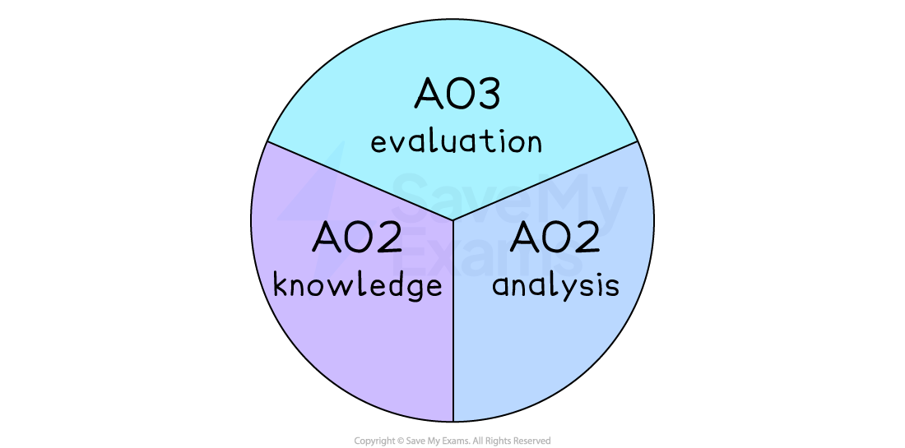

# Skills You Need To Demonstrate

## An introduction to the skills

> **Spec point** — `spcpt_4Zy8YvWS3q2R86dv`

## An introduction to the skills

- The IGCSE Economics exams test three key skills:

*Skills IGCSE economics students need to demonstrate*

- You will use these skills **across both papers**, but they are most heavily rewarded in **Paper 2**, where written explanations, diagrams and data analysis are required
- The exams assess your ability to:

  - Recall definitions and core economic concepts
  - Apply concepts to real-world contexts
  - Analyse diagrams, tables and written scenarios
  - Perform simple calculations
  - Explain cause–effect relationships
  - Make reasoned, balanced economic judgements
- Each of these skills must be demonstrated clearly and separately in longer answers

## AO1 Knowledge and Understanding

> **Spec point** — `spcpt_Nc686dd76S3PCbjQ`

## AO1 Knowledge and Understanding

- AO1 is the foundation of every Economics question

  - To score well in other skills, AO1 must be secure
- You gain AO1 marks for:

  - **Recognising, recalling and stating** key economics terms
  - Giving **precise definitions** (e.g., opportunity cost, inflation, PED)
  - Identifying **characteristics**, **causes**, **features** or **effects**
  - **Selecting the correct formula** for a calculation
  - Drawing **accurate, fully labelled diagrams**
  - Using **appropriate terminology** (scarcity, equilibrium, elasticity, productivity etc)
- Economic diagrams fall under AO1 **only when they are drawn and labelled correctly**

> **Worked Example**
> **Define **opportunity cost
> 
> “Opportunity cost is the next best alternative foregone when a choice is made.”
> 
> - “Next best alternative”
> - “Foregone”
> 
> Both elements must be present for full AO1 marks

## AO2 Analysis

> **Spec point** — `spcpt_45wHhJhbDZWfn2WC`

## AO2 Analysis

- AO2 tests your ability to **use economic concepts to explain real-world situations**, and to show **cause-effect relationships**

  - AO2 is the skill used most frequently in 4-mark and 6-mark questions
- You gain AO2 analysis marks for:

  - Making **developed explanations** rather than simple statements
  - Showing **chains of reasoning** (“because… therefore… leading to…”)
  - **Applying** economics to:
  
    - data extracts
    - context paragraphs
    - diagrams
  - Using diagrams to support an explanation (e.g., explaining why a curve shifts)
  - Interpreting data from tables, charts or numerical information
  - Explaining **why** an event occurs or **how** one variable affects another

> **Worked Example**
> **Explain **why a fall in interest rates may increase consumer spending
> 
> A strong AO2 explanation will show:
> 
> - A cause →
> - A direct effect →
> - A final economic impact
> 
> **For example**
> 
> Lower interest rates reduce the cost of borrowing for households →
> this makes loans and credit more affordable → leading to higher consumer spending in the economy.
> 
> This chain of reasoning demonstrates AO2 clearly

### AO2 using diagrams

- When diagrams appear in Paper 2, AO2 marks are awarded for:

  - Explaining what the diagram shows
  - Explaining the **economic reasoning behind a shift or movement**
  - Linking the diagram to the context of the question
- The diagram itself is AO1, but the **explanation of it** is AO2

## AO3 Evaluation

> **Spec point** — `spcpt_2m8D3C299dNQmg4m`

## AO3 Evaluation

- AO3 is tested **only in Paper 2**, usually in 8-mark “Discuss” questions
- Evaluation means making:

  - Judgements
  - Comparisons
  - Trade-offs
  - Balanced reasoning
  - Considerations of “it depends” factors
  - Short-run vs long-run differences
  - Contextual decisions
- In the official Cambridge mark scheme, AO3 is credited through “levels of response”
- In Save My Exams resources, AO3 is made clearer using the *defined-mark structure*  -  where students develop two arguments on each side
- You gain AO3 marks for:

  - Considering both sides of an economic issue
  - Judging which side is stronger **and why**
  - Referencing context (where relevant)
  - Recognising limitations of arguments
  - Showing conditions under which a policy or outcome may change
- There is no need to write a full conclusion

> **Worked Example**
> **Discuss **whether an increase in income tax will reduce income inequality.
> 
> Evaluation may include points such as:
> 
> - It depends on the **progressiveness** of the tax system
> - Effectiveness depends on **how tax revenue is used**
> - Higher income tax may reduce incentives to work (counter-effect)
> - If tax avoidance is high, inequality may not fall
> - Short-run impact may differ from long-run impact
> 
> Here is an [example of a 'discuss' response](https://www.savemyexams.com/igcse/economics/cie/25/revision-notes/7-exam-technique/7-3-structuring-your-responses/answering-8-mark-questions/)

## Putting the skills together

> **Spec point** — `spcpt_9qq53mwQtNBYjw6r`

## Putting the skills together

- In most longer Paper 2 answers, you are expected to use **two or more** skills in the same response:

  - AO1 provides the definition, diagram or basic concept
  - AO2 develops explanations and shows cause–effect
  - AO3 weighs arguments and makes judgements
- For example, in an 8-mark “Discuss” question:

  - AO1 = the economic concepts used
  - AO2 = the two developed explanations on each side
  - AO3 = the balanced discussion across both sides
- Correctly combining the skills leads to full marks
