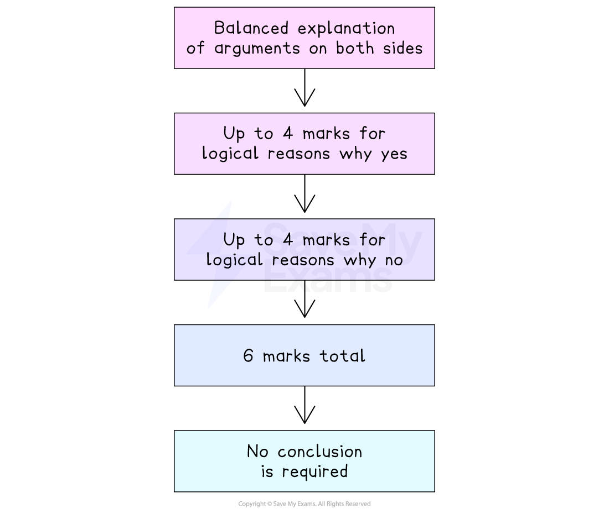

# Answering 6-Mark Questions

## How do I answer IGCSE economics 6-mark discuss questions?

> **Spec point** — `spcpt_xqq6tZH6fzjx2pfw`

## How do I answer IGCSE economics 6-mark 'discuss' questions?

- To answer IGCSE Economics 6-mark 'discuss' questions, consider the following:

  - A 6-mark 'Discuss' question requires a **balanced explanation of arguments** on both sides
  - Examiners award:
  
    - Up to 4 marks for logical reasons *why yes*
    - Up to 4 marks for logical reasons *why no*
    - A maximum 6 marks total
  - For each reason:
  
    - (1) for the reason
    - (1) for development (cause → effect → impact)
    - Two developed reasons on one side, plus one developed reason on the other, are enough for full marks
    - No conclusion is required

#### Summary of the 6-mark 'discuss' structure

*How to structure a 6 mark discuss question in IGCSE economics*

> **Worked Example**
> ** Discuss **whether or not the Algerian Government should impose a carbon tax
> 
> **Model Answer**
> 
> **Arguments for**
> 
> A carbon tax puts financial pressure on firms to reduce emissions** (1),**
> helping to lower pollution and reduce the external costs caused by production** (1)**
> 
> The tax can raise government revenue **(1)**, which can then be spent on public services such as healthcare or renewable energy projects **(1)**
> 
> **Argument against**
> 
> If other countries do not impose a carbon tax, Algerian products may become less internationally competitive **(1)**, reducing exports and potentially causing firms to move production abroad **(1)**
> 
> **Mark Scheme & Guidance**
> 
> - Award up to **4 marks** for well-developed arguments in favour
> - Award up to **4 marks** for well-developed arguments against
> - **Maximum total**: **6 marks**
> - Each point may only be credited once, but development explaining **how/why** the effect occurs can gain an additional mark
> - No conclusion is required

## How do I answer IGCSE economics 6-mark 'analyse' questions?

> **Spec point** — `spcpt_Ds6vTbpC3DBp7x7B`

## How do I answer IGCSE economics 6-mark 'analyse' questions?

- To answer IGCSE Economics 6-mark 'analyse' questions, consider the following:

  - A 6-mark ‘Analyse’ question requires you to give **two fully developed chains **of economic reasoning
  - Examiners award:
  
    - Up to **3 marks** for each analytical chain
    - A maximum **6 marks** total
  - For each chain:
  
    - **(1)** for the reason
    - **(1)** for developing the reason
    - **(1)** for explaining the final impact (cause → effect → consequence)
    - Two well-developed chains are enough for full marks
    - No evaluation or conclusion is required

> **Worked Example**
> **Analyse** two reasons why the demand for public transport may increase.
> 
> **Model Answer**
> 
> **Analytical chain 1**
> 
> Higher petrol prices make using private cars more expensive** (1)**, so consumers switch to cheaper alternatives such as buses and trains** (1)**, leading to higher demand for public transport at every price level** (1)**
> 
> **Analytical chain 2**
> 
> **Additionally,** government subsidies can reduce the price of public transport **(1)**,
> making it more affordable for households **(1), **which increases the quantity demanded according to the law of demand **(1)**

> **Exam Hint**
> - Signpost the start of your second chain by using conjunctives such as 'additionally' or 'secondly'

## How do I answer IGCSE economics 6-mark 'analyse, using a demand and supply diagram' questions?

> **Spec point** — `spcpt_TQbX5dHPGKqXwQm9`

## How do I answer IGCSE economics 6-mark 'analyse, using a demand and supply diagram' questions?

- To answer IGCSE Economics 6-mark 'analyse, using a demand and supply diagram' questions, consider the following:

  - A 6-mark ‘analyse, using a diagram’ question requires you to:
  
    - Draw an accurate, fully labelled diagram
    - Explain the economic change shown in the diagram
  - Examiners award:
  
    - Up to 4 marks for the diagram
    - Up to 2 marks for the written analysis
    - A maximum 6 marks total
  - For diagram marks:
  
    - **(1)** correctly labelled axes
    - **(1)** correct original curves
    - **(1)** correct shift
    - **(1)** correct new equilibrium
  - For analysis marks:
  
    - **(1)** for explaining the cause of the shift
    - **(1)** for explaining the impact on price or quantity
  - A full, correct diagram plus a short, clear explanation is enough for full marks
  - No evaluation or conclusion is required

> **Worked Example**
> **Analyse, using a demand and supply diagram,** the effect of falling steel prices on the market for cars
> 
> **Model Answer**
> 
> 
> 
> Falling steel prices **reduce firms’ production costs in car manufacturing**** (1)**,
> shifting the supply curve in the market for cars to the right and leading to a **lower market price and higher quantity of cars sold** **(1)**
> 
> **Mark Scheme & Guidance**
> 
> - A student can still gain analysis marks even if the diagram is incomplete
> - Diagrams must be **fully labelled** to receive full diagram marks
