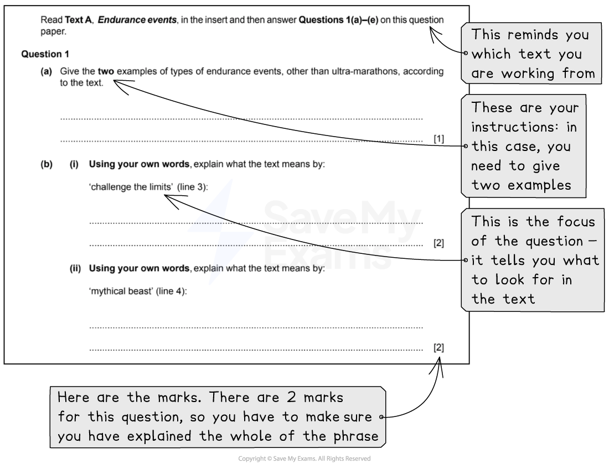

# How to Answer Question 1: Comprehension

**This revision note is for exams in 2026. If you are sitting your exam from 2027, please switch to the 'First exams 2027' syllabus edition.**

## Paper 1: How to Answer Question 1: Comprehension

> **Spec point** — `spcpt_5WgR9rcGj4Ghmh64`

## How to Answer Question 1: Comprehension

Paper 1: Reading is the compulsory exam in the CIE IGCSE, and CIE examiners recommend that you complete the questions in the order they are set. Question 1 is split into two tasks: a comprehension task and a summary task. The comprehension task will be based on **Text A** in your reading insert.

The following guide will provide you with the information you need to answer **Question 1: Comprehension** confidently.

## Overview for Question 1

> **Spec point** — `spcpt_f4gQw5ZhXqXqXqfH`

## Overview for Question 1

For this task, you will respond to a series of sub-questions about Text A. These sub-questions will test your understanding of both explicit and implicit meanings, and your ability to select and use information from the text (Assessment Objectives R1, R2 and R5). The sub-questions are worth 15 marks in total and are broken down as follows:

| **Question** | **What you are asked to do** | **Marks** |
|---|---|---|
| 1(a) | Identify two specific pieces of information from the text | 1 |
| 1(b)(i) | Explain, *using your own words*, what a word or phrase in the text means | 2 |
| The word or phrase will have a surface meaning for you to explain |   |   |
| 1(b)(ii) | Explain, *using your own words*, what a word or phrase means | 2 |
| The word or phrase will have a more implicit meaning, which means you will have to consider its meaning a little more carefully |   |   |
| 1(c) | Identify two specific pieces of information from the text | 2 |
| 1(d)(i) | Identify two specific pieces of information from the text | 2 |
| 1(d)(ii) | Explain something, making three separate points, based on the text | 3 |
| 1(e) | Explain something from the text *using your own words*, making three separate points | 3 |
| Use inference here to find the suggested or hidden meaning |   |   |

## Breaking down the questions

> **Spec point** — `spcpt_2GxW3XjfKtxdTgnd`

## Breaking down the questions

Question 1: Comprehension will be divided into seven sub-questions. It is important that you read each question carefully and highlight:

- The command words in each question (what you have to do)
- The focus of each question (what you are looking for in the text)
- How many marks each question is worth (this indicates how much you need to write)

### Question 1 example:

*Example Question 1*

## Steps to success

> **Spec point** — `spcpt_8y4t8wdQHJ2Pdt6y`

## Steps to success

Following these steps will give you a strategy for answering this question effectively:

1. Read the question and **highlight**:

  1. The command words (what you are instructed to do)
  2. The focus of the question (the words or phrases you have to look for in the text)
  3. When highlighting, take note of the marks given for each sub-question
2. Scan Text A and highlight the evidence that answers the question, or the words or phrases you need to explain:

  1. Remember that there may be more than one answer - make sure your answer provides what the question instructions have asked for
3. Write your answers according to the question instructions:

  1. If the question asks for two examples, then make sure you give two separate examples
  2. If the question asks you to use your own words, then make sure you do not repeat words from the text
  3. Check how many marks are awarded for each question, and tailor your answers accordingly
  4. When explaining the meaning of a phrase, consider the context of the text (do not just guess the meaning without context)
  5. Remember, not all of the answers will be explicit:
  
    1. You will have to make some inferences or read between the lines

You are advised to spend no more than 15-20 minutes on this question (including reading time).

## Exam tips

> **Spec point** — `spcpt_ZwCz9QbSXjXZ9sgw`

## Exam tips

- Read the command words and the paragraph references in the instructions carefully
- Do not write overly long explanations or answers in your own words where they are not required:

  - Equally, make sure you do not just repeat the language of the text in answers where your own words are required
  - It is made clear in the task instructions when you should write your answers using your own words
- Avoid adding additional unnecessary material and/or extra guesses in your answers
- Follow the order of the sub-questions and work through the text from the beginning
- Where a question asks you to explain a phrase in your own words, make sure you explain the meaning of the whole of the phrase (rather than just trying to analyse an individual word in the phrase)
- Where a question directs you to a particular paragraph(s), make sure that you only use the sections of text specified:

  - You will not be awarded marks for anything taken outside of these sections or paragraphs

The full June 2022 exam paper is available [here](https://www.savemyexams.com/igcse/english-language/cie/past-papers/).

For more advice on how to apply the skills required for success in this question, please see our [Question 1 skills: Explicit and implicit meanings](https://www.savemyexams.com/igcse/english-language/cie/20/revision-notes/1-paper-1-reading/question-1-comprehension/question-1-skills-explicit-and-implicit-meanings/) revision notes. For model answers to these questions, please see [Question 1 Comprehension: Model answers.](https://www.savemyexams.com/igcse/english-language/cie/20/revision-notes/1-paper-1-reading/question-1-comprehension/question-1-comprehension-model-answers/)
