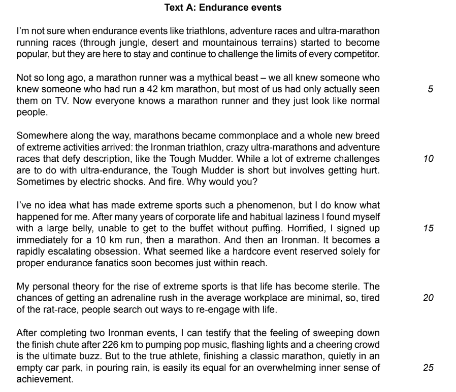
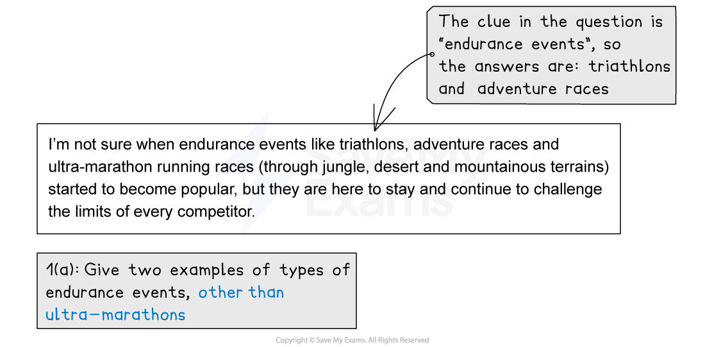
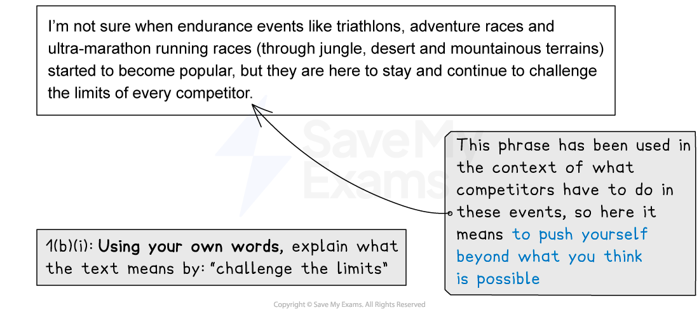
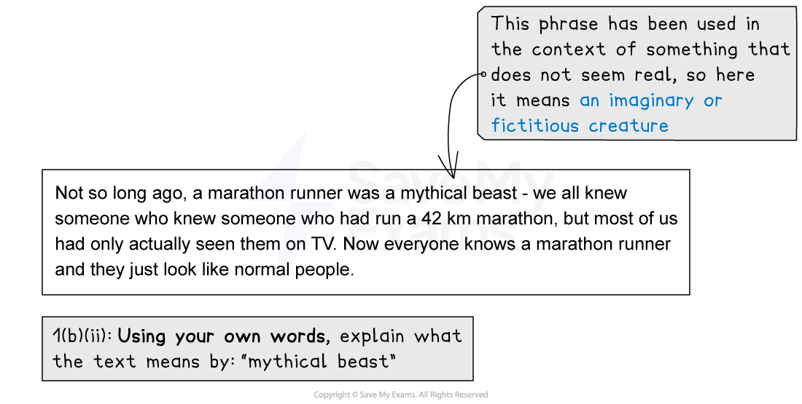
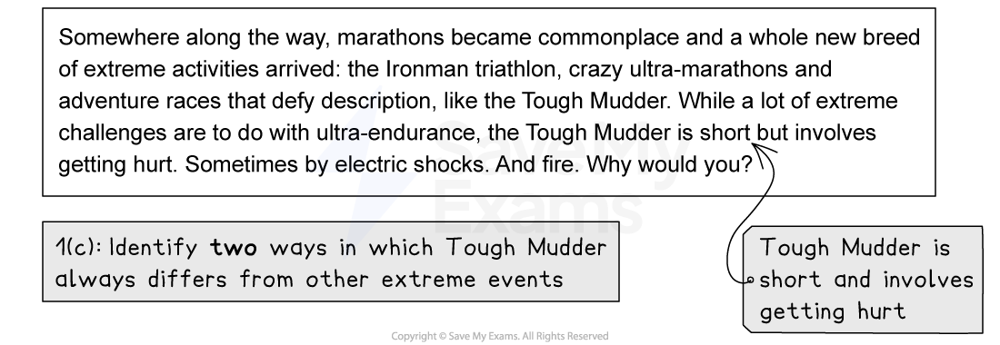
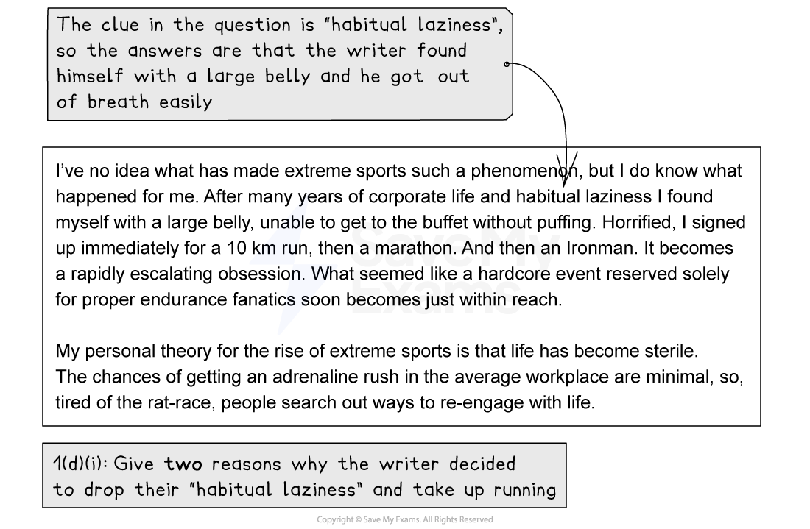
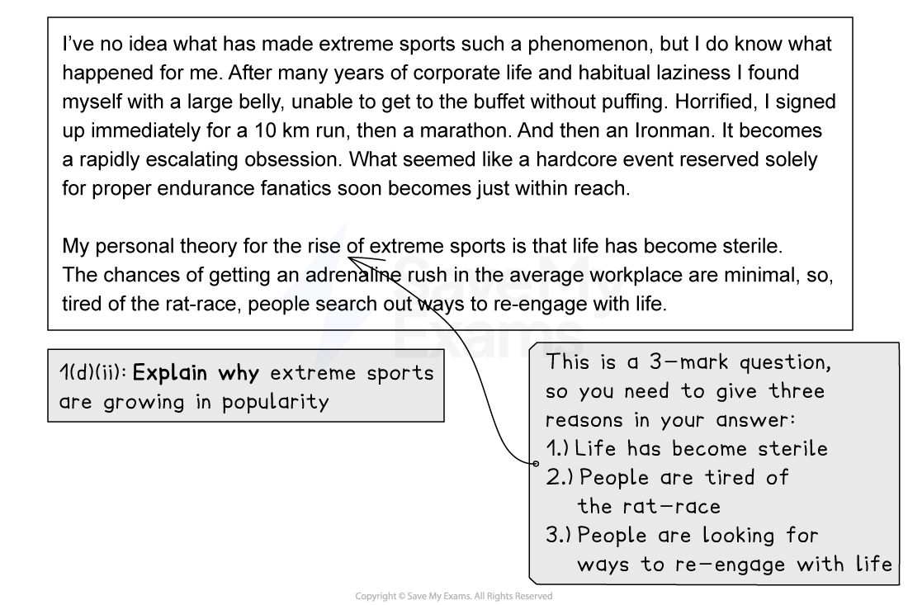
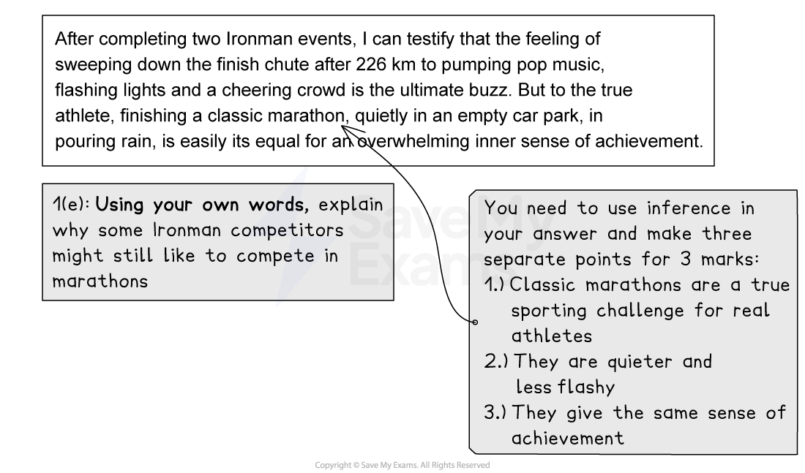

# Question 1 Comprehension: Model Answers

**This revision note is for exams in 2026. If you are sitting your exam from 2027, please switch to the 'First exams 2027' syllabus edition.**

## Question 1 Comprehension: Model Answers

> **Spec point** — `spcpt_TNymxNtHwpq7tY3g`

## Question 1 Comprehension: Model Answers

Question 1 is split into two tasks: a comprehension task and a summary task. The comprehension task will be based on Text A in your reading insert, and is designed as a series of short-answer questions, testing your ability to select and interpret what you read appropriately.

## Text A

> **Spec point** — `spcpt_G6495yJWMM2wnY7F`

## Text A

The following is Text A taken from the June 2022 exam paper and is about *endurance* running events. Question 1(a-e) will ask you either to identify specific information from this text, or explain something from the text in your own words.

## Question 1(a-e) model answers

> **Spec point** — `spcpt_7wbyhmDf8wmRcsSb`

## Question 1(a-e) model answers

Below you will find the questions based on the above text, along with suggested answers:

## Summary

> **Spec point** — `spcpt_wp3MckmWrxgQHXxz`

## Summary

- Remember to read each sub-question carefully and highlight:

  - What you have to do (“give two examples”/”write your answer in your own words”, etc.)
  - What you have to look for in the text (the focus of the question)
- Pay attention to the number of marks awarded for each sub-question and write your answers accordingly
- Make sure you are reading the correct section of text (according to the sub-question instructions)
- If the question asks you to use your own words,* most* of your answer needs to be in your own words; you must not just copy and paste from the text
- These are short-answer questions so do not waste time writing paragraphs when short sentences will do:

  - Writing more will not get you more marks - the examiner can only award the amount of marks allocated to each sub-question

The full June 2022 exam paper is available [here](https://www.savemyexams.com/igcse/english-language/cie/past-papers/).
