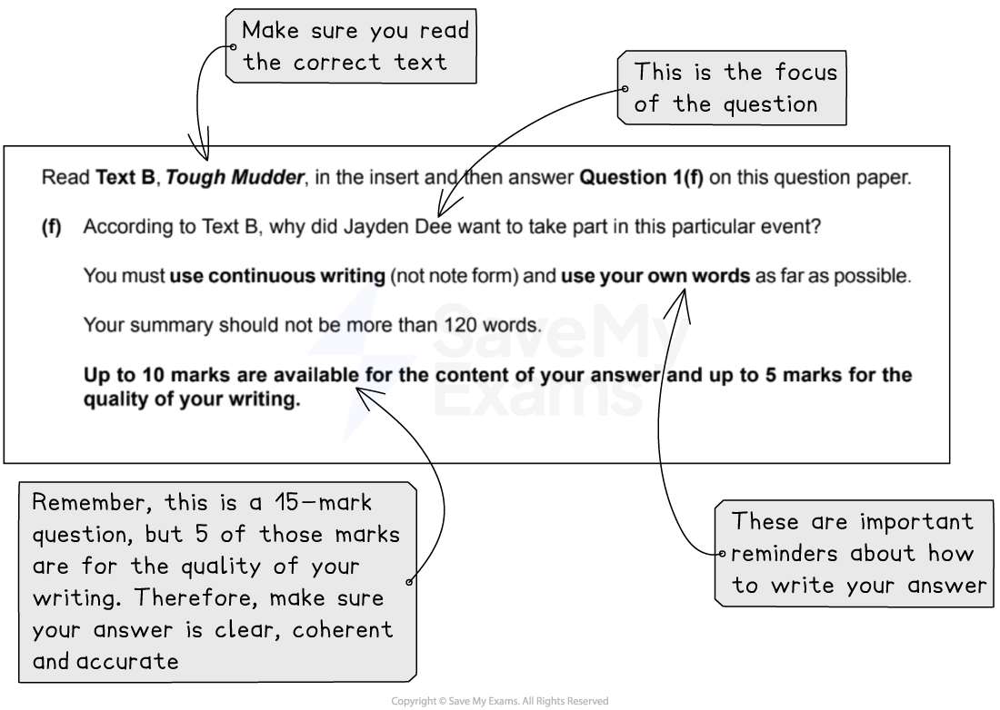

# How to Answer Question 1: Summary

**This revision note is for exams in 2026. If you are sitting your exam from 2027, please switch to the 'First exams 2027' syllabus edition.**

## Paper 1: How to Answer Question 1: Summary

> **Spec point** — `spcpt_kFh7BKh8WbfRjhRy`

## How to Answer Question 1: Summary

Paper 1: Reading is the compulsory exam in the CIE IGCSE, and CIE examiners recommend that you complete the questions in the order they are set. Question 1 is split into two tasks: a comprehension task and a summary task. The summary task will be based on Text B in your reading insert.

The following guide will provide you with the information you need to answer **Question 1: Summary** to a high standard.

## Overview

> **Spec point** — `spcpt_9tGXBmQ69W3GVKZ6`

## Overview

For this task, you will respond to one question about Text B. The question will test you on your ability to understand explicit and implicit meanings and ideas in a text, and to select and use information for specific purposes. It will also assess your ability to organise and structure your ideas in writing, use a range of suitable vocabulary and sentence structures and write accurately, with correct spelling, grammar and punctuation. The question is worth 15 marks in total and is broken down as follows:

| **Question** | **Assessment Objective tested** | **What this means** | **Marks** |
|---|---|---|---|
| 1(f) - reading objectives | R1: demonstrate understanding of explicit meanings  R2: demonstrate understanding of implicit meanings and attitudes  R5: select and use information for specific purposes | Base your answer on both explicit and implied information in Text B | 10 |
| 1(f) - writing objectives | W2: organise and structure ideas and opinions for deliberate effect  W3: use a range of vocabulary and sentence structures appropriate to context  W5: make accurate use of spelling, punctuation and grammar | Write an answer of no more than 120 words.  Summarise, in your own words and in continuous form (not note form), what you learn about the focus of the question in the text | 5 |

The question, taken from the [June 2022](https://www.savemyexams.com/igcse/english-language/cie/past-papers/) exam paper, looks like this:

## Steps to success

> **Spec point** — `spcpt_nF6kt2m3m4svpvh4`

## Steps to success

Following these steps will give you a strategy for answering this question effectively:

1. Read the question and **highlight**:

  - The command words (what you are instructed to do)
  - The focus of the question (the words or phrases you have to look for in the text)
  - When highlighting, take note of the word count guidance and make sure you are using the correct text (Text B)
2. Scan Text B and highlight the evidence that answers the question:

  - In the above example, this would be anything that tells you why Jayden Dee wanted to take part in the Tough Mudder event
  - Disregard any information or extra details which are not directly relevant to the focus of the question:
  
    - In the above example, the focus of the question is on “reasons why” - you should therefore ignore any “reasons why not”
3. Plan your answer before you start writing:

  - Use bullet points for this
  - Make sure each idea in each bullet point is distinct and complete (you are not repeating yourself)
4. Write your answers according to the question instructions:

  - Do not just copy whole paragraphs from the text, or use quotes from the text
  - You must summarise using your own words as much as possible
  - Remember, not all of the information will be explicit (obvious):
  
    - You will have to make some inferences or read between the lines
5. Re-read your answer when you have finished to check whether:

  - It answers the question
  - It makes sense
  - It is accurate (correct any obvious spelling, grammar or punctuation errors)

You are advised to spend no more than 20 minutes on this question (including reading time).

## Exam tips

> **Spec point** — `spcpt_HBdGpGgFdHKctdS8`

## Exam tips

- Read the command words and the question carefully:

  - This will allow you to demonstrate a thorough understanding of the requirements of the task
- Make sure that you demonstrate that you understand a range of ideas in the text, as relevant to the focus of the question
- Write your answer in paragraph form, expressing yourself clearly, fluently and concisely:

  - Explain the ideas in a way that someone who had not read the text themselves would understand
- Do not just copy from the text or use quotes - this is not a language analysis question
- Try not to repeat the same idea - the examiner can only credit you once
- When summarising, you should use Standard English:

  - Therefore, if Text B is written using a more informal register, adapt this to a more formal style suitable for a written summary
- Start your answer with a focus on the question:

  - Do not waste time on unnecessary introductions
- As you read Text B, highlight a range of ideas from different parts of the text:

  - Then re-organise them more efficiently for the reader
  - You do not need to work through the ideas in the order they appear in the text
- It is a very good idea to make a brief, bulleted plan of your answer before you start writing:

  - This will help you structure your response concisely
- Ensure you do not write too little or too much:

  - 120 words is approximately half a page of A4 in average handwriting

The full June 2022 exam paper is available [here](https://www.savemyexams.com/igcse/english-language/cie/past-papers/).

For more advice on how to apply the skills required for success in this question, please see our [Question 1 skills: How to summarise](https://www.savemyexams.com/igcse/english-language/cie/20/revision-notes/1-paper-1-reading/question-1-summary/question-1-skills-how-to-summarise/) revision notes.  For a model answer to this question, please see [Question 1 Summary: Model answer](https://www.savemyexams.com/igcse/english-language/cie/20/revision-notes/1-paper-1-reading/question-1-summary/question-1-summary-model-answer/).
