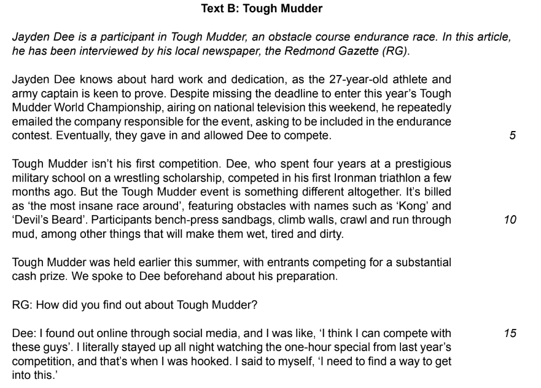
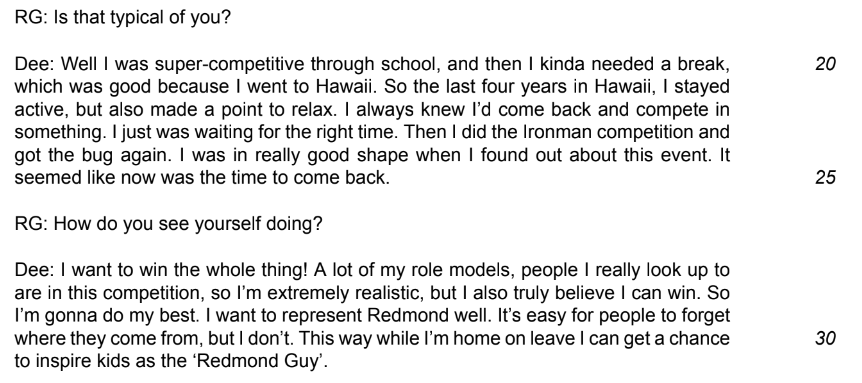
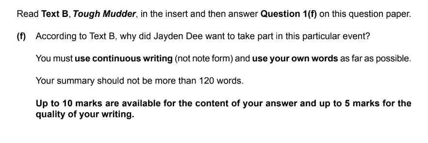

# Question 1 Summary: Model Answer

**This revision note is for exams in 2026. If you are sitting your exam from 2027, please switch to the 'First exams 2027' syllabus edition.**

## Question 1 Summary: Model Answer

> **Spec point** — `spcpt_nP9CVdpGwwGrxKCw`

## Question 1 Summary: Model Answer

Question 1 is split into two tasks: a comprehension task and a summary task. The summary task will be based on Text B in your reading insert, and is designed to test your ability to secure meaning from what you read, and write fluently and concisely in your own words.

The following guide will demonstrate how to answer the Question 1: Summary question from the June 2022 exam paper.

## Text B (June 2022)

> **Spec point** — `spcpt_8FdG3WqHv6gbyG2B`

## Text B (June 2022)

The following text is Text B taken from the June 2022 exam paper. It is about a sporting event called Tough Mudder, which is a long race with obstacles in it.

## Question 1(f): Summary model answer

> **Spec point** — `spcpt_2QybnShXRqxqqwfn`

## Question 1(f): Summary model answer

Below is Question 1(f) from the June 2022 exam paper:

Based on the above question, the following model answer demonstrates how to use continuous writing to summarise information in your own words. It is an example of a full mark answer (15/15):

> **Worked Example**
> *Dee wanted to take part in this particular event because he likes to show that he is hardworking and dedicated.* *He saw the event as something challenging and original which appealed to his competitive nature.* He saw it as different from other events and had become obsessed with taking part after watching last year's event on TV. *He got hooked on these events by competing in the Ironman competition and thought the timing was right because he felt really fit.* *He wanted to become an inspiration like people he looked up to, representing Redmond and inspiring children from his hometown*. *Ultimately, he wanted to take part in the event because he believed he could win.*

## Commentary

> **Spec point** — `spcpt_GcRcKRW5SB2Gb2fM`

## Commentary

- The answer demonstrates understanding of both the text and the task
- It remains focused on the task throughout (no unnecessary detail)
- It provides a concise overview of all the main points in the text that answer the question
- The response is well-organised, clear, fluent and written accurately
- It uses the candidate’s own words with well-chosen vocabulary
- Whilst the response goes slightly over the 120 word limit, it is still concise and covers all of the points required

## Summary

> **Spec point** — `spcpt_h3BHCbmPsV3cVjXD`

## Summary

- Remember to read the question carefully and highlight:

  - The instructions (what you have got to do)
  - The focus of the question (what you are being asked to write a summary about)
- Remember that up to five marks are awarded in this question for the quality of your writing:

  - Therefore, make sure you re-read your answer before moving on to the next question
- It is important that you are able to summarise mostly in your own words - do not just copy and paste from the text, or directly quote from the text
- This answer should be written in paragraph form - do not use bullet points or single words

The full June 2022 exam paper is available [here](https://www.savemyexams.com/igcse/english-language/cie/past-papers/).
