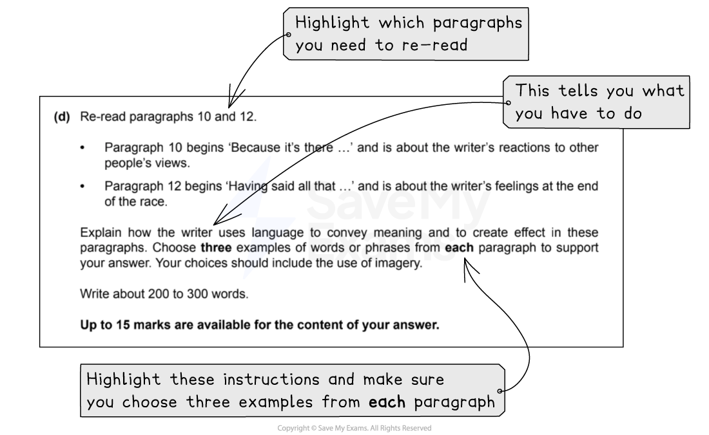

# How to Answer Question 2: Language Task

**This revision note is for exams in 2026. If you are sitting your exam from 2027, please switch to the 'First exams 2027' syllabus edition.**

## Paper 1: How to Answer Question 2: Language Task

> **Spec point** — `spcpt_k4Pkcp949WB8Bkz2`

## How to Answer Question 2: Language Task

Paper 1: Reading is the compulsory exam in the CIE IGCSE, and CIE examiners recommend that you complete the questions in the order they are set. Question 2 is split into two tasks: a short-answer task and a language analysis task. Both tasks will be based on **Text C** in your reading insert.

The following guide will provide you with the information you need to answer **Question 2: Language analysis task** to a high standard.

## Overview

> **Spec point** — `spcpt_vr5hVzJmzKYbk4tV`

## Overview

For this task, you will be asked to re-read certain paragraphs from Text C, and explain how the writer uses language to convey meaning and to create effects in these paragraphs. You are instructed to choose **three** examples of words or phrases from **each** paragraph to support your answer, and your choices should include the use of [imagery](https://www.savemyexams.com/glossary/gcse/english-language/imagery-definition/).

You are advised to write between 200 and 300 words in your answer; this means about one side of A4 in standard handwriting. Up to 15 marks is available for this question, and you are being tested on the following assessment objectives:

- **R1**: demonstrate understanding of explicit meanings
- **R2**: demonstrate understanding of implicit meanings and attitudes
- **R4**: demonstrate understanding of how writers achieve effects and influence readers

This means, in order to get the highest marks, you need to demonstrate:

- Your ability to select language to analyse appropriately
- Your ability to explore the meanings of the language you have chosen, and why the writer may have chosen them
- Your ability to comment on the use of imagery with precision and imagination
- That you understand how language works

## Breaking down the question

> **Spec point** — `spcpt_2gkrc9VgfGb5QkbX`

## Breaking down the question

Question 2(d) will give you quite detailed instructions. It is therefore important that you read the question carefully and highlight:

- Which paragraphs you need to re-read
- The command words in the question (what you have to do)
- The focus of each question (what you are looking for in the text)

For example (taken from the [June 2022 exam paper](https://www.savemyexams.com/igcse/english-language/cie/past-papers/)):

## Steps to success

> **Spec point** — `spcpt_D5VWfvBKNH2DN2n7`

## Steps to success

Following these steps will give you a strategy for answering this question effectively:

1. Read the question and **highlight**:

  - The command words (what you are instructed to do)
  - The focus of the question (the words or phrases you have to look for in the text)
  - The paragraphs you need to re-read
2. Scan the relevant paragraphs in Text C and highlight three examples of language or imagery in each paragraph:

  - Keep your annotations short and concise - there is no benefit to highlighting lines and lines of text
3. Write your answer dealing with one paragraph first, and then the other:

  - Start with an overview of the paragraph:
  
    - For example: “In paragraph 10, the writer conveys a feeling of being fiercely protective and a sense of pride in her husband’s choice.”
  - Then, select three specific words or phrases to analyse:
  
    - These selections could include interesting elements of grammar and punctuation
    - Ensure you choose a range of quotations to demonstrate your understanding of how language works
  - Do the same for the second paragraph

You are advised to spend no more than 20 minutes on this question (including reading time).

## Exam tips

> **Spec point** — `spcpt_jNFJj58KttqpcD4R`

## Exam tips

- Read the command words and the paragraph references in the instructions carefully
- Successful answers often start by explaining the literal meaning of the chosen word or phrase in context, and then move on to consider the [connotations](https://www.savemyexams.com/glossary/gcse/english-language/connotation-definition/) and impacts caused by the writer’s language choices
- Avoid selecting long quotations or writing generalised comments:

  - Make sure that the quotations you select are precise and accurate
  - Do not copy out lines or chunks of text, or miss out key words
- Remember that you need to choose six words or phrases in total (three from each paragraph):

  - Select words or phrases that you are best able to explain, rather than the ones using the most obvious literary devices
  - Ensure you divide your time equally between both paragraphs
- When explaining how language works, avoid comments such as: “the writer helps us to imagine the scene”. This type of comment is not awarded any marks
- Ensure you also select and explain images created by the writer:

  - Consider the connotations and associations of your chosen words to help you suggest the effect the writer might have wanted to create
  - Successful candidates are able to visualise images and explain their precise meanings
- Importantly, do not simply list literary devices:

  - It is the quality of your analysis that attracts marks, not whether you can spot a [metaphor](https://www.savemyexams.com/glossary/gcse/english-language/metaphor-definition/) or [juxtaposition](https://www.savemyexams.com/glossary/gcse/english-language/juxtaposition-definition/)

The full June 2022 exam paper is available [here](https://www.savemyexams.com/igcse/english-language/cie/past-papers/).

For more advice on how to apply the skills required for success in this question, please see our [Question 2 skills: Language analysis](https://www.savemyexams.com/igcse/english-language/cie/20/revision-notes/1-paper-1-reading/question-2-language-task/question-2-skills-language-analysis/) revision notes. For a model answer to this question, please see [Question 2 language task: Model answer](https://www.savemyexams.com/igcse/english-language/cie/20/revision-notes/1-paper-1-reading/question-2-language-task/question-2-language-task-model-answer/).
