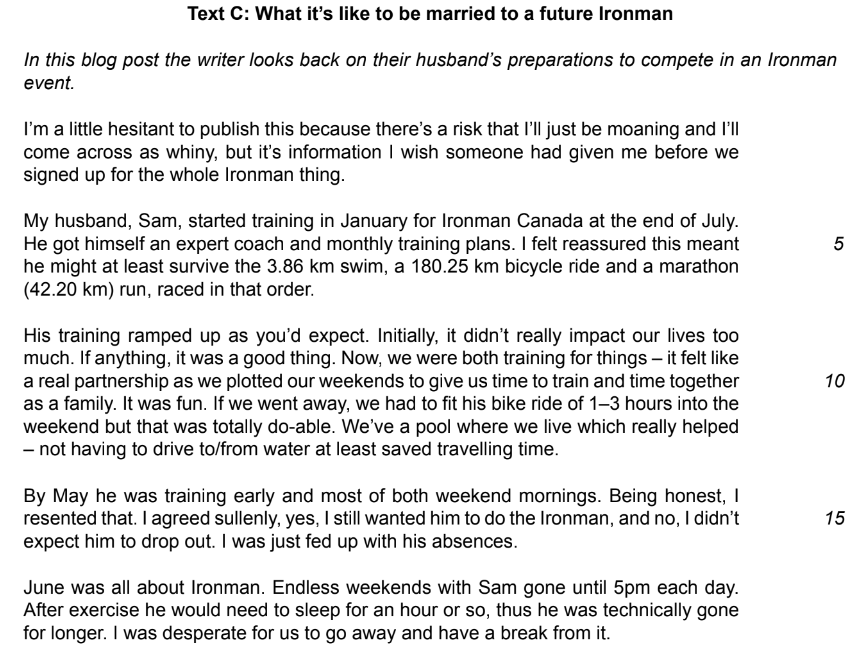
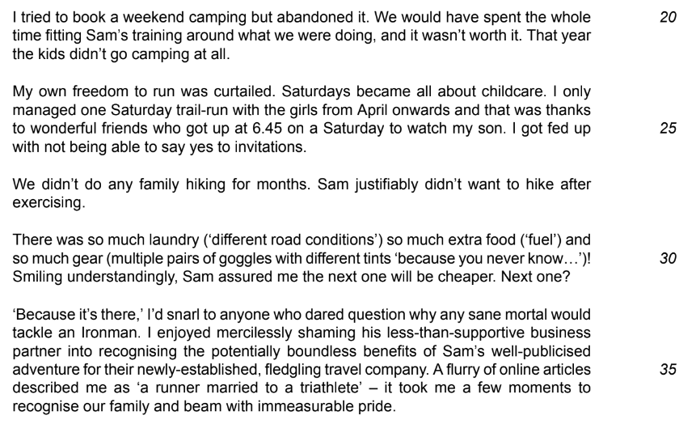
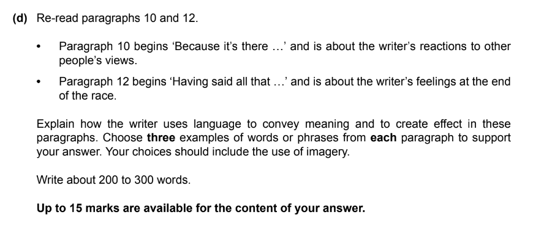

# Question 2 Language Task: Model Answer

**This revision note is for exams in 2026. If you are sitting your exam from 2027, please switch to the 'First exams 2027' syllabus edition.**

## Question 2 Language Task: Model Answer

> **Spec point** — `spcpt_tZrQFDyrb432t96r`

## Question 2 Language Task: Model Answer

Question 2 is split into two tasks: a short-answer task and a language analysis task. Both tasks will be based on Text C in your reading insert, and are designed to test your ability to select and interpret what you read appropriately.

The following guide will demonstrate how to answer the language task question from the June 2022 exam paper.

## Text C (June 2022)

> **Spec point** — `spcpt_nSxpmJWtqSVVR3jC`

## Text C (June 2022)

The following is Text C taken from the June 2022 exam paper. It is about a writer’s experience of supporting her husband’s training to compete in an extreme event, and contains both the explicit and implicit information you will need in order to answer the question.

## Question 2(d) model answer

> **Spec point** — `spcpt_cgFWfJGhBDDVh4Nt`

## Question 2(d) model answer

Below is Question 2(d) from the June 2022 exam paper (you can find a breakdown of this question [here](https://www.savemyexams.com/igcse/english-language/cie/20/revision-notes/1-paper-1-reading/question-2-language-task/question-2-skills-language-analysis/):

Based on the above question, the following model answer demonstrates an explanation of how the writer uses language to convey meaning and to create effects. It is an example of a full-mark answer (15/15).

> **Worked Example**
> *The writer uses language in paragraph 10 to show their reactions to other people's views on her husband's choices.* Firstly, the writer describes her answer as a "snarl" to anyone who "dared question" her husband's choices. *To "snarl" is to answer back fiercely, reminiscent of a wild animal's growl, and the baring of teeth when an animal is challenged or threatened.* This reaction suggests the writer is showing her protective instincts towards her loved ones. This sense of protectiveness continues when the writer reveals that she "enjoyed mercilessly shaming" her husband's business partner, who hadn't been supportive. The writer suggests that she took pleasure in making him feel bad about this, and the use of *the adverb "mercilessly" implies she felt no remorse in doing so.* *Finally*, the writer's feelings of pride towards her husband are shown by the fact that she beamed "with immeasurable pride" implying her satisfaction at being part of a family containing a triathlete. The adjective "immeasurable" suggests these feelings have no end.
> 
> *In paragraph 12, the writer uses language to show her feelings at the end of the race, sharing in her husband's sense of power and achievement.* *She begins by describing watching her husband "emerge god-like from the water".* This is a dramatic and powerful exit, suggesting the strength of a conquering hero. The "god-like" image implies her husband has achieved more than a mere mortal would and that he has been transformed into something super-human. This imagery continues when she describes watching him "power past us", which demonstrates that he was still full of strength and energy even at the end of a gruelling race. Furthermore, the *metaphor* "rocket down the finishing chute" with his "head held high" suggests his incredible speed and energy at the end, as if he was propelled by rocket fuel to a higher state of self-esteem.

## Commentary

> **Spec point** — `spcpt_W59mnBRVnmgJMbCh`

## Commentary

- The response starts by focusing on the question, with no unnecessary introduction
- Three distinct examples of language are chosen to analyse for each paragraph
- The language analysis “zooms in” on particular words to consider why the writer has chosen them
- The response is structured logically
- The response includes analysis of imagery
- The response clearly separates the two paragraphs requiring analysis
- Literary terminology is used accurately, appropriately and *judiciously*

The suggested word count for this question is advisory, and you are not penalised for going either under or over 200-300 words. However, writing too much or too little can be self-penalising, so it is a good idea to use the suggested word count as a guide.

## Summary

> **Spec point** — `spcpt_wV6jfhBJyV6DR7vX`

## Summary

- Remember to read the question carefully and highlight:

  - The instructions (what you have to do)
  - The focus of the question (what you have to analyse in the text)
- Make sure that you are using the paragraphs indicated in the question
- Ensure you highlight three distinct examples of words or phrases to analyse:

  - Do not highlight whole sentences
  - Ensure you also include at least one use of imagery per paragraph
- When writing your answer, ensure you put the quotation from the text in context:

  - What is the quote about, or describing?
  - This helps your answer make sense overall

The full June 2022 exam paper is available [here](https://www.savemyexams.com/igcse/english-language/cie/past-papers/).
