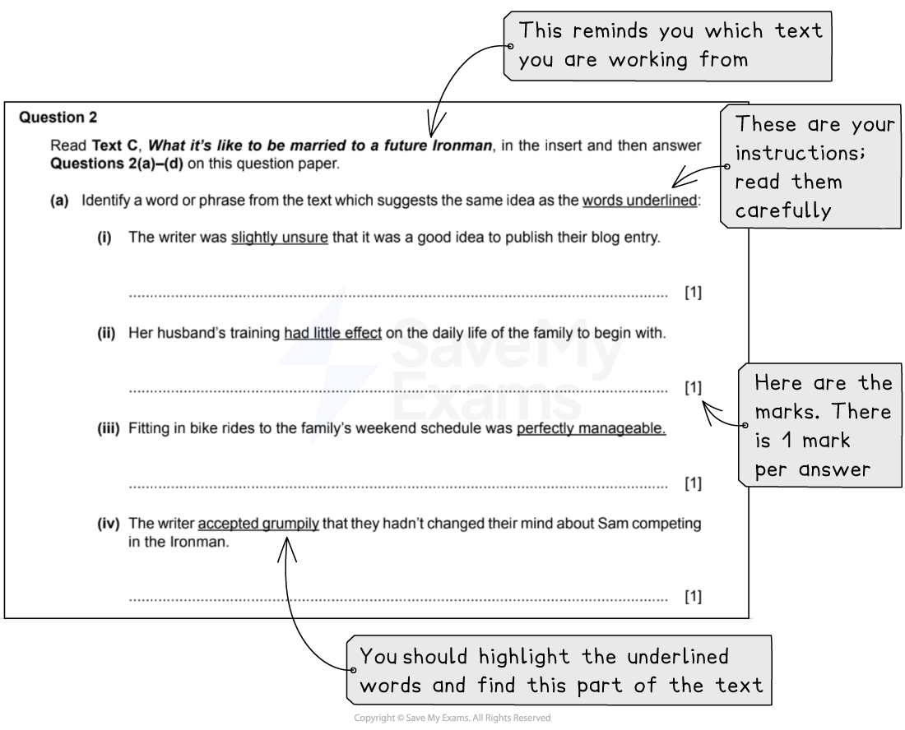
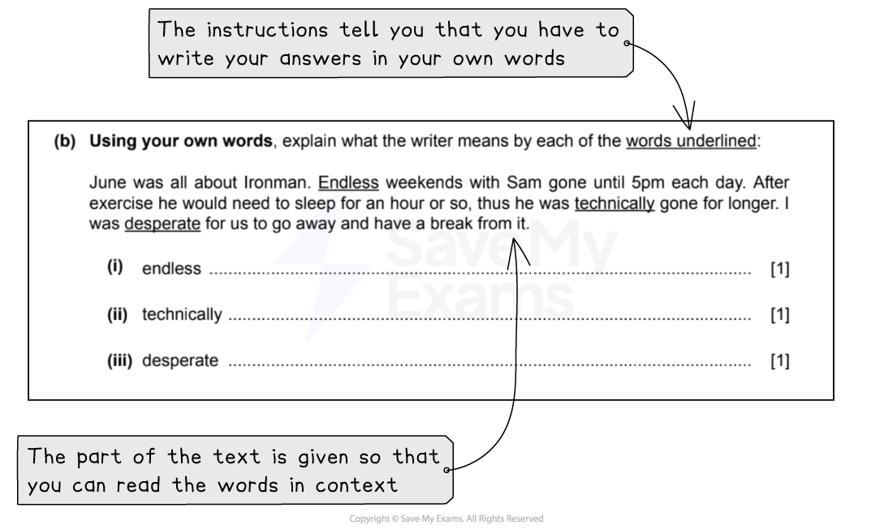
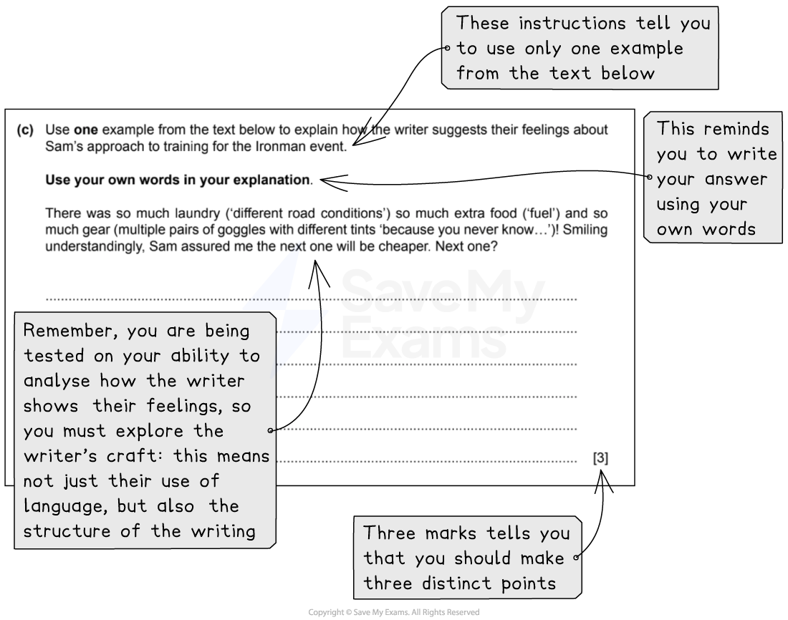

# How to Answer Question 2: Short-Answer Questions

**This revision note is for exams in 2026. If you are sitting your exam from 2027, please switch to the 'First exams 2027' syllabus edition.**

## Paper 1: How to Answer Question 2: Short-Answer Questions

> **Spec point** — `spcpt_ccFwJyhsYzyhRfKW`

## How to Answer Question 2: Short-Answer Questions

Paper 1: Reading is the compulsory exam in the CIE IGCSE, and CIE examiners recommend that you complete the questions in the order they are set. Question 2 is split into two tasks: a short-answer task (2a-c) and a language analysis task (2d). Both tasks will be based on **Text C** in your reading insert.

The following guide will provide you with the information you need to answer **Question 2: Short-answer questions**  confidently.

## Overview

> **Spec point** — `spcpt_sR2kgjqPHCNQBXJN`

## Overview

For this task, you will respond to a series of sub-questions about Text C. These sub-questions will require answers of different lengths and test your understanding of the meaning of words and phrases used in Text C, as well as the effect they have on the reader. These sub-questions are worth 10 marks in total and are broken down as follows:

| **Question** | **What you are asked to do** | **Marks** |
|---|---|---|
| 2(a) | Identify a word or phrase from the text which suggests the same idea as the words underlined in the sub-questions | 4 |
| 2(b) | Explain, *using your own words*, what a word or phrase underlined means | 3 |
| 2(c) | Select one example from the section of text printed underneath the question, and use it to explain how the writer suggests something, *using your own words* | 3 |

## Breaking down the questions

> **Spec point** — `spcpt_RmDs94fZmkpMH6FJ`

## Breaking down the questions

Short-answer questions will be divided into seven sub-questions. It is important that you read each question carefully and highlight:

- The command words in each question (what you have to do)
- The focus of each question (what you are looking for in the text)
- How many marks each question is worth (this indicates how much you need to write)

For example (taken from the [June 2022 exam paper](https://www.savemyexams.com/igcse/english-language/cie/past-papers/)):

*Example Question 2*

## Steps to success

> **Spec point** — `spcpt_5B5yYv5QTRmmq9cc`

## Steps to success

Following these steps will give you a strategy for answering this question effectively:

1. Read the question and **highlight**:

  - The command words (what you are instructed to do)
  - The focus of the question (the words or phrases you have to look for in the text)
  - When highlighting, take note of the marks given for each sub-question
2. Scan Text C and highlight the evidence that answers the question, or the words or phrases you need to explain:

  - Remember that there may be more than one answer - make sure your answer provides what the question instructions have asked for
3. Write your answers according to the question instructions:

  - If the question asks you to explain each of the words underlined, make sure that you give an answer for each one
  - If the question asks you to use your own words, then make sure you do not repeat words from the text
  - Check how many marks are awarded for each question, and tailor your answers accordingly:
  
    - For Question 2(c), 3 marks tells you that you should make three distinct points
4. For Question 2(c), examiners are looking for you to select an appropriate example and provide a comprehensive explanation which shows that you understand how the writer gets their message or point across:

  - For example, you might consider the meanings of particular phrases and why the writer has chosen to use them
  - You might wish to consider why the writer has punctuated a phrase or sentence in a certain way
  - Above all, you need to read between the lines to consider what the writer really means

You are advised to spend no more than 15 minutes on this question (including reading time).

## Exam tips

> **Spec point** — `spcpt_KSNdcZ6RdKymQfPn`

## Exam tips

- Read the command words and the paragraph references in the instructions carefully
- Do not write overly long explanations or answers in your own words where they are not required:

  - Equally, make sure you do not just repeat the language of the text in answers where your own words are required
  - It is made clear in the task instructions when you should write your answers using your own words
- Avoid adding additional unnecessary material and/or extra guesses in your answers:

  - In Question 2(a)(i-v), you only need to write a word or phrase as your answer - this means you do not need to copy out the whole of the sentence
  - In Question 2(b)(i-iii), you have to consider the precise meaning of each word in the context in which they have been used
  - Avoid repeating the word itself in your explanation
  - In Question 2(c), make sure you select just one example and explain its meaning first in context:
  
    - You can then go on to explore what this suggests
    - Make sure you make three distinct points about your chosen example
  - Remember, you are being tested on your ability to analyse how the writer shows their feelings, so you must explore the writer’s craft:
  
    - This means not just their use of language, but also the structure of the writing

The full June 2022 exam paper is available [here](https://www.savemyexams.com/igcse/english-language/cie/past-papers/).

For more advice on how to apply the skills required for success in this question, please see our [Question 2 skills: Synonyms](https://www.savemyexams.com/igcse/english-language/cie/20/revision-notes/1-paper-1-reading/question-2-short-answer-questions/question-2-skills-synonyms/) revision notes. For model answers to these questions, please see [Question 2 short-answer questions: Model answers.](https://www.savemyexams.com/igcse/english-language/cie/20/revision-notes/1-paper-1-reading/question-2-short-answer-questions/question-2-short-answer-questions-model-answers/)
