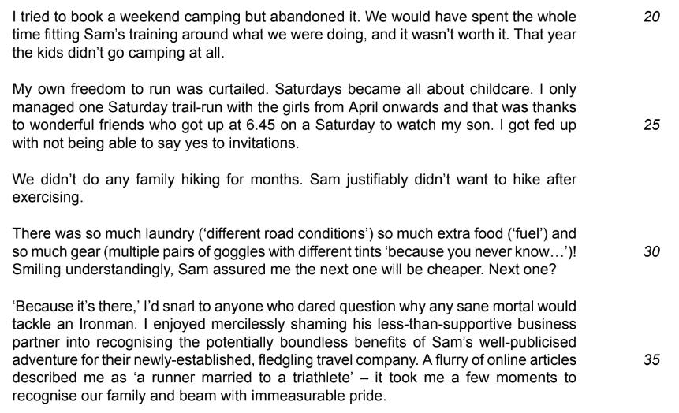
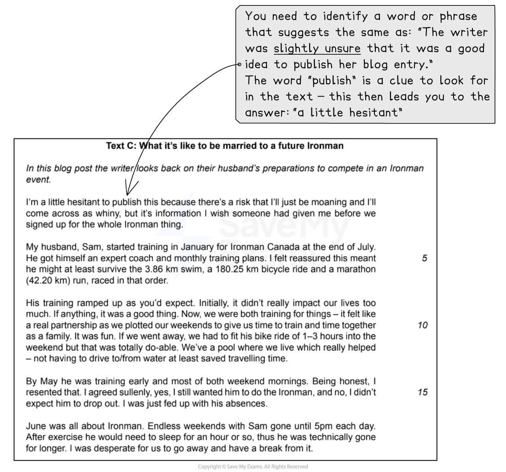
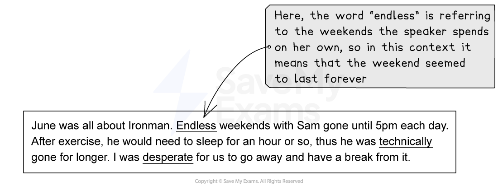
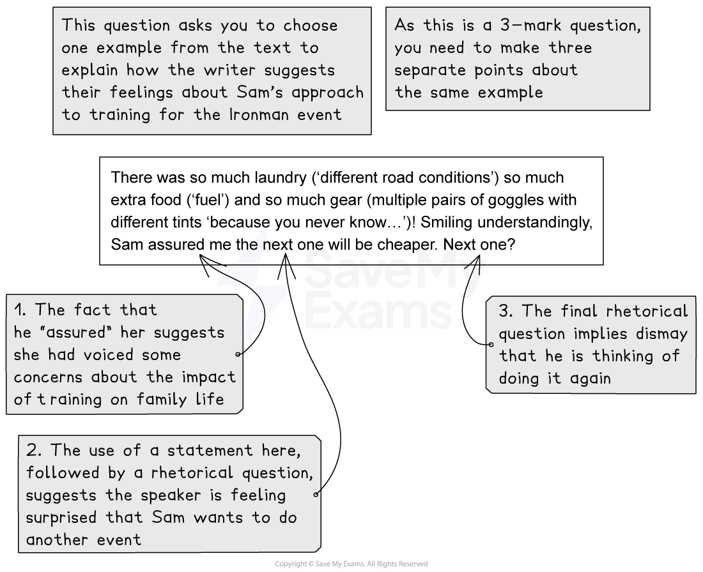

# Question 2 Short-Answer Questions: Model Answers

**This revision note is for exams in 2026. If you are sitting your exam from 2027, please switch to the 'First exams 2027' syllabus edition.**

## Question 2 Short-Answer Questions: Model Answers

> **Spec point** — `spcpt_YbQz5dvPYKSDQDnv`

## Question 2 Short-Answer Questions: Model Answers

Question 2 is split into two tasks: a short-answer task and a language analysis task. Both tasks will be based on Text C in your reading insert, and are designed to test your ability to select and interpret what you read appropriately.

The following guide will demonstrate how to answer the Question 2: Short-answer questions from the June 2022 exam paper.

## Text C (June 2022)

> **Spec point** — `spcpt_2tTC29Nq6PXMjgHK`

## Text C (June 2022)

The following is Text C taken from the [June 2022 exam paper](https://www.savemyexams.com/igcse/english-language/cie/past-papers/). It is about a writer’s experience of supporting her husband’s training to compete in an endurance athletics event, and contains both the explicit and implicit information you will need in order to answer the questions.

## Question 2(a-c) model answers

> **Spec point** — `spcpt_q2kK7jkwk4GrwVp2`

## Question 2(a-c) model answers

Question 2(a) is broken down into four sub-questions, and will ask you to identify a word or phrase from the text which suggests the same idea as the words underlined.

When looking for words or phrases in the text that suggest the same as the words underlined in the question, it is important to look for what other clues you are given in the text.

For example:

Question 2(b) will ask you to explain, in your own words, what the writer means by certain words underlined in the text. You should therefore find and highlight the words in the text, and then explain their meaning in context. For example:

Question 2(c) will ask you to choose one example from the text to explain how the writer conveys something to the reader. For this question, again locate the passage in the context of the whole text. Make sure, in your answer, that it is clear which example from the text you are using, and then make three separate points about it. Do not waste time writing in long paragraphs when three short sentences will do.

## Summary

> **Spec point** — `spcpt_9Yk3FZ9Zh3rD6Gms`

## Summary

- Remember to read each sub-question carefully and highlight:

  - What you have to do
  - What you have to look for in the text (the focus of the question)
- Pay attention to the number of marks awarded for each sub-question and write your answers accordingly
- Make sure you find and highlight the words and phrases in the text:

  - This will ensure that you are explaining them in the correct context
- If the question asks you to use your own words,* most* of your answer needs to be in your own words; you must not just copy from the text
- These are short-answer questions, so do not waste time writing paragraphs when short sentences will do:

  - Writing more will not get you more marks - the examiner can only award the amount of marks allocated to each sub-question

The full June 2022 exam paper is available [here](https://www.savemyexams.com/igcse/english-language/cie/past-papers/).
