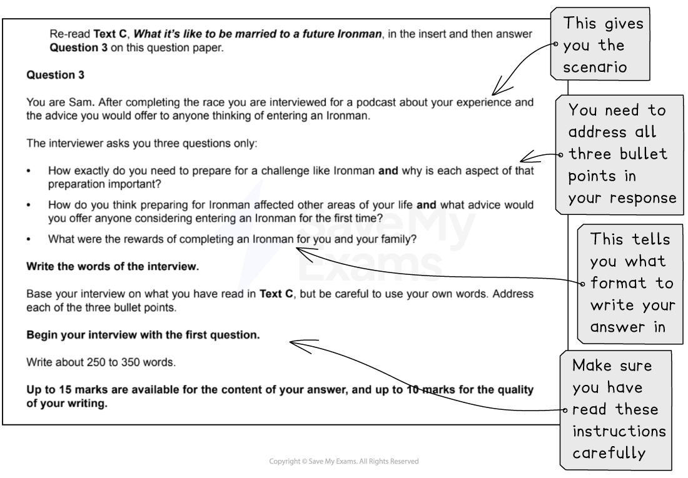

# How to Answer Question 3: Extended Response

**This revision note is for exams in 2026. If you are sitting your exam from 2027, please switch to the 'First exams 2027' syllabus edition.**

## Paper 1: How to Answer Question 3: Extended Response

> **Spec point** — `spcpt_2w5WbcS9p69TD3sH`

## How to Answer Question 3: Extended Response

Paper 1: Reading is the compulsory exam in your IGCSE, and CIE examiners recommend that you complete the questions in the order they are set. By the time you reach Question 3, you should already be familiar with **Text C**, upon which this question is based.

The following guide will provide you with the information you need to answer **Question 3: Extended response** with confidence.

## Overview

> **Spec point** — `spcpt_XkGbVR2PFHNPqVWq`

## Overview

For this task, you will be asked to produce a piece of writing in a particular format, based on what you have read in Text C. You may be asked to write in one of six possible formats (genres):

- A letter
- A report
- A journal entry
- A speech
- An interview
- An article

You are advised to write about 250 to 350 words, which means between one and one and a half sides of A4 in standard handwriting. There are 25 marks available for this extended response: up to 15 marks are available for the content of your answer, and up to 10 marks are available for the quality of your writing. You are being tested on both reading and writing assessment objectives, as follows:

**15 marks:**

- **R1**: demonstrate understanding of explicit meanings
- **R2**: demonstrate understanding of implicit meanings and attitudes
- **R3**: analyse, evaluate and develop facts, ideas and opinions, using appropriate support from the text

**10 marks:**

- **W1**: articulate experience and express what is thought, felt and imagined
- **W2**: organise and structure ideas and opinions for deliberate effect
- **W3**: use a range of vocabulary and sentence structures appropriate to context
- **W4**: use register appropriate to context
- **W5**: make accurate use of spelling, punctuation and grammar

This means, in order to get the highest marks, you need to:

- Select appropriate ideas from the text
- Develop them relevantly, demonstrating your thorough evaluation and analysis of the text
- Support what you write with details from the text
- Write in an appropriate style and tone for the genre (format)
- Write a clear, well-sequenced and balanced response which covers the three areas of the question
- Write in your own words, sounding confident and consistent

## Breaking down the question

> **Spec point** — `spcpt_ftR6zmpJZvyXpQQc`

## Breaking down the question

Question 3 is quite detailed. It is therefore important that you read the whole of the question and instructions carefully. You should highlight the key information you have given, and start by annotating the text for information that answers each of the three bullet points in the question.

For example (taken from the [June 2022 exam paper](https://www.savemyexams.com/igcse/english-language/cie/past-papers/)):

## Steps to success

> **Spec point** — `spcpt_Cgqfx5PXfcgJV8n7`

## Steps to success

Following these steps will give you a strategy for answering this question effectively:

1. Read the question and **highlight**:

  - The important information in the scenario (in the above example, you are asked to imagine that you are Sam, *not* the writer)
  - The format you are being asked to write in (letter, speech, article, etc.)
  - The important information from each of the three bullet points that you need to include in your answer
2. Re-read Text C and annotate any references directly relevant to the focus of the first bullet point:

  - Do the same for the second and third bullet points* before *you start writing your answer
3. Start your answer with the first bullet point:

  - Maintain your focus on the bullet point - avoid the temptation to write about everything or make up information not directly relevant to the bullet point
4. Ensure you write in the format instructed:

  - This means that if you are being asked to write up an interview, then you need to use language and a tone appropriate for this style of writing
  - You can use the three bullet points as sub-headings, if appropriate
5. Ensure you leave time to edit and correct your response

You are advised to spend no more than 40 minutes on this question (including reading time).

## Exam tips

> **Spec point** — `spcpt_d3DDzGs3JxJpMPhV`

## Exam tips

- Always remember to base your answer on the ideas and details you find in Text C:

  - If you write your answer without any reference to Text C, you will score very low marks
- Keep the intended audience and purpose of writing in mind throughout your answer:

  - Maintain a consistent voice and style throughout
- Do not invent extra information or details outside of what you read in Text C:

  - Look for clues and evidence in the text to help you make informed judgements about characters and situations
- Give equal attention to each of the three bullet points
- Do not copy directly from the text:

  - You need to use your own words as far as possible to express your ideas
- Avoid just repeating details of what happens in the text:

  - Try to develop your ideas by explaining feelings or commenting from the point of view of the character you are writing as

The full June 2022 exam paper is available [here](https://www.savemyexams.com/igcse/english-language/cie/past-papers/).

For more advice on how to apply the skills required for success in this question, please see our [Question 3 skills: Extended response to reading](https://www.savemyexams.com/igcse/english-language/cie/20/revision-notes/1-paper-1-reading/question-3-extended-response/question-3-skills-extended-response-to-reading/) revision notes.
