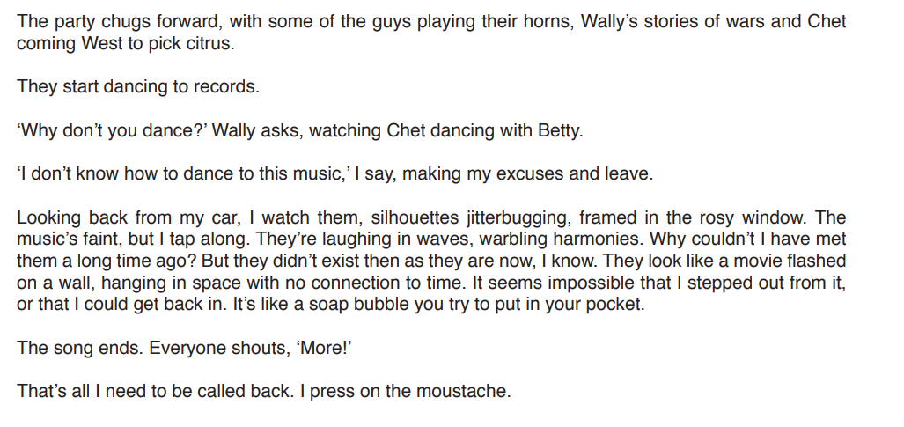
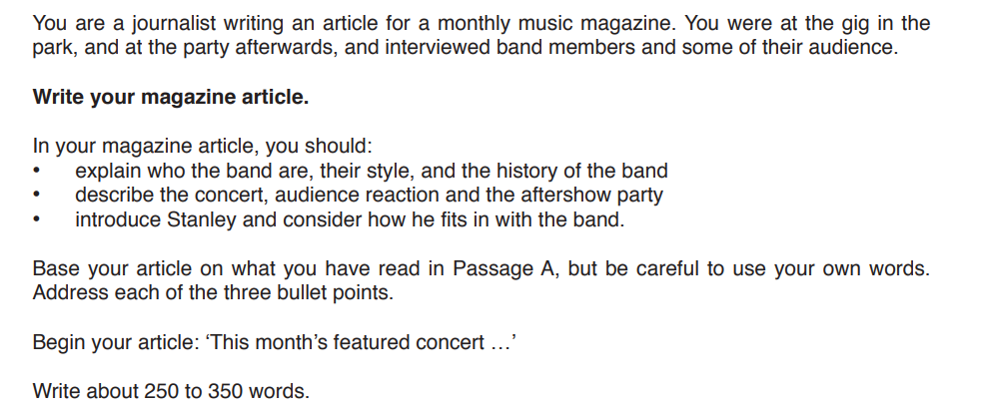

# Question 3 Model Answer: Article

**This revision note is for exams in 2026. If you are sitting your exam from 2027, please switch to the 'First exams 2027' syllabus edition.**

## Question 3 Model Answer: Article

> **Spec point** — `spcpt_fFpNtYYYSJrhpqnX`

## Question 3 Model Answer: Article

For this task, you will be asked to produce a piece of writing in a particular format, based on what you have read in Text C. You may be asked to write in one of six possible formats (genres):

- A letter
- A report
- A journal entry
- A speech
- An interview
- An article

The following guide will demonstrate how to answer Question 3 in the format of an **article**. The task itself is taken from a past exam paper.

## Text and question

> **Spec point** — `spcpt_hg5yptbXZ4HjPg8p`

## Text and question

The following text is about a drummer who has been invited to play with a jazz band at their next gig, which is at an open-air summer concert.

**Question:**

## Article model answer

> **Spec point** — `spcpt_tYQPJDDhP6CSzM9R`

## Article model answer

Based on the above question, the following model answer is an example of a full-mark article response:

> **Worked Example**
> **REVIEW: The Nightblooming Jazzmen Bloom in Sutton Park**
> 
> *This month's featured concert series at Sutton Park concluded with a charming performance by The Nightblooming Jazzmen*. Aside from their drummer, ‘Old Stanley’, the group consists of retired musicians who share an obvious, comfortable camaraderie.*Dressed in bow ties and moustaches, they exude a retro vibe that perfectly suits their shift towards jazz and swing* — a strategic move to attract larger audiences that has clearly paid off. There are no gimmicks or backing tracks here, only a stripped-back, honest sound that the crowd absolutely lapped up.
> 
> *The setting, a graffiti-covered bandstand, provided a gritty contrast to the music*, yet the atmosphere was electric. The predominantly older crowd remained fiercely loyal, their appreciation evident as the Jazzmen’s talent won over the park. Post-concert, the mood stayed buoyant over crackers and dips, with devoted fans like Ruth, Nancy, and Betty reminiscing about the band's history and their enduring love for the genre.
> 
> *At the after-party, I caught up with ‘Old Stanley’ (Nathanial) to see how he adapts to the group.* Though decades younger, his false moustache and bleached eyebrows reveal a dedicated, endearing effort to blend in. While his social graces lack polish — he spoke enthusiastically with his mouth full — his musical pedigree is undeniable. Having learned from his father, a jazz veteran, Nathanial clearly feels at home. His connection with the band, particularly Hal, is genuine. He is not just a drummer, but a welcome, energetic addition to this unique ensemble.

## Commentary

> **Spec point** — `spcpt_SkT8YDj34GPgkHNk`

## Commentary

- The answer uses the suggested sentence starter from the task instructions
- The response directly refers to details from the text, with appropriate development
- The tone and register are appropriate for an article written for a music magazine (sub-headings are not required for this kind of article)
- Each bullet point in the task is dealt with in a separate paragraph
- Details from the text are well integrated into the response
- The first person perspective is appropriate for the format of the task
- Development is not too far-fetched

> **Exam Hint**
> The suggested word count for this task is a guide, and you are not penalised for writing under or over 250-350 words. However, writing too little can mean that your answer does not have enough development or detail. Writing too much can mean that you go off topic and lose focus, which again can be self-penalising. It is therefore a good idea to stick as closely as you can to the word count guidance.
> 
> You can find further guidance on suggested word counts for CIE [here](https://help.cambridgeinternational.org/hc/en-gb/articles/20633569448466-How-strict-is-the-word-count-in-each-component).

## Summary

> **Spec point** — `spcpt_G2vYTnrDZmKNmgQJ`

## Summary

- Remember to read the question carefully and highlight:

  - The instructions (what you have to do)
  - The focus of each bullet point
- Re-read Text C and highlight the relevant information you can use in your answer
- Address each bullet point in order:

  - Make sure you cover all of the bullet points as equally as possible
  - Base all of your answer on the ideas and details you find in Text C
- Decide on the voice and style you want to create and maintain that in your answer
- Do not just repeat details of what happened:

  - You need to develop your ideas to demonstrate understanding
