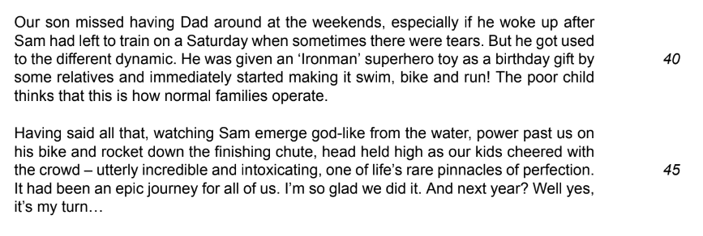

# Question 3 Model Answer: Interview

**This revision note is for exams in 2026. If you are sitting your exam from 2027, please switch to the 'First exams 2027' syllabus edition.**

## Question 3 Model Answer: Interview

> **Spec point** — `spcpt_xZsfnY5p9ns8wC4Q`

## Question 3 Model Answer: Interview

For this task, you will be asked to produce a piece of writing in a particular format, based on what you have read in Text C. You may be asked to write in one of six possible formats (genres):

- A letter
- A report
- A journal entry
- A speech
- An interview
- An article

The following guide will demonstrate how to answer Question 3 in the format of an **interview**.

## Text C and Question 3

> **Spec point** — `spcpt_cwfyrJY7SXfm5YQd`

## Text C and Question 3

The following is Text C taken from a past exam paper. It is about a writer’s experience of supporting her husband’s training to compete in an extreme event.

**Question:**

*Example interview question*

## Question 3 interview model answer

> **Spec point** — `spcpt_jpX8hvv6fRzFxSWb`

## Question 3 interview model answer

Based on the above question, the following model answer is an example of a full-mark, interview-style response:

> **Worked Example**
> **Interviewer: How exactly do you need to prepare for a challenge like Ironman and why is each aspect of that preparation important?**
> 
> **Candidate:** *Preparation is brutal*. You must dedicate immense time to building stamina; I started six months prior to the event. Crucially, I hired an experienced coach to keep me on track and motivated when I felt like quitting. Since Ironman requires diverse skills, you must ensure your training balances cycling, swimming, and running. My advice is not to focus on what you find easy; you gain the most ground by ruthlessly targeting your weakest discipline, however painful that is.
> 
> **Interviewer: How do you think preparing for Ironman affected other areas of your life and what advice would you offer anyone considering entering an Ironman for the first time?**
> 
> **Candidate:** Sacrifices are inevitable. *Training consumed my weekends, meaning I missed precious family moments, including our regular camping trips*. While my partner was incredibly supportive, be warned: your social life will suffer. My advice to first-timers is to involve your family — train together where possible so you don't drift apart. Also, do not underestimate the financial cost; from bikes to wetsuits, the kit is expensive, so you must budget carefully before signing up.
> 
> **Interviewer: What were the rewards of completing an Ironman for you and your family?**
> 
> **Candidate:** Crossing that finish line to the roar of the crowd gave me an overwhelming sense of achievement. Seeing my children there was a cherished memory; I believe I’ve set a strong example of resilience for them. Inspiring my wife to enter next year is the icing on the cake — if I can do it, anyone can! *Finally, on a practical note, the publicity has provided a fantastic boost to my new travel company, proving the pain was worth it.*

## Commentary

> **Spec point** — `spcpt_Vv2jSfH3D9S3NPVq`

## Commentary

- The answer starts by addressing the first bullet point, in the “voice” of the character
- The answer references specific details from the text
- Direct references to the text are then developed and expanded upon
- The tone and choice of language is appropriate for an interview
- The character’s “voice” is confident and sustained
- The bullet point asks what advice the character would give, so using direct address is appropriate
- The answer continues to reference specific detail from Text C

> **Exam Hint**
> The suggested word count for this task is a guide, and you are not penalised for writing under or over 250-350 words. However, writing too little can mean that your answer does not have enough development or detail. Writing too much can mean that you go off topic and lose focus, which again can be self-penalising. It is therefore a good idea to stick as closely as you can to the word count guidance.
> 
> You can find further guidance on suggested word counts for CIE [here](https://help.cambridgeinternational.org/hc/en-gb/articles/20633569448466-How-strict-is-the-word-count-in-each-component).

## Summary

> **Spec point** — `spcpt_xWy9XtkjdgmmkFxk`

## Summary

- Remember to read the question carefully and highlight:

  - The instructions (what you have to do)
  - The focus of each bullet point
- Re-read Text C and highlight the relevant information you can use in your answer
- Address each bullet point in order:

  - Make sure you cover all three of the bullet points as equally as possible
  - Base all of your answer on the ideas and details you find in Text C
- Decide on the voice and style you want to create and maintain that in your answer
- Do not just repeat details of what happened:

  - You need to develop your ideas to demonstrate understanding
