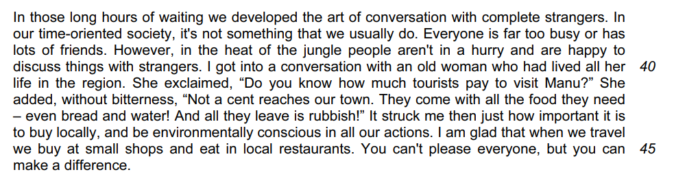

# Question 3 Model Answer: Journal

**This revision note is for exams in 2026. If you are sitting your exam from 2027, please switch to the 'First exams 2027' syllabus edition.**

## Question 3 Model Answer: Journal

> **Spec point** — `spcpt_6kbtD9hKh4NY79RB`

## Question 3 Model Answer: Journal

For this task, you will be asked to produce a piece of writing in a particular format, based on what you have read in Text C. You may be asked to write in one of six possible formats (genres):

- A letter
- A report
- A journal entry
- A speech
- An interview
- An article

The following guide will demonstrate how to answer Question 3 in the format of a **journal**. The task itself is taken from a past exam paper.

## Text C and Question 3

> **Spec point** — `spcpt_rJjQGQx3TbtNTJn4`

## Text C and Question 3

The following example of Text C is about a travel specialist who goes on a cycling journey across the Andes mountain range in South America.

**Question:**

*Example journal entry question*

## Question 3 journal model answer

> **Spec point** — `spcpt_cDZ66VqnJj6PvwWN`

## Question 3 journal model answer

Based on the above question, the following model answer is an example of a full-mark journal response:

> **Worked Example**
> *Now that we are homeward bound, I can reflect on this incredible adventure.* We started out so excited, confident that our wet-weather gear prepared us for anything.*I quickly realised how wrong I was when we hit the mountain pass and the hailstones began!* I normally love the thrill of a descent, but the freezing cold numbed my hands, making it terrifyingly hard to control the bike. I can’t describe the relief of reaching Colquepata. *Although the ride to Paucartambo took longer than the promised "40 minutes," the smooth roads were a joy, and the picturesque town reignited my excitement.*
> 
> The journey was physically tough, with constant downpours and flat tyres, but the jungle changed everything. The humid air and heady scents were the complete opposite of the high Andes, and cycling through a haze of butterflies felt like a cartoon. The bus delay in Pilcopata, *while initially annoying*, became an unexpected bonus. It allowed us to truly immerse ourselves in Peruvian life. It made me realise how we rush around at home, ruled by schedules, whereas nobody hurries in the jungle heat.
> 
> I was, however, shocked to learn how little tourism money reaches the actual townspeople. *This trip has taught me to be an environmentally aware tourist and to buy locally to support the economy.* Despite the grueling challenges, I have grown as a person, learned the value of teamwork, and discovered a part of the world I knew little about.

## Commentary

> **Spec point** — `spcpt_yx7zjTShpMRX6ztw`

## Commentary

- The answer starts clearly in the first person and demonstrates an awareness of the purpose of the task
- The response gives a clear and convincing account of the main features of the journey
- It uses and develops several ideas, both factual and inferential, from the passage
- The response clearly focuses on the writer’s thoughts and feelings
- A consistent narrative voice is maintained throughout
- It picks up on the references to the understanding of a different way of life and the importance of preserving this and the surrounding environment
- The response also demonstrates and develops suggestions about what the writer may have learnt from their journey

> **Exam Hint**
> The suggested word count for this task is a guide, and you are not penalised for writing under or over 250-350 words. However, writing too little can mean that your answer does not have enough development or detail. Writing too much can mean that you go off topic and lose focus, which again can be self-penalising. It is therefore a good idea to stick as closely as you can to the word count guidance.
> 
> You can find further guidance on suggested word counts for CIE [here](https://help.cambridgeinternational.org/hc/en-gb/articles/20633569448466-How-strict-is-the-word-count-in-each-component).

## Summary

> **Spec point** — `spcpt_SQbHNbwM43zr7g9y`

## Summary

- Remember to read the question carefully and highlight:

  - The instructions (what you have to do)
  - The focus of each bullet point
- Re-read Text C and highlight the relevant information you can use in your answer
- Address each bullet point in order:

  - Make sure you cover all of the bullet points as equally as possible
  - Base all of your answer on the ideas and details you find in Text C
- Decide on the voice and style you want to create and maintain that in your answer
- Do not just repeat details of what happened:

  - You need to develop your ideas to demonstrate understanding
