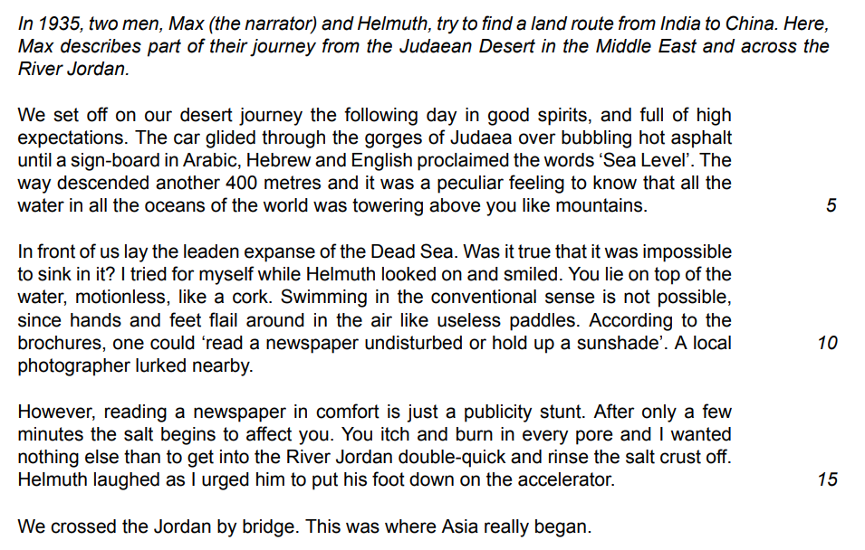
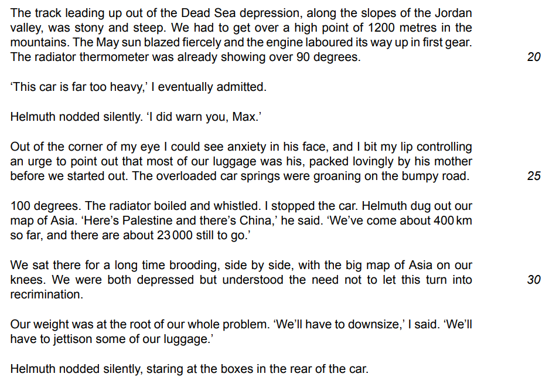
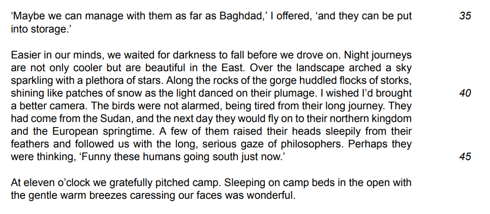
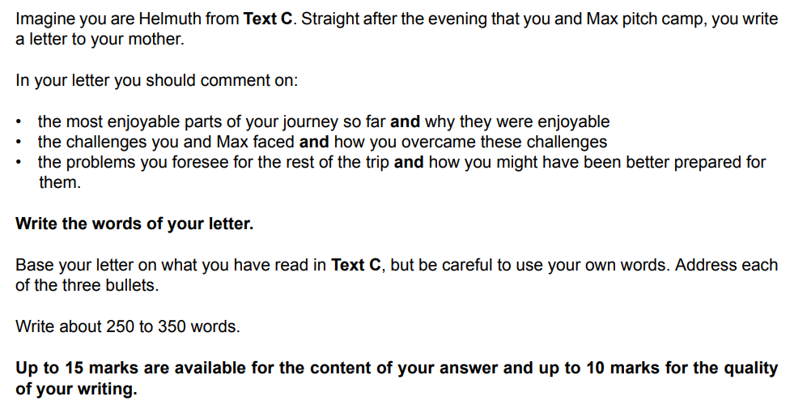

# Question 3 Model Answer: Letter

**This revision note is for exams in 2026. If you are sitting your exam from 2027, please switch to the 'First exams 2027' syllabus edition.**

## Question 3 Model Answer: Letter

> **Spec point** — `spcpt_bSrPWGBXTx3CjpPy`

## Question 3 Model Answer: Letter

For this task, you will be asked to produce a piece of writing in a particular format, based on what you have read in Text C. You may be asked to write in one of six possible formats (genres):

- A letter
- A report
- A journal entry
- A speech
- An interview
- An article

The following guide will demonstrate how to answer Question 3 in the format of a **letter**. The task itself is taken from a past exam paper.

## Text C and Question 3

> **Spec point** — `spcpt_26vdTdnNFDTxRBpP`

## Text C and Question 3

The following Text C example is about two men embarking on a journey across the desert.

## Question 3:

> **Spec point** — `spcpt_w4NNsC97SnRtqRRy`

## Question 3:

## Question 3 letter model answer

> **Spec point** — `spcpt_QyttWhg9KwrHXfFx`

## Question 3 letter model answer

Based on the above question, the following model answer is an example of a full-mark letter response:

> **Worked Example**
> *Dear Mother,*
> 
> I am writing to you from my camp bed in the middle of the desert to share our news. There is a gentle breeze this evening, which is most welcome after the heat of the day.
> 
> *Our journey began well*. Gliding over the hot tarmac of the Judaean Desert, we experienced the exotic novelty of being 400 metres below sea level — strange to think we were travelling at the same depth as sea creatures! The Dead Sea lived up to expectations; Max floated on the surface like a cork. After a quick dip in the River Jordan to wash off the salt, he urged me to drive as fast as the car would go!
> 
> *However, challenges soon arose*. The ground became steep and the sun blazed, causing the car to overheat. I felt anxious about whether the engine could cope, especially given the heavy load we are carrying. I warned Max about the weight, though I know most of the luggage is mine — *lovingly packed by you*! With temperatures hitting 100 degrees and 23,000 km still to go, we stopped to consider our options. I reluctantly agreed we must shed weight, though I hope to reach Baghdad first to store my belongings rather than abandon them.
> 
> *I fear we are ill-prepared for what lies ahead.* My biggest worry is the car; in this intense heat and remote terrain, we are pushing the vehicle to its limits. Furthermore, if we cannot find storage in Baghdad, tensions will rise. Max is practical, but I cannot bear to part with my things. We can only hope the car holds together and we avoid getting lost in this vast wilderness.
> 
> *With warm wishes*,
> 
> Helmuth

## Commentary

> **Spec point** — `spcpt_Dvq7969yMkfKsSSQ`

## Commentary

- The answer starts by demonstrating understanding of the format of the writing and contextualises the letter in relation to Text C
- Each bullet point in the question is dealt with in a separate paragraph
- The answer uses information directly from the text, and then develops it
- The response shows understanding of the task and who the narrative voice is supposed to be
- The style and tone of the letter is appropriate to the time period and the intended recipient
- The narrative voice and perspective is sustained throughout the response
- The greeting and sign off are appropriate for a letter format

> **Exam Hint**
> The suggested word count for this task is a guide, and you are not penalised for writing under or over 250-350 words. However, writing too little can mean that your answer does not have enough development or detail. Writing too much can mean that you go off topic and lose focus, which again can be self-penalising. It is therefore a good idea to stick as closely as you can to the word count guidance.
> 
> You can find further guidance on suggested word counts for CIE [here](https://help.cambridgeinternational.org/hc/en-gb/articles/20633569448466-How-strict-is-the-word-count-in-each-component).

## Summary

> **Spec point** — `spcpt_qBWdsPvKKg4WSTCg`

## Summary

- Remember to read the question carefully and highlight:

  - The instructions (what you have to do)
  - The focus of each bullet point
- Re-read Text C and highlight the relevant information you can use in your answer
- Address each bullet point in order:

  - Make sure you cover all of the bullet points as equally as possible
  - Base all of your answer on the ideas and details you find in Text C
- Decide on the voice and style you want to create and maintain that in your answer
- Do not just repeat details of what happened:

  - You need to develop your ideas to demonstrate understanding
