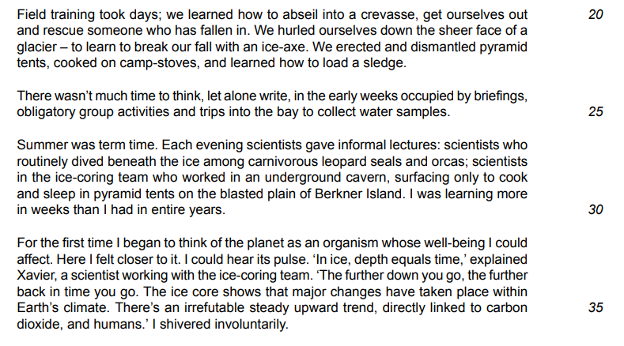
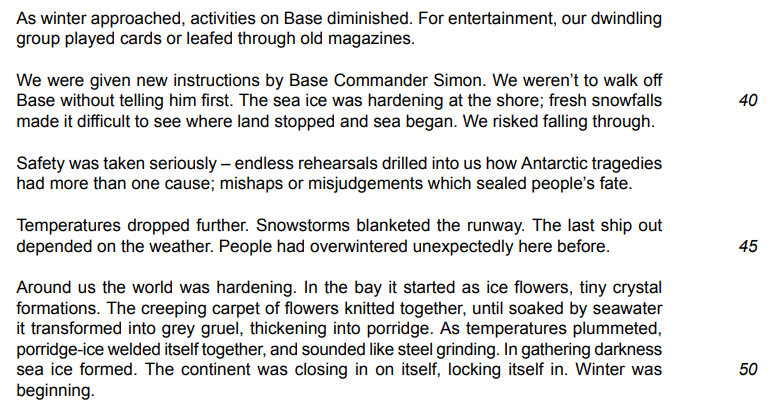
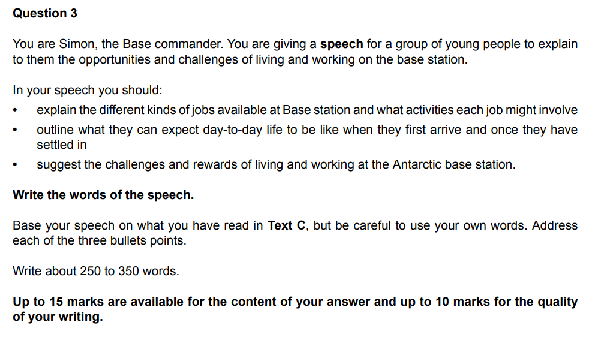

# Question 3 Model Answer: Speech

**This revision note is for exams in 2026. If you are sitting your exam from 2027, please switch to the 'First exams 2027' syllabus edition.**

## Question 3 Model Answer: Speech

> **Spec point** — `spcpt_SdRnQNDWDQh4x3pj`

## Question 3 Model Answer: Speech

For this task, you will be asked to produce a piece of writing in a particular format, based on what you have read in Text C. You may be asked to write in one of six possible formats (genres):

- A letter
- A report
- A journal entry
- A speech
- An interview
- An article

The following guide will demonstrate how to answer Question 3 in the format of a **speech**. The task itself is taken from a past exam paper.

## Text C and Question 3

> **Spec point** — `spcpt_XgCM5nzjxrkP65Zx`

## Text C and Question 3

The following example of Text C is about a journalist who has been invited to spend time at a base station in Antarctica.

**Question:**

## Question 3 speech model answer

> **Spec point** — `spcpt_WpTdMYxpWWbdmtHr`

## Question 3 speech model answer

Based on the above question, the following model answer is an example of a full-mark speech response:

> **Worked Example**
> *Good morning everyone! I’m Simon, Base Commander.* I am here today to talk to you about the unique opportunities and challenges of living and working on our Antarctic base station.
> 
> *We offer a variety of vital roles*. You might join us as a scientist collecting climate samples in the field, or a *marine biologist diving with orcas*. Equally important are the mechanics and engineers who maintain our planes and generators; without them, and the pilots who transport us to the camps, we simply could not survive in these conditions.
> 
> *If you decide this life is for you, what can you expect?* Firstly, forget modern luxuries. There are no cafes or Wi-Fi here, and entertainment is limited to card games. However, you will be too busy to notice. You will undergo intense field training, learning to abseil into crevasses to rescue fallen colleagues. You must be self-reliant, pitching your own tents, cooking on camp-stoves, and collecting water supplies. It is physically demanding, but intellectually rewarding; *summer lectures from experts provide incredible perspectives on our research.*
> 
> Be warned, however: the challenges are real. The isolation, particularly during the dark winter months, is severe, and the local wildlife can be dangerous. You will work hard with little leisure time. Yet, the rewards are unmatched. The shared struggle builds a teamwork dynamic where colleagues become family. Furthermore, working in this inspirational landscape develops a profound respect for our planet. *If you have the resilience for this life, I recommend you give it a go!*

## Commentary

> **Spec point** — `spcpt_CHSHgqzrF9h7S2Rf`

## Commentary

- The answer starts by demonstrating understanding of the format of the task (a speech) and what the task is about
- Each bullet point in the question is dealt with in a separate paragraph
- Direct references to the text are developed and expanded upon
- The answer uses direct address to the audience, which is appropriate for a speech
- All of the examples are taken from the text
- The answer uses inference to develop points appropriately
- The answer sustains a confident “voice” throughout

> **Exam Hint**
> The suggested word count for this task is a guide, and you are not penalised for writing under or over 250-350 words. However, writing too little can mean that your answer does not have enough development or detail. Writing too much can mean that you go off topic and lose focus, which again can be self-penalising. It is therefore a good idea to stick as closely as you can to the word count guidance.
> 
> You can find further guidance on suggested word counts for CIE [here](https://help.cambridgeinternational.org/hc/en-gb/articles/20633569448466-How-strict-is-the-word-count-in-each-component).

## Summary

> **Spec point** — `spcpt_Dw9hvc6XCnBRDj3C`

## Summary

- Remember to read the question carefully and highlight:

  - The instructions (what you have to do)
  - The focus of each bullet point
- Re-read Text C and highlight the relevant information you can use in your answer
- Address each bullet point in order:

  - Make sure you cover all three of the bullet points as equally as possible
  - Base all of your answer on the ideas and details you find in Text C
- Decide on the voice and style you want to create and maintain that in your answer
- Do not just repeat details of what happened:

  - You need to develop your ideas to demonstrate understanding
