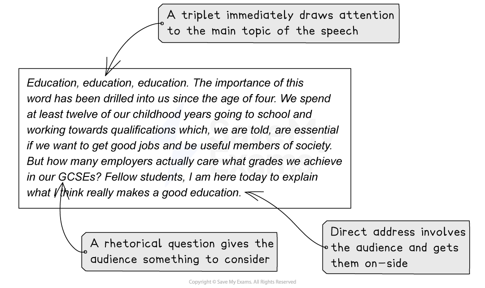

# Question 1 Directed Writing: How to Write a Speech

**This revision note is for exams in 2026. If you are sitting your exam from 2027, please switch to the 'First exams 2027' syllabus edition.**

## Paper 2: Question 1 Directed Writing: How to Write a Speech

> **Spec point** — `spcpt_4M3D3ZP3ySZ7z3Qg`

## Question 1 Directed Writing: How to Write a Speech

One of the three formats that you may be asked to write in for Question 1 is a speech. This may be to your class or students in your school or college, or something more formal intended for broadcast. The opinions and ideas you put forward in your speech should be based on what you have read in the reading passages given, and your writing marks will come from your ability to vary your writing to suit the purpose, audience and form of the task, as well as how you structure your response.

The following guide will detail how to structure your response in the style of a speech.

## Key features of a speech

> **Spec point** — `spcpt_z43mvGzRQncQtZVK`

## Key features of a speech

The language and tone of your speech will be determined by the task and subject, but the following are the basic features of a speech which you could include in your response:

| **Speech or talk** |
|---|
| In a speech or talk you should:  - Address the audience directly throughout - Engage the audience in your introduction:    - Outline the topic   - Use persuasive devices to hook the audience, such as [rhetorical questions](https://www.savemyexams.com/glossary/gcse/english-language/rhetorical-definition/) to get them thinking - Structure your speech logically, building your arguments persuasively:    - Speeches or talks will use persuasive language features   - Use the acronym [DAN FOREST PIE](https://www.savemyexams.com/igcse/english-language/cie/20/revision-notes/2-paper-2-writing/section-a-directed-writing/question-1-directed-writing-what-the-question-is-asking/) to remember these   - To offer a balanced view, include an objection to the argument in a separate paragraph - Include your audience using inclusive pronouns (“we”, “us”, “our”) - To finish, circle back to your original argument, calling your audience to action if appropriate |

You might wish to structure your speech in the following way:

1. Directly address the reader or audience:

  - Introduce the topic and your point of view
  - Use personal and inclusive pronouns to involve your audience, e.g., “you” or “we”
  - Engage your audience using a rhetorical question
2. Your next paragraph should develop your argument:

  - You will need to infer information, ideas and opinions from the reading texts to do this
3. Provide an [anecdote](https://www.savemyexams.com/glossary/gcse/english-language/anecdote-definition/) to offer an example which proves your argument:

  - This builds rapport** **with your reader by engaging with them on a personal level
  - Again, this should be based on what you have read
4. Engage the reader on a personal level using a counter-argument:

  - Again, this should be based on and developed from the ideas in the reading texts
5. Offer more research or studies:

  - This can be in the form of statistics, a witness statement, poll, or quote from an expert, based on the reading texts
6. End your speech with an emotive plea:

  - Use emotive language to engage your reader
  - Ending your response on a single sentence, perhaps using a triplet, is an effective conclusion

> **Exam Hint**
> Rhetorical questions are commonly used as a persuasive device, but avoid over-using any one technique, as this will make your writing sound much less sophisticated. Always consider the reason why you are using a technique and what the effect is that you want to achieve. Do not just use techniques for the sake of using them.

## Persuasive writing

> **Spec point** — `spcpt_9Hc6xW4pNdHjffMy`

## Persuasive writing

A speech is often more persuasive than other forms of writing. You are trying to persuade your audience that your point of view is valid, and sometimes encourage them to join you.

Here are some tips for how to make your speech persuasive:

- Write in the first person (write from your own perspective)
- Use personal and inclusive pronouns:

  - Using words such as “we” and “us” builds rapport between you and your audience and makes them feel involved
- Present your opinions as facts; as a truth that should not be challenged
- Be passionate but not aggressive:

  - Use emotive language and imperatives to call your audience to action
- Decide on your position and stick to it
- Make sure you do not sound like an advertisement

As an example, let’s consider the following introduction to a speech about GCSEs:

For more guidance, please see our [speech model answer.](https://www.savemyexams.com/igcse/english-language/cie/20/revision-notes/2-paper-2-writing/section-a-directed-writing/question-1-model-answer-speech/)
