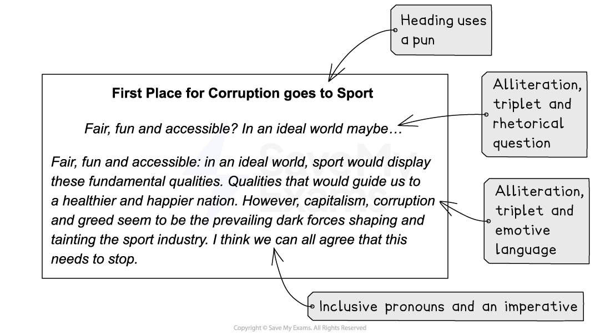

# Question 1 Directed Writing: How to Write an Article

**This revision note is for exams in 2026. If you are sitting your exam from 2027, please switch to the 'First exams 2027' syllabus edition.**

## Paper 2: Question 1 Directed Writing: How to Write an Article

> **Spec point** — `spcpt_hgbKrggtp7ZKzDC6`

## Question 1 Directed Writing: How to Write an Article

One of the three formats that you may be asked to write in for Question 1 is an article. This will most likely be for a magazine, and you will be given the intended audience for your article and the reason why you are writing it in the task instructions. The opinions and ideas you put forward in your article should be based on what you have read in the reading passages given, and your writing marks will come from your ability to vary your writing to suit the purpose, audience and form of the task, as well as how you structure your response.

## Key features of an article

> **Spec point** — `spcpt_BkrsYPTNhxxqZRWn`

## Key features of an article

The language and tone of your article will be determined by the task and subject, but the following are the basic features of an article which you could include in your response:

| **Magazine or newspaper article** |
|---|
| In an article you should:  - Use a snappy heading:    - Consider using [alliteration](https://www.savemyexams.com/glossary/gcse/english-language/alliteration-definition/), a [rhetorical question](https://www.savemyexams.com/glossary/gcse/english-language/rhetorical-definition/) or a [pun](https://www.savemyexams.com/glossary/gcse/english-literature/pun-definition/) (a play on words) for this   - Use capital letters for all but filler words in your heading   - For example: *“The Cruelty of Captivity”* - A strapline underneath the heading can summarise your point of view:    - For example: *“Why keeping animals in captivity has fallen out of favour”* - Use sub-headings to help structure your article (if appropriate) - Address your audience directly, with consideration to the fact that an article is intended to be read by a wide audience - Be light-hearted and entertaining, formal and serious, or provide advice and tips, depending on the task set - Use topic sentences to begin each paragraph, and then develop that point appropriately and in detail - Do not try to include multiple different arguments in one paragraph - Avoid beginning your article with *“I’m writing this because..”* or *“In this article I shall be discussing…”* |

Because an article is intended for publication, it is important to use Standard English and to vary your sentence and paragraph lengths to keep your audience engaged. The heading, strapline and opening paragraph of an article can employ lots of persuasive devices to hook your reader and introduce your point of view. For example:

> **Exam Hint**
> Rhetorical questions are commonly used as headings, but they can be too simplistic or too general, so consider how you can make your headline sophisticated and specific. Choosing a simple statement can be very effective, using a play on words taken from the article topic.

## Article structure

> **Spec point** — `spcpt_yvdRvY5mxv3P7vYZ`

## Article structure

The ideas and opinions you put forward in your article will be based on what you have read in the text(s). However, your opinion can either be in favour of something, or against it, as long as you are able to sustain a convincing argument and a consistent point of view.

- Your article should be structured into five or six paragraphs:

  - Remember, each paragraph does not have to be the same length
  - Better answers vary the lengths of their paragraphs for effect
  - Develop separate ideas or points in each paragraph
  - But avoid repeating the same idea throughout your article

Remember that to produce an effective response, you should aim to develop your points carefully in each paragraph, using language features and techniques to highlight ideas and emphasise your points.

> **Exam Hint**
> While writing in the correct form as instructed is important in this question, you only need to adhere to the basic conventions of an article. Drawing columns or spending too much time thinking up the perfect headline wastes valuable time and will not improve your mark. Remember, it is more important that you adapt your style, language and tone to suit the intended audience and purpose, and that you construct a well-structured and coherent piece of writing, than waste time on the layout of your response.

For more guidance, please see our [article model answer.](https://www.savemyexams.com/igcse/english-language/cie/20/revision-notes/2-paper-2-writing/section-a-directed-writing/question-1-model-answer-article/)
