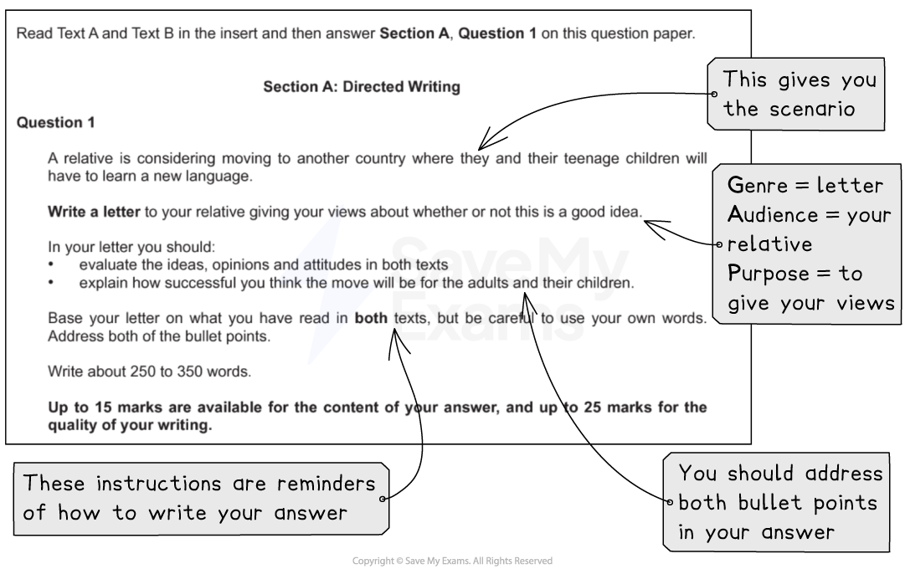
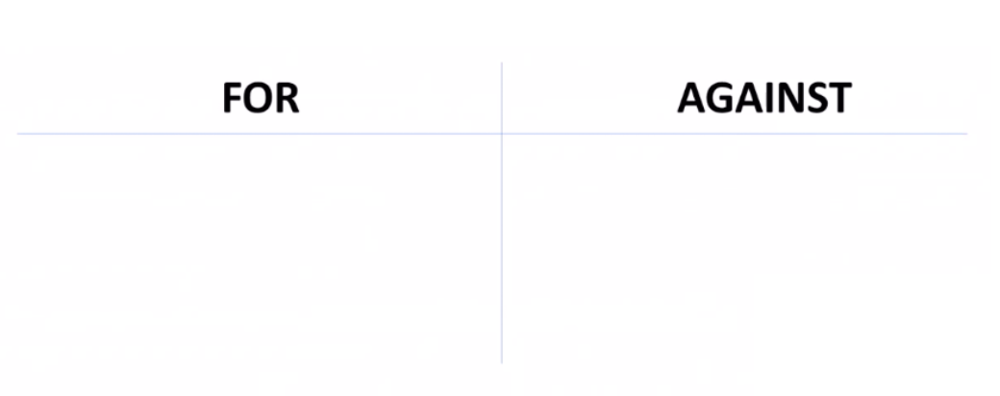

# Question 1 Directed Writing: What the Question is Asking

**This revision note is for exams in 2026. If you are sitting your exam from 2027, please switch to the 'First exams 2027' syllabus edition.**

## Paper 2: Question 1 Directed Writing: What the Question is Asking

> **Spec point** — `spcpt_zcvJvbryFskGbHsT`

## Question 1 Directed Writing: What the Question is Asking

Question 1 on Paper 2 is the Directed Writing question and it is compulsory. Your piece of writing will be based on one or two reading passages, and you will be asked to write in the format of either a speech, letter or article.

The following guide will provide you with the information you need to answer **Question 1: Directed Writing** to a high standard.

## Overview

> **Spec point** — `spcpt_RpBVcMQwsYCBKWkx`

## Overview

Although Question 1 is mainly an assessment of your writing skills, your piece of writing will be based on one or two reading texts. This means that, of the total of 40 available marks, 25 are awarded for your writing skills, and 15 are based on your reading skills.

This means that you will have to use, evaluate and develop the information and ideas in the reading text or texts in order to craft your response in the form of a letter, article or speech. Ideally, you will be using some of the same skills that you demonstrated in Paper 1, Question 3, such as your written response being in your own words. You are not being assessed on your ability to quote directly from the text or texts, or to repeat the exact words of the texts.

You should write between 250 and 350 words, which is 1½ to 2 sides of A4 in standard handwriting. In order to get the highest marks, you need to demonstrate the following skills:

- The ability to write in a highly effective style, capable of conveying subtle meanings (W1)
- The ability to structure your writing carefully for the benefit of your reader (W2)
- The ability to use a wide range of sophisticated vocabulary, used precisely and accurately (W3)
- The ability to write in highly effective language and an appropriate tone for your audience and purpose (W4)
- The ability to write with virtually no errors in spelling, grammar and punctuation (W5)
- The ability to successfully evaluate ideas and opinions, both explicit and implicit (R1-R3)
- The ability to assimilate ideas from the text(s) to give a developed and sophisticated response (R3 and R5)

## Breaking down the question

> **Spec point** — `spcpt_kx4YBN3zpFdRtj89`

## Breaking down the question

In Question 1, you will be given a scenario based on the themes of the reading text(s). You will be told the context, the format of your writing and who you are writing for. You should always approach this question by reading the task carefully first, and highlighting what is sometimes referred to as a GAP analysis, or the “3 Ws”:

| **G** | **A** | **P** |
|---|---|---|
| **Genre **(format) | **Audience** | **Purpose** |
| **What** am I writing? | **Who** am I writing for? | **Why** am I writing? |

For example:

You should spend 15-20 minutes reading and planning your response, and 40-45 minutes writing your response (allowing a few minutes at the end for re-reading and checking).

> **Exam Hint**
> Remember, Question 1 requires an extended written response. Therefore, the most effective answers will demonstrate a well-planned structure covering a range of points written in the correct [form](https://www.savemyexams.com/glossary/gcse/english-language/form/). It is important to sign off your letter appropriately or give your article a headline. Make sure you have correctly identified the format required in the task, and avoid writing letters to indiscriminate recipients, or writing speeches for unspecified events. Respond to what the task is, rather than what you hoped it would be.

## Language, audience and purpose

> **Spec point** — `spcpt_dd4ZxVXdzB6kqCb9`

## Language, audience and purpose

Your audience for this task will be the intended recipients or audience for your piece of writing. Part of what you are being assessed on is your ability to adapt your language and tone to suit this intended audience.

For example:

- A parent will have different concerns and values to a student
- A local MP would need convincing using facts and evidence to be persuaded by your arguments
- Readers of a local newspaper would be more persuaded by emotive language
- A letter to a headteacher or someone in authority requires formal, respectful language which is not aggressive or inappropriate
- Teenagers would need something to relate to, so personal [anecdotes](https://www.savemyexams.com/glossary/gcse/english-language/anecdote-definition/) would work well

Addressing your audience or reader specifically is a convincing technique to persuade people to agree with your point of view, or at least to acknowledge its validity; you can also use inclusive language, such as “we” and “us”, or “fellow students” or “parents”. You should always write using Standard English, but the level of formality you should employ will be dictated by the task itself.

For example:

| **Target audience** | **Example of how to adapt language** |
|---|---|
| Teenagers | *I’m sure we’ve all had our parents or guardians moan at us for how long we spend on our gaming machines. However, gaming can help us develop important skills, such as teamwork, as well as being an awesome way of connecting with friends from all over the world!* |
| The use of *inclusive pronouns* and *colloquial language*, such as “awesome”, demonstrates that this example is aimed at teenagers or younger people |   |
| Adults | *Using animals for sports, such as fox-hunting, has been debated for many years, and it is an issue which ***elicits*** strong emotions from both sides.* |
| The use of more sophisticated vocabulary, such as “elicits”, as well as complex sentences, demonstrate that this is aimed at adults reading about a serious topic |   |
| Older people | *The purpose of wearable technology, such as smart-watches and fitness trackers, is to make staying connected as easy and hands-free as possible. In addition, wearable technology can have important health benefits, as they can monitor your blood sugars, heart rate, blood pressure and quality of sleep.* |
| The simple explanations and examples show that this is written for people who might not know much about wearable technology |   |

Question 1 will also ask you to write for a specific purpose. You will be asked to create a discursive, argumentative or persuasive response, using your own words. This means that you will be rewarded for your ability to select relevant language techniques and employ them in a sophisticated way. A useful acronym to remember some of the key language techniques for this type of writing is DAN FOREST PIE:

| **Device** | **Definition** | **Example** |
|---|---|---|
| **D**irect address | Addressing your audience directly to build rapport | *When it comes to the issue of animal cruelty, you cannot stand back and not take a stand. This is your fight as well.* |
| **A**udience | Acknowledging the whole of your audience in your writing | *Parents, you must surely agree that banning mobile phones in classrooms will improve concentration and enable your children to make better progress in their studies.* |
| **Not** only, but also | Used as part of your sentence to add to an argument | *Not only does this issue affect local communities, but it also has wider implications for the whole of the country.* |
| **F**acts | Something that can be proven to be true | *London Zoo is the oldest zoo in the UK.* |
| **O**pinions | What you believe or think, often presented as fact | *In my view, banning fox hunting with hounds is the best thing to have happened for a long time.* |
| **R**hetorical questions | A question which does not require an answer | *Is it right that reality TV stars are paid vast amounts of money while not actually having any skills?* |
| **E**motive language | Language deliberately chosen to make the audience or reader feel a particular emotion or have an emotional response | *The horribly cruel, brutal and violent manner in which hunting hounds murder a fox when caught, ripping them apart, is completely wrong.* |
| **S**tatistics | Factual data used in a persuasive way | *80% of commuters agree that rail fares currently do not represent good value for money.* |
| **T**riplets | Three ideas or examples in a sentence used to emphasise a point | *Nutritious, delicious and environmentally conscious, plant-based eating is the only way to reduce our impact on the environment.* |
| **P**ersonal and *inclusive pronouns* | “I”, “you”, “we”, “us” | *We must act now on climate change, as it matters not only to us, but to our children and children’s children.* |
| **I**mperatives | Command verbs | *Act now, as further delay could be catastrophic.* |
| **E**xaggeration | Also known as [hyperbole](https://www.savemyexams.com/glossary/gcse/english-language/hyperbole-definition/) - exaggerated language or examples used for effect | *If we do nothing, we will regret our inaction for the rest of eternity.* |

You could also consider using:

| Flattery | Complimenting your readers or audience | *As well-educated and intelligent people, I am sure you will agree that this situation must not continue.* |
|---|---|---|
| [Alliteration](https://www.savemyexams.com/glossary/gcse/english-language/alliteration-definition/) | Two or more words that begin with the same consonant sounds - the words do not have to be consecutive | *Is fast food making us fatter, or is this idea just a fad?* |
| [Antithesis](https://www.savemyexams.com/glossary/gcse/english-language/antithesis-definition/) | Opposing words or ideas presented together to show a contrast | *Just a small act of defiance could have a huge effect.* |
| Double adjectives | Starting your sentence with two adjectives | *Smart and exciting, new wearable technology is the latest craze.* |

It is also important to carefully consider the purpose of the task. “Giving your views” about a subject can mean to explain what you think, to argue your point or to persuade your audience to agree with you. Most importantly, your language and tone needs to match your intended audience and purpose.

| **Purpose ** | **Devices and techniques to demonstrate you understand the purpose of the task** |
|---|---|
| **Write to explain:**  - “Explain your point of view about…” - “Explain your attitude to…” - “Explain your thoughts on…” | - Provide reasons for your ideas - Offer examples and anecdotes:    - Use [imagery](https://www.savemyexams.com/glossary/gcse/english-language/imagery-definition/) to describe experiences - Provide facts and statistics:    - In the exam you can use those provided in the reading texts - Use present-tense verbs:    - Usually you are explaining about something that is currently the case - Use either** **first** **or** **third person consistently  Use appropriate connectives:  - Words like “Moreover”, “Furthermore”, “However” and “On the other hand” provide cohesion and fluency |
| **Write to argue:**  - “Argue your point of view about…” - “Give your views on…” | - Write in the first person as you are putting forward your thoughts and opinions - Use personal and *inclusive pronouns*:    - Using words like “we” and “us” builds rapport between you and your reader and makes them feel involved - Present your opinions as facts - as a truth that shouldn’t be challenged - Be persuasive and passionate about your argument, but not aggressive:    - Readers do not respond well to an aggressive tone - Use emotive language and [rhetorical questions](https://www.savemyexams.com/glossary/gcse/english-language/rhetorical-definition/) to persuade your reader of the validity of your argument - You can present both sides of an argument, but decide on your position and maintain it throughout:    - This means that you can start your counter-argument with phrases such as “While I acknowledge that some people might think…”   - Then circle back to your original position |
| **Write to persuade:**  - “Persuade the audience of your point of view about…” | - Write in the first person as you are putting forward your thoughts and opinions - Use personal and *inclusive pronouns*:    - Using words like “we” and “us” builds rapport between you and your reader and makes them feel involved - Present your opinions as facts - as a truth that shouldn’t be challenged - Be persuasive and passionate about your argument, but not aggressive:    - Readers do not respond well to an aggressive tone - Use emotive language and rhetorical questions to persuade your reader of the validity of your argument - Use imperatives to call your audience to action - Use rhetorical techniques such as the rule of three** **to convince the reader of your argument - Decide on your position or opinion and stick to it throughout - Avoid sounding like an advertisement |

Above all, remember: your arguments and point of view must be based on the reading passages you are given. If you just write without establishing a clear summary of the main points in the text(s), you will not score high marks.

> **Exam Hint**
> As part of your planning and preparation for this task, you should write a summary of your argument in response to the task in a single sentence. This should be included in your introductory paragraph, establishing your position, and confirmed in the concluding paragraph. The highest marks are achieved when you are able to establish a central argument and sustain this throughout your writing.

## Steps to success

> **Spec point** — `spcpt_w5xzJx5fzpTxyQHH`

## Steps to success

1. Read the task carefully:

  - Identify and highlight **what** you are writing, **who** you are writing for and **why** you are writing
  - Also highlight the **main focus** in each bullet point in the task
2. Read the text(s):

  - Highlight evidence or information relevant to the focus of each bullet point
3. Plan your response:

  - Turn what you have highlighted in the text(s) into bullet points, summarising the information or idea *in your own words*
4. Make your point of view clear in your introduction:

  - If you are writing a letter, state what you are writing about, why you are writing and what your point of view is
  - If you are writing a speech, introduce your audience to the topic of your speech and your point of view
  - If you are writing an article, consider an introduction that grabs your reader’s attention while also indicating your viewpoint
5. Start each paragraph with an appropriate connective and topic sentence
6. Develop each paragraph in detail:

  - Make your point using the information or ideas from the text:
  
    1. To do this, you need to read between the lines in the text(s)
    2. Your ideas and opinions must be derived from the passage
  - Explain what you mean
  - Develop your point, assessing its implications with clear and persuasive arguments
  - Make sure you have developed your point thoroughly before moving on to your next point (which should be a different point or argument)
7. Try to leave five minutes at the end to re-read your writing carefully, correcting any obvious mistakes you have made

## Exam tips:

> **Spec point** — `spcpt_fZKqfQ9G72cNDdPp`

## Exam tips:

- Make sure that you employ fluent, varied sentence styles and a wide range of vocabulary
- Structure your ideas and organise your responses effectively to persuade, discuss ideas and engage the reader
- Do not just copy from the reading texts:

  - This will seriously limit both your reading and writing marks
- Likewise, do not quote from the text(s)
- Nor should you just repeat the ideas in the text(s):

  - You need to select relevant points and evaluate them
  - Remember, you are not producing a summary of the text(s)
  - Make sure you do not just lift points from the text and discuss them generally
- It is important to plan your response and decide what your arguments are going to be:

  - Recognise that there may be implicit meanings in the text, which you need to be aware of
- The careful use of [rhetoric](https://www.savemyexams.com/glossary/gcse/english-language/rhetoric/), such as questioning or exclamations, can help to convince and persuade your intended audience
- Remember, you are required to consider and evaluate the ideas in the text(s) and use them to develop your *own* argument
- Ensure you keep to the suggested word limit:

  - Writing significantly under or over the suggested word count will affect your marks

## Persuasive plan

> **Spec point** — `spcpt_dzzmpYSn3ZQRDmhG`

## Persuasive plan

**THINK**

- This question is split between PURPOSE and FORM.
- The **purpose** of the paper is to persuade/argue/discuss. So remember the **Persuasive Writing Theory** *(*[ethos](https://www.savemyexams.com/glossary/gcse/english-language/ethos/)*/*[pathos](https://www.savemyexams.com/glossary/gcse/english-literature/pathos-definition/)*/*[logos](https://www.savemyexams.com/glossary/gcse/english-language/logos/)*).*
- The form will be a letter, article or speech. So remember those techniques.
- Analyse the question and actively read the insert, just as you would for the Paper 1 Reading exam.

**FEEL**

- Write down three words that sum up how you **feel** about the arguments presented in the text.

**DO**

- Write a quick table like this:

- **Find 5-6 arguments** from the text (4 For, 1 Against / 4 Against, 1 For – depending which side you’re arguing).

  - Sum them up into bullet-points and write them under the corresponding headers.
  - Remember to be aware of the counter-arguments, as that’s what you should start with.

- **Focusing only on your side of the argument**, label your bullets with the following argument type:

  - **E (emotional)**
  - **L (logical)**
  - **A (authoritative)**
  - This will make sure you have a varied and multi-faceted argument.

> **Exam Hint**
> - Don’t waste time on writing long narratives in your plan – save that for your answer! Stick to bullet-points, or a even just a single word to jog your memory. This plan is for YOUR benefit, not the examiner’s. Also, if you’re unable to sum up your arguments, the examiner won’t be able to either.
