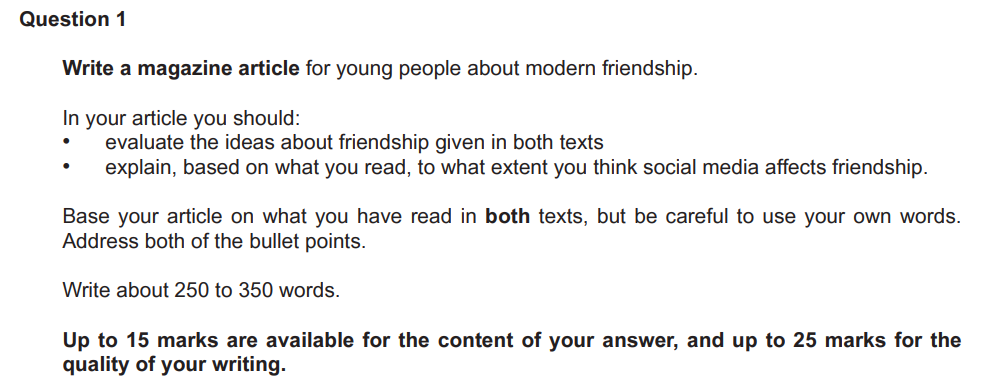
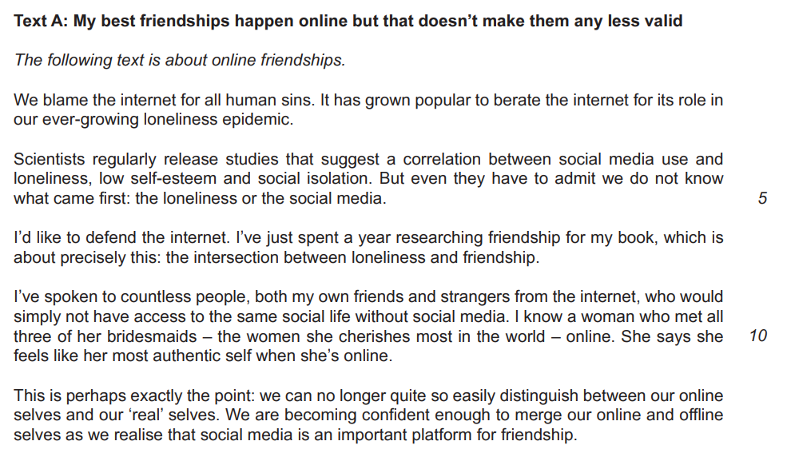
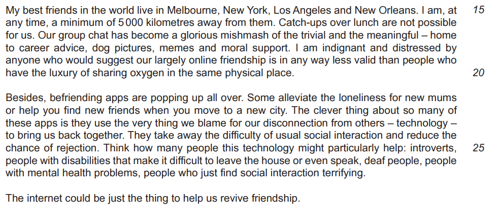
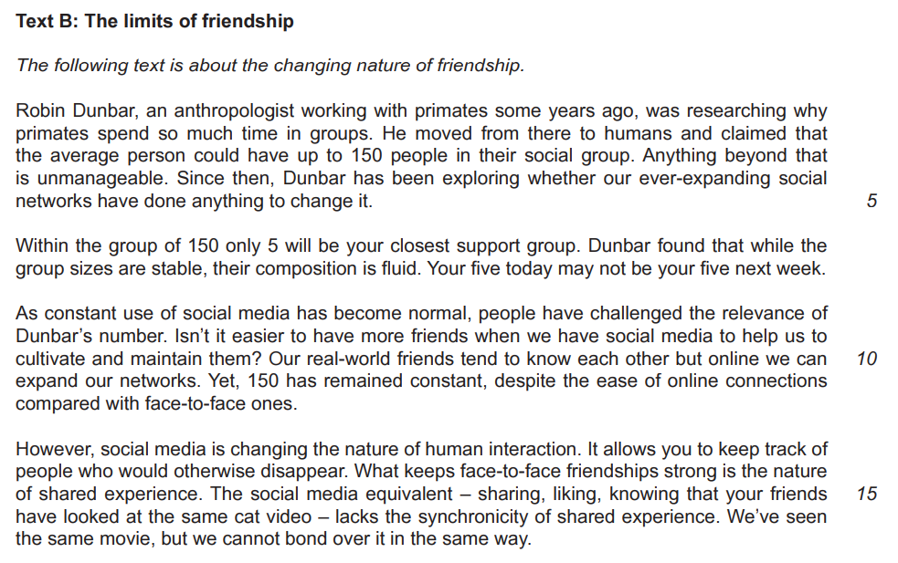

# Question 1 Model Answer: Article

**This revision note is for exams in 2026. If you are sitting your exam from 2027, please switch to the 'First exams 2027' syllabus edition.**

## Question 1 Model Answer: Article

> **Spec point** — `spcpt_DjTBTp7jyYxQ8jBr`

## Question 1 Model Answer: Article

For this task, you will be asked to produce a piece of writing in a particular format, based on the opinions, ideas and information you are presented with in one or two reading passages. You may be asked to write in one of three possible formats (genres):

- A letter
- A speech
- An article

The following guide will demonstrate how to answer Question 1 in the format of an **article**. The task itself is taken from a past exam paper.

## Addressing the reading assessment objectives

> **Spec point** — `spcpt_vrBkB6nBRvJ2G83v`

## Addressing the reading assessment objectives

Up to 15 marks are available in this task for your ability to evaluate both the explicit and implied ideas, opinions and attitudes expressed in one or two texts, and assimilate them to write a developed and sophisticated response.

Let’s take a look at how you do this, using the following Question 1 example:

Your response here has to be based on the ideas, opinions and attitudes contained in the following two texts:

After carefully reading the task, you should then read the texts and highlight the ideas and opinions that could inform your writing. Your response might use the following ideas from these texts:

**Text A:**

- The internet is blamed for everything without reason
- Loneliness, low self-confidence and social isolation are linked to social media, but it is not really known in what way
- The internet can make people less lonely, not more
- People can build meaningful connections over the internet
- Social media can help people find friends and develop a social life
- You can be yourself on the internet as well as in person - our online and real-life [personas](https://www.savemyexams.com/glossary/gcse/english-literature/persona-definition/) are being merged
- Online friendships can be made across vast distances
- Talking and friendships online can be just as rich and as valid as in-person ones
- Befriending apps are now increasingly available
- Some people will find it easier to make friends online

**Text B:**

- Research shows how important real friendship is to people
- We are genetically wired to make a small number of close friends even in larger social groups
- Even though we now have the internet to help us maintain friendships across expanding distances, we don’t actually have more friends with social media
- The nature of friendship is changing
- Shared experience in real life is essential for strong friendships
- Deeper connections take more effort than being online

## Planning your response

> **Spec point** — `spcpt_tBGW5QFCj2QG48DM`

## Planning your response

Once you have read the text(s), identified relevant opinions, ideas and attitudes and bullet-pointed these in your own words, you should then spend five minutes planning your written response. In your plan:

- Decide on your “voice” and point of view
- Write a statement that summarises your point of view, based on your reading
- Note down which points you can develop that support your point of view in your first paragraph
- Decide if you are going to make a counter-argument, and note down which points you can develop to support this
- Return to your main argument, ensuring that you have included ideas and opinions from both texts (if more than one)
- Note down the points you can make to address the second bullet point in the task
- Note down how you are going to start and finish your response, ensuring that it establishes the correct style and tone

## Article model answer

> **Spec point** — `spcpt_5jzwk6nHcwRX3qry`

## Article model answer

The following model answer demonstrates a top mark response to the above task:

> **Worked Example**
> *The Muddling of Modern Friendships*
> 
> We live in challenging times. Feelings of loneliness, isolation and disconnection rose sharply during the pandemic, leading to a significant increase in mental health issues. All too often the blame for this is placed with social media. *But maybe our traditional ideas of friendship now need to be re-evaluated? *We all use it, so is it time to stop blaming social media and start thinking about its benefits?
> 
> It tends to be people who haven't grown up with the internet and social media who are the most against online friendships, *unlike our generation who are so used to it*. But lockdown has shown us just how important our online connections are; without the internet to help us stay in touch, we all would have been truly isolated. "Offline" friendship shouldn't be seen as any better than "online" friendship, as technology is now able to bring people together in more ways than ever before.* Social media can help people find friends no matter where in the world they live.*
> 
> *For people of our age, we might find ourselves moving away from where we grow up, and social media and the internet can help us find new friends and prevent loneliness.* *There is an increase in the number of "making friends" apps now available*, improving access to friendship groups for those for whom making in-person connections can be difficult.
> 
> Of course, we don't necessarily have "more" friends because of the internet. *Research has suggested that, no matter how many people we know, we tend to have no more than five "close" friendships.* These are the ones we invest time in, so surely it is better to be able to maintain that bond even if that person moves away, rather than let it disappear? *My closest friend is away travelling right now, but our relationship, which is now all online, is still as valid as any other.*
> 
> *Social media can affect friendships, and not always in a positive way*. But people drift apart in real life as well, and in an increasingly connected world, the nature of friendship is changing. There is more to blame for feelings of isolation and loneliness than social media. *In my opinion, it is more important than ever to maintain those connections, whether online or in person.*

## Commentary

> **Spec point** — `spcpt_HnJ9W3MdjCY43xZP`

## Commentary

- The heading uses [alliteration](https://www.savemyexams.com/glossary/gcse/english-language/alliteration-definition/) to catch the reader’s attention
- The introduction uses persuasive devices and demonstrates an understanding of the task
- The answer demonstrates awareness of the intended audience, which is sustained throughout
- Style, tone and voice are appropriate and consistent, using ideas contained in Text A and Text B
- Any specific references to ideas or opinions in the text are put in the candidate’s own words
- The use of a personal [anecdote](https://www.savemyexams.com/glossary/gcse/english-language/anecdote-definition/) is appropriate for an article
- The final paragraph explicitly addresses the second bullet point in the task
- A personal point of view is sustained throughout
- Spelling, grammar and punctuation are accurate throughout

> **Exam Hint**
> The suggested word count for this task is a guide, and you are not penalised for writing under or over 250-350 words. However, writing too little can mean that your answer does not have enough development or detail. Writing too much can mean that you go off topic and lose focus, which again can be self-penalising. It is therefore a good idea to stick as closely as you can to the word count guidance.
> 
> You can find further guidance on suggested word counts for CIE [here](https://help.cambridgeinternational.org/hc/en-gb/articles/20633569448466-How-strict-is-the-word-count-in-each-component).

## Summary

> **Spec point** — `spcpt_ZJnWB2zmP73yBkmf`

## Summary

- Remember to read the question carefully and highlight:

  - What you are writing, who your audience is and why you are writing
  - The focus of each bullet point
- Read the text(s) and highlight the relevant information that could be developed in your answer
- Bullet-point this information in your own words
- Plan your writing, focusing on one main idea or opinion per paragraph
- Address each bullet point in order:

  - Make sure you cover all of the bullet points as equally as possible
- Decide on the voice and style you want to create and maintain that in your answer
- Do not just repeat details from the text(s):

  - You need to evaluate and develop the ideas, opinions and attitudes in the text(s) - you are not summarising them
