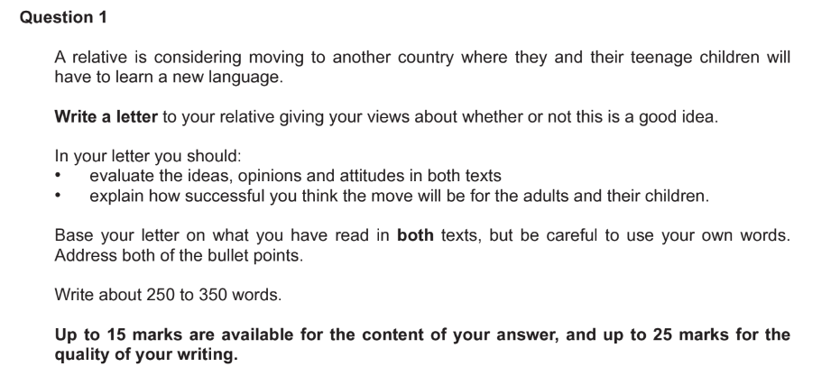
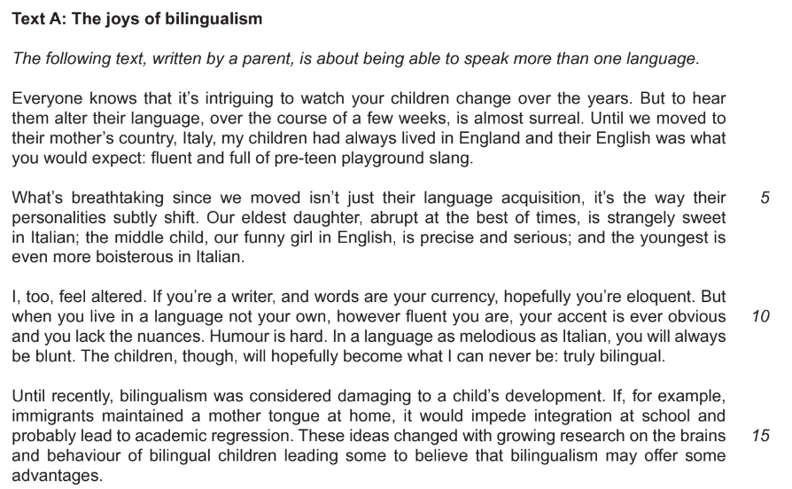
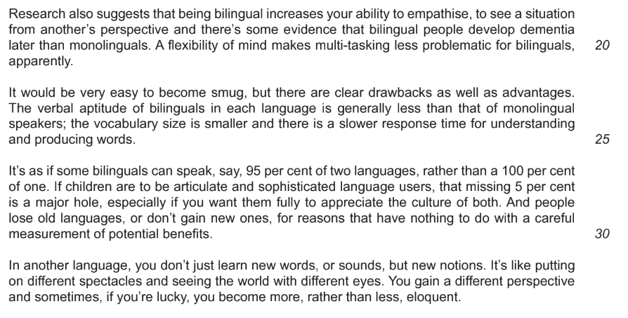
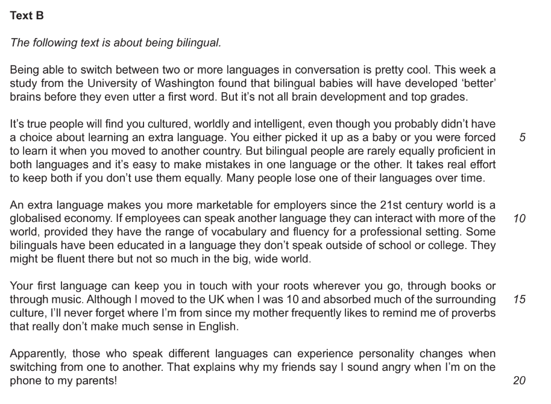

# Question 1 Model Answer: Letter

**This revision note is for exams in 2026. If you are sitting your exam from 2027, please switch to the 'First exams 2027' syllabus edition.**

## Question 1 Model Answer: Letter

> **Spec point** — `spcpt_kFRYSyZ73pZbnHFs`

## Question 1 Model Answer: Letter

For this task, you will be asked to produce a piece of writing in a particular format, based on the opinions, ideas and information you are presented with in one or two reading passages. You may be asked to write in one of three possible formats (genres):

- A letter
- A speech
- An article

The following guide will demonstrate how to answer Question 1 in the format of a **letter**. The task itself is taken from a past exam paper.

## Addressing the reading assessment objectives

> **Spec point** — `spcpt_jzBmDjcgXVKcrmYM`

## Addressing the reading assessment objectives

Up to 15 marks are available in this task for your ability to evaluate both the explicit and implied ideas, opinions and attitudes expressed in one or two texts, and assimilate them to write a developed and sophisticated response.

Let’s take a look at how you do this, using the following Question 1 example:

Your response here has to be based on the ideas, opinions and attitudes contained in the following two texts:

After carefully reading the task, you should read the texts and highlight the ideas and opinions that could inform your writing. Your response might use the following ideas from these texts:

**Text A:**

- “Pre-teens” pick up a new language quickly
- New languages can change young people’s personalities
- Picking up on nuance and being able to express humour in a new language is hard
- Arguably, true bilingualism is not possible
- Accents are always obvious
- Attitudes to bilingualism have changed with research
- Bilingualism can help with empathy and help people to see different perspectives
- There is some evidence that bilingualism could protect against dementia and makes our minds more flexible
- But it can make people less articulate/developed in both languages
- Bilingualism can be very enriching and help you to become more eloquent

**Text B:**

- Gaining a second language is not always a choice
- It can make you a more interesting person
- Bilingual people are rarely equally proficient in both languages and it is easy to make mistakes
- Languages can be lost without effort
- Being able to speak an extra language can make you more employable
- It is not always possible to be fluent in more than one context
- Retaining your first language helps you keep your link to your culture
- Switching from one language to another can lead to personality changes

## Planning your response

> **Spec point** — `spcpt_YJdfPkFy9z7q8RWn`

## Planning your response

Once you have read the text(s), identified relevant opinions, ideas and attitudes and bullet-pointed these in your own words, you should then spend five minutes planning your written response. When planning:

- Decide on your “voice” and point of view
- Write a statement that summarises your point of view, based on your reading
- Note down which points you can develop that support your point of view in your first paragraph
- Decide if you are going to make a counter-argument, and note down which points you can develop to support this
- Return to your main argument, ensuring that you have included ideas and opinions from both texts (if more than one)
- Note down the points you can make to address the second bullet point in the task
- Note down how you are going to start and finish your response, ensuring that it establishes the correct style and tone

## Letter model answer

> **Spec point** — `spcpt_xNhywTcnb9MccG47`

## Letter model answer

The following model answer demonstrates a top-mark response to the above task:

> **Worked Example**
> Dear Auntie Ruth,
> 
> *It was lovely to hear from you. Your potential move to France sounds like a thrilling adventure, though we would naturally miss Luke and Harry terribly!*
> 
> *I have been doing some research, and I must be honest about my concerns.* Achieving fluency is significantly harder as we get older. Since the boys are teenagers, they may struggle to integrate at school; I would hate for them to feel isolated because their accents mark them out as different. *Professionally, you may also face hurdles; missing linguistic nuances like tone can easily lead to workplace confusion. *There is also a risk that if the boys adapt faster than you, it could create a frustrating distance within the family.
> 
> *That said, the benefits are undeniable*. Viewing the world through a different cultural lens is enriching, and bilingualism is a fantastic employability skill. I even read that it can help prevent dementia in later life!
> 
> However, you must weigh this against the potential loss of identity. Making constant mistakes can leave you feeling like an outsider. *More importantly, there is a genuine danger of severing the link to your own culture.* You do not want to become "interesting" to others at the expense of losing who you really are.
> 
> *Please think this through carefully.* While I admire the ambition, I worry that the struggle to be articulate in a new language might prove too high a price for your family’s happiness.
> 
> Whatever you decide, I wish you all the best!
> 
> Take care,
> 
> Nadia

## Commentary

> **Spec point** — `spcpt_vRvfM7Js2RY8mGhQ`

## Commentary

- The greeting and tone are appropriate for a letter to a relative
- The introduction demonstrates an understanding of the purpose of the task
- The second paragraph develops ideas and opinions mainly from Text A, and establishes a point of view
- Although the letter is informal, the vocabulary is sophisticated
- The third paragraph acknowledges a counter-argument, using ideas from both texts
- The fourth paragraph returns to the main argument, using ideas mainly from Text B
- Punctuation is used deliberately to emphasise the more friendly tone
- The final paragraph explicitly addresses the second bullet point in the task
- Persuasive devices are used to add weight to the argument
- Style and tone are maintained throughout, with an appropriate sign off
- Spelling, grammar and punctuation are accurate throughout

> **Exam Hint**
> The suggested word count for this task is a guide, and you are not penalised for writing under or over 250-350 words. However, writing too little can mean that your answer does not have enough development or detail. Writing too much can mean that you go off topic and lose focus, which again can be self-penalising. It is therefore a good idea to stick as closely as you can to the word count guidance.
> 
> You can find further guidance on suggested word counts for CIE [here](https://help.cambridgeinternational.org/hc/en-gb/articles/20633569448466-How-strict-is-the-word-count-in-each-component).

## Summary

> **Spec point** — `spcpt_zhGHfqDwsGtMjghW`

## Summary

- Remember to read the question carefully and highlight:

  - What you are writing, who you are writing to and why you are writing
  - The focus of each bullet point
- Read the text(s) and highlight the relevant information that could be developed in your answer
- Bullet-point this information in your own words
- Plan your writing, focusing on one main idea or opinion per paragraph
- Address each bullet point in order:

  - Make sure you cover all of the bullet points as equally as possible
- Decide on the voice and style you want to create and maintain that in your answer
- Do not just repeat details from the text(s):

  - You need to evaluate and develop the ideas, opinions and attitudes in the text(s) - you are not summarising them
