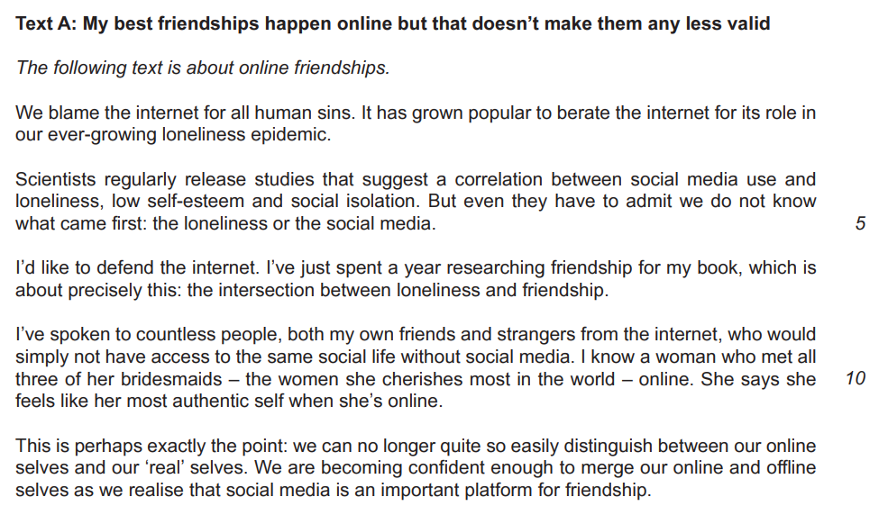
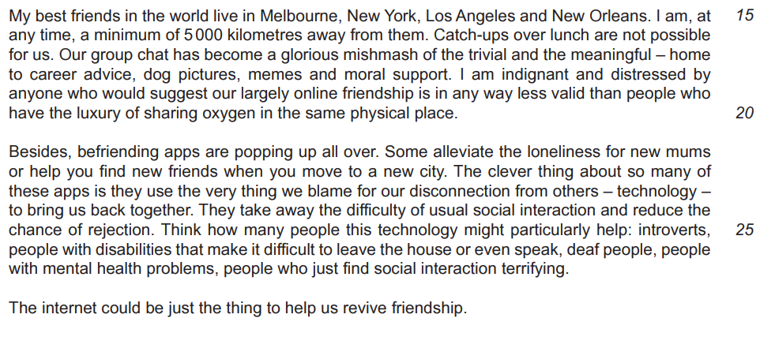
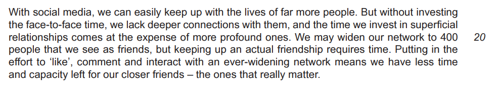
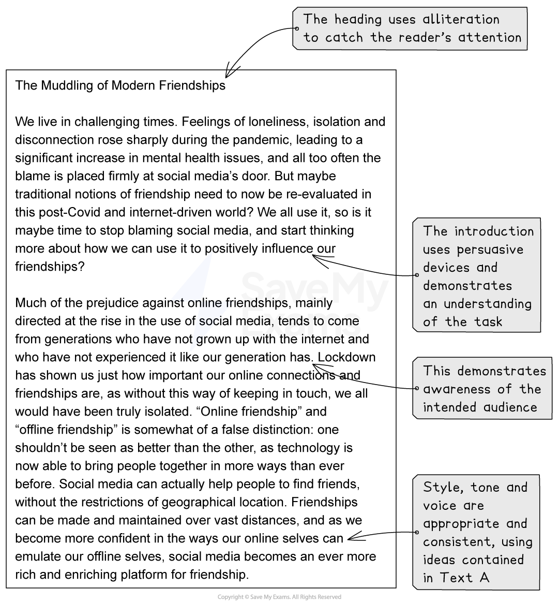
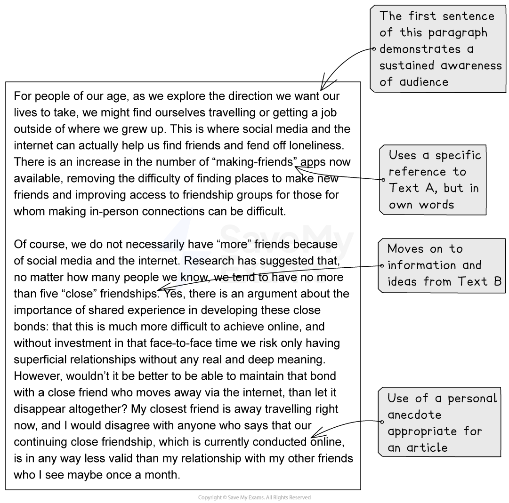
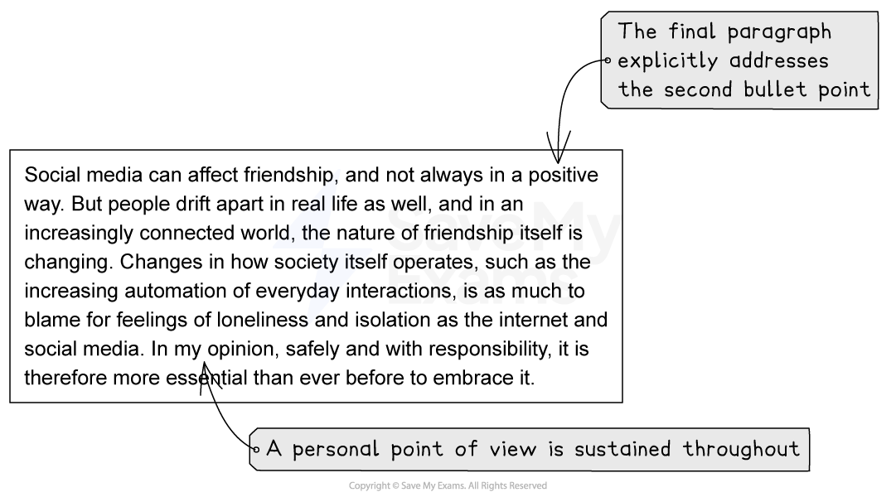

# Model Answer: Article

**This revision note is for exams in 2026. If you are sitting your exam from 2027, please switch to the 'First exams 2027' syllabus edition.**

## Model Answer: Article

> **Spec point** — `spcpt_vjR7NV8mcy8HDxcB`

## Model Answer: Article

For this task, you will be asked to produce a piece of writing in a particular format, based on the opinions, ideas and information you are presented with in one or two reading passages.

The following guide will demonstrate how to approach this task in the format of an **article**. While the task itself is taken from a past exam paper, it is important to note that in your coursework portfolio you are *not permitted to use texts or tasks from exam papers*. However, we have included this example in order to demonstrate the skills required in order to achieve a top-mark piece of work.

## Addressing the reading assessment objectives

> **Spec point** — `spcpt_b2jgFHyjVrxPq5pJ`

## Addressing the reading assessment objectives

Up to 15 marks are available in this task for your ability to evaluate both the explicit and implied ideas, opinions and attitudes expressed in one or two texts, and assimilate them to write a developed and sophisticated response.

Let’s take a look at how you do this, using the following two texts:

To begin with, you should read the texts and highlight the ideas and opinions that could inform your writing. Your response might use the following ideas from these texts:

**Text A:**

- The internet is blamed for everything without reason
- Loneliness, low self-confidence and social isolation are linked to social media, but it is not really known in what way
- The internet can make people less lonely, not more
- People can build meaningful connections over the internet
- Social media can help people find friends and develop a social life
- You can be yourself on the internet as well as in person - our online and real-life [personas](https://www.savemyexams.com/glossary/gcse/english-literature/persona-definition/) are being merged
- Online friendships can be made across vast distances
- Talking and friendships online can be just as rich and as valid as in-person ones
- Befriending apps are now increasingly available
- Some people will find it easier to make friends online

**Text B:**

- Research shows how important real friendship is to people
- We are genetically wired to make a small number of close friends even in larger social groups
- Even though we now have the internet to help us maintain friendships across expanding distances, we don’t actually have more friends with social media
- The nature of friendship is changing
- Shared experience in real life is essential for strong friendships
- Deeper connections take more effort than being online

## Assignment 1 task

> **Spec point** — `spcpt_QGYs4FVCsYTgVxFg`

## Assignment 1 task

In response to the above texts, a possible Assignment 1 task wording would be:

*“Write a magazine article for young people about modern friendship.*

*Base your article on what you have read in both texts.”*

## Article model answer

> **Spec point** — `spcpt_krN473chGMpVT9xP`

## Article model answer

The following model answer demonstrates a top-mark response to the above task:

## Unannotated model answer

> **Spec point** — `spcpt_jFtzyVz5pnhFgYZK`

## Unannotated model answer

| The Muddling of Modern Friendships  We live in challenging times. Feelings of loneliness, isolation and disconnection rose sharply during the pandemic, leading to a significant increase in mental health issues, and all too often the blame is placed firmly at social media’s door. But maybe traditional notions of friendship need to now be re-evaluated in this post-Covid and internet-driven world? We all use it, so is it maybe time to stop blaming social media, and start thinking more about how we can use it to positively influence our friendships?  Much of the prejudice against online friendships, mainly directed at the rise in the use of social media, tends to come from generations who have not grown up with the internet and who have not experienced it like our generation has. Lockdown has shown us just how important our online connections and friendships are, as without this way of keeping in touch, we all would have been truly isolated. “Online friendship” and “offline friendship” is somewhat of a false distinction: one shouldn’t be seen as better than the other, as technology is now able to bring people together in more ways than ever before. Social media can actually help people to find friends, without the restrictions of geographical location. Friendships can be made and maintained over vast distances, and as we become more confident in the ways our online selves can emulate our offline selves, social media becomes an ever more rich and enriching platform for friendship.  For people of our age, as we explore the direction we want our lives to take, we might find ourselves travelling or getting a job outside of where we grew up. This is where social media and the internet can actually help us find friends and fend off loneliness. There is an increase in the number of “making-friends” apps now available, removing the difficulty of finding places to make new friends and improving access to friendship groups for those for whom making in-person connections can be difficult.  Of course, we do not necessarily have “more” friends because of social media and the internet. Research has suggested that, no matter how many people we know, we tend to have no more than five “close” friendships.  Yes, there is an argument about the importance of shared experience in developing these close bonds: that this is much more difficult to achieve online, and without investment in that face-to-face time we risk only having superficial relationships without any real and deep meaning. However, wouldn’t it be better to be able to maintain that bond with a close friend who moves away via the internet, than let it disappear altogether? My closest friend is away travelling right now, and I would disagree with anyone who says that our continuing close friendship, which is currently conducted online, is in any way less valid than my relationship with my other friends who I see maybe once a month.  Social media can affect friendship, and not always in a positive way. But people drift apart in real life as well, and in an increasingly connected world, the nature of friendship itself is changing. Changes in how society itself operates, such as the increasing automation of everyday interactions, is as much to blame for feelings of loneliness and isolation as the internet and social media. In my opinion, safely and with responsibility, it is therefore more essential than ever before to embrace it. |
|---|

**Commentary:**

- The heading uses alliteration to catch the reader’s attention
- The introduction uses persuasive devices and demonstrates an understanding of the task
- The answer demonstrates awareness of the intended audience, which is sustained throughout
- Style, tone and voice are appropriate and consistent, using ideas contained in Text A and Text B
- Any specific references to ideas or opinions in the text are put in the candidate’s own words
- The use of a personal anecdote is appropriate for an article
- The final paragraph explicitly addresses the second bullet point in the task
- A personal point of view is sustained throughout
- Spelling, grammar and punctuation are accurate throughout
