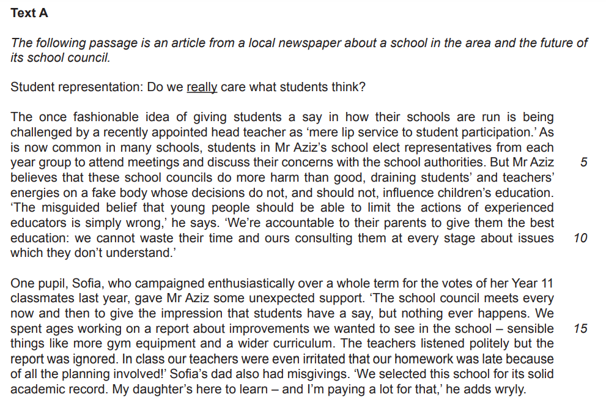
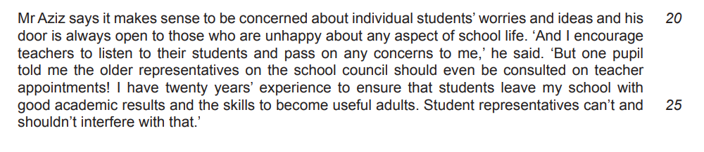
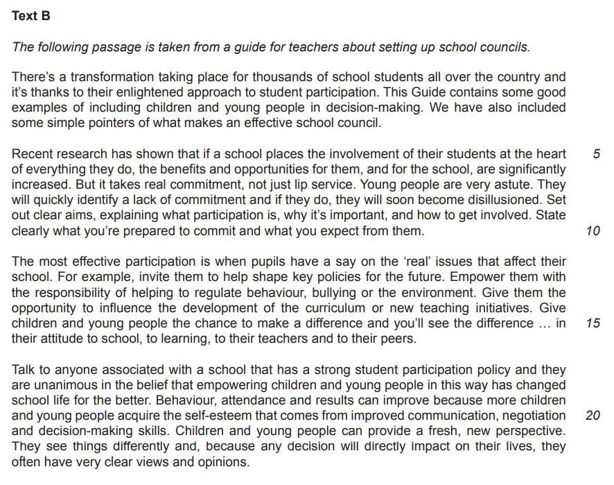
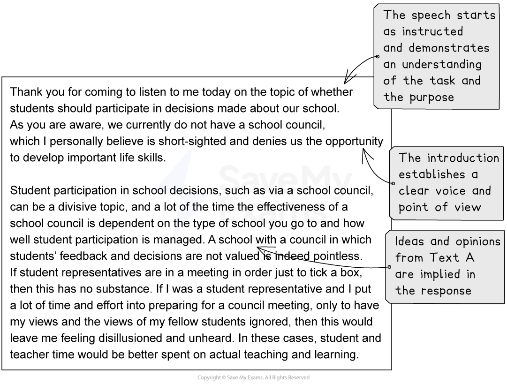
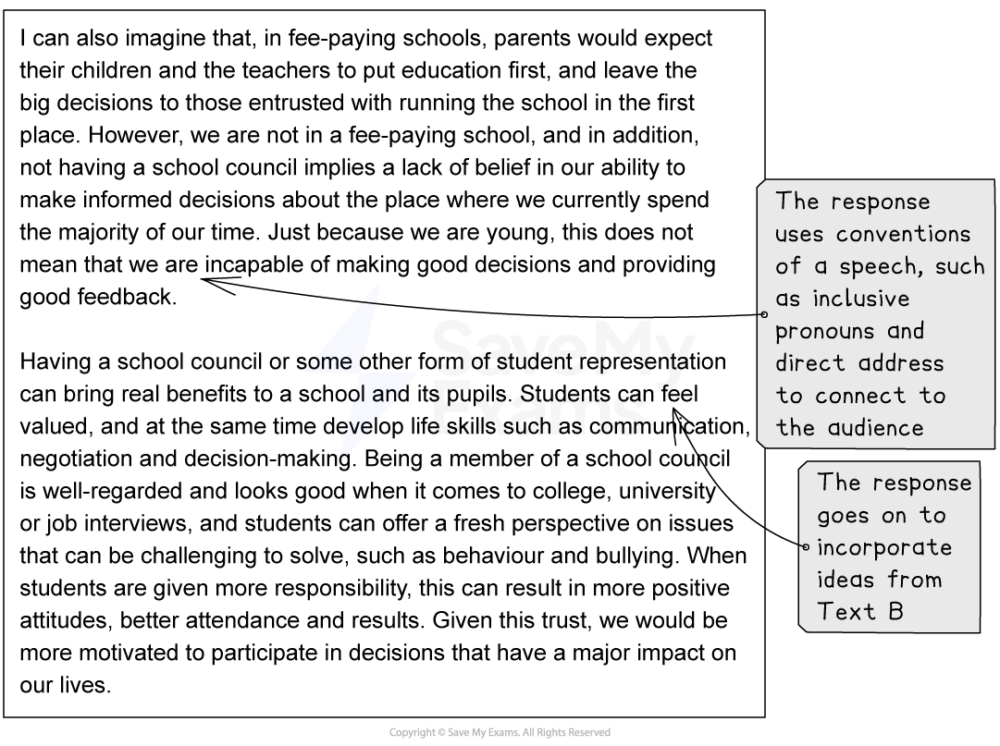

# Model Answer: Speech

**This revision note is for exams in 2026. If you are sitting your exam from 2027, please switch to the 'First exams 2027' syllabus edition.**

## Model Answer: Speech

> **Spec point** — `spcpt_2yss2dYMj3fjKPV9`

## Model Answer: Speech

For this task, you will be asked to produce a piece of writing in a particular format, based on the opinions, ideas and information you are presented with in one or two reading passages.

The following guide will demonstrate how to approach this task in the format of a **speech**. While the task itself is taken from a past exam paper, it is important to note that in your coursework portfolio you are *not permitted to use texts or tasks from exam papers*. However, we have included this example in order to demonstrate the skills required in order to achieve a top-mark piece of work.

## Addressing the reading assessment objectives

> **Spec point** — `spcpt_V4hh2DpGM6hzf5GM`

## Addressing the reading assessment objectives

Up to 15 marks are available in this task. You are assessed on your ability to evaluate both the explicit and implied ideas, opinions and attitudes expressed in one or two texts, and assimilate them to write a developed and sophisticated response.

Let’s take a look at how you do this, using the following two texts:

To begin with, you should read the texts and highlight the ideas and opinions that could inform your writing. Your response might use the following ideas from these texts:

**Text A:**

- Student representation was “once fashionable”, but it may just be a passing fad
- School councils take up too much time and energy from schools and teachers when they have more important things to be getting on with
- If student representation is fake or just to tick a box, then it has no substance, especially if views and ideas are not acted upon
- Teachers are accountable to parents and should put education first
- Even some students are disillusioned with the idea of student representation when nothing is acted upon, especially given the time and effort involved
- Experienced teachers should make decisions, not children - trust should be placed in the people appointed to run the school and deliver the education

**Text B:**

- An “enlightened” approach is needed to make school councils work and it takes real commitment
- Student participation is very popular and well regarded
- Student participation works when children are involved in “real” issues
- Students can take responsibility for difficult problems such as behaviour or bullying
- Participation can make a difference to students’ attitudes to school
- Attendance and results are improved by participation
- Students can learn important skills such as negotiation, communication and decision-making
- Students can have a fresh eye on issues
- Decisions made may have a major impact on them, so students are motivated to participate

## Assignment 1 task

> **Spec point** — `spcpt_FgtM6J7xP94nGDSN`

## Assignment 1 task

In response to the above texts, a possible Assignment 1 task wording would be:

*“Imagine you are a pupil in a school which does not have a school council.*

*Write a speech to be given in a school assembly, giving your views on whether or not students should participate in decisions made about the school. Base your speech on what you have read.”*

## Speech model answer

> **Spec point** — `spcpt_B4d8tJhwZs2wHqbd`

## Speech model answer

The following model answer demonstrates a top-mark response to the above task:

## Unannotated model answer

> **Spec point** — `spcpt_W4K7JbCXbxPsNbMd`

## Unannotated model answer

| Thank you for coming to listen to me today on the topic of whether students should participate in decisions made about our school. As you are aware, we currently do not have a school council, which I personally believe is short-sighted and denies us the opportunity to develop important life skills.  Student participation in school decisions, such as via a school council, can be a divisive topic, and a lot of the time the effectiveness of a school council is dependent on the type of school you go to and how well student participation is managed. A school with a council in which students’ feedback and decisions are not valued is indeed pointless. If student representatives are in a meeting in order just to tick a box, then this has no substance. If I was a student representative and I put a lot of time and effort into preparing for a council meeting, only to have my views and the views of my fellow students ignored, then this would leave me feeling disillusioned and unheard. In these cases, student and teacher time would be better spent on actual teaching and learning.  I can also imagine that, in fee-paying schools, parents would expect their children and the teachers to put education first, and leave the big decisions to those entrusted with running the school in the first place. However, we are not in a fee-paying school, and in addition, not having a school council implies a lack of belief in our ability to make informed decisions about the place where we currently spend the majority of our time. Just because we are young, this does not mean that we are incapable of making good decisions and providing good feedback.  Having a school council or some other form of student representation can bring real benefits to a school and its pupils. Students can feel valued, and at the same time develop life skills such as communication, negotiation and decision-making. Being a member of a school council is well-regarded and looks good when it comes to college, university or job interviews, and students can offer a fresh perspective on issues that can be challenging to solve, such as behaviour and bullying. When students are given more responsibility, this can result in more positive attitudes, better attendance and results. Given this trust, we would be more motivated to participate in decisions that have a major impact on our lives.  As part of my preparation for this speech, I read a guide for teachers on setting up school councils, and while some ambitious claims were made about their benefits, I wonder how realistic the guide is when considering the amount of time and commitment a school council requires from both students and teachers. The guide only promoted the benefits, and while I believe that we do need student representation in this school, I do think it has to be balanced and well-considered. I think the most effective type of participation is one in which pupils have a say on the real issues that affect our school, and where we have the opportunity to shape key policies for the future. This enlightened approach, however, should not just be rushed into. For this to work in our school it will take real commitment, with real benefits attached for both students and teachers alike. Ultimately, I believe that we should be trusted with the responsibility in shaping the course of our own education, and a school council would be one of the ways in which we can do this.  Thank you for listening. |
|---|

**Commentary:**

- The speech starts as instructed and demonstrates an understanding of the task, its purpose and intended audience
- The introduction establishes a clear voice and point of view
- Ideas and opinions from both texts are implied in the response
- The response uses conventions of a speech, such as inclusive pronouns and direct address, to connect to the audience
- The argument is sustained throughout
- Spelling, grammar and punctuation are accurate
