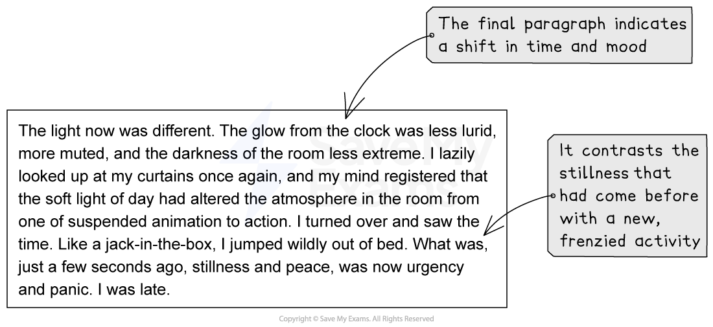

# Model Answer: Descriptive Writing

**This revision note is for exams in 2026. If you are sitting your exam from 2027, please switch to the 'First exams 2027' syllabus edition.**

## Model Answer: Descriptive Writing

> **Spec point** — `spcpt_kdKkqmstQ5DpYTMy`

## Model Answer: Descriptive Writing

Assignment 2 of your coursework portfolio is the descriptive writing assignment. The following guide will provide you with a descriptive writing model answer.

## Planning your descriptive writing

> **Spec point** — `spcpt_4P7GBmvRRFrnYXYK`

## Planning your descriptive writing

Let’s take this descriptive writing task as an example of what you could respond to for your coursework:

***“Describe trying to sleep before an important day.”***

We can use the “panoramic, zoom, single line, shift, shift, panoramic” six-step structure to plan our response:

| **Stage** | **Suggested techniques and details** |   |
|---|---|---|
| **Step 1** | **Panoramic** | - Introduce [motif](https://www.savemyexams.com/glossary/gcse/english-literature/motif-definition/) of clock - Dark outside, contrasting with light and stillness - Describe what I can hear and feel |
| **Step 2** | **Zoom** | - Focus on a fly - add movement and sound |
| **Step 3** | **Single line** | - Turn over/re-adjust bedding |
| **Step 4** | **Shift** | - Focus on what is going on in my mind - Use imagery to convey inner thoughts |
| **Step 5** | **Shift** | - Describe what can be heard outside in the street |
| **Step 6** | **Panoramic** | - Wake up - must have fallen asleep - Describe changes in light and atmosphere - Return to motif of clock - late |

## Descriptive writing model answer

> **Spec point** — `spcpt_Xxj7HdB6G2jzxwT5`

## Descriptive writing model answer

The following model answer demonstrates how to structure, and what to include in, a top-mark response to the above task:

## Unannotated model answer

> **Spec point** — `spcpt_xpCkJD3qhcGFhmzV`

## Unannotated model answer

| The soft glow from the digital display flickered as the minutes sluggishly passed. The pale green cast an eerie shadow across my bed, while outside was as dark as a raven’s pupil. The streetlight outside of the window had blown its bulb and towered, redundantly, over the pavement. Nothing moved, apart from me, anxiously turning and fidgeting my blankets into a tangle. I heard a faint hum from downstairs; the sound of the dishwasher automatically starting, churning and rumbling the plates from dinner until they sparkled. My mind churned like the machine, impossible to turn off now it had started. I checked the clock again. The night felt endless.  I shuffled over to turn on the light. Silhouetted against the inside of a shade, a fly lazily crept to the top, balancing on the rim like a tiny tightrope walker. I watched as it fluttered its wings slightly, before it took off in a frenzy of buzzing around the top of my bed, going nowhere in particular. I wondered what its purpose was. Why was it here? It hummed close to my face and I swatted it away gruffly. It landed back on the rim, satisfied with its little flurry of activity, as I reached over to turn off the light again.  I straightened out my blankets and turned again.  The clock’s mechanical glow informed me that only a few minutes had passed. I sighed and attempted to still my mind. I had numbers, facts and figures spiralling down a rabbit hole in my mind, becoming jumbled and muddled. I could see the dim outlines of my post-it notes, meticulously written and ordered, with all of the information I could ever need neatly written in my careful handwriting. But now all of that order had turned to chaos, as I struggled to remember even the simplest of equations. I needed to get some sleep, but my brain point-blank refused to let me.  Outside, I heard the sudden honking of a horn and a dog’s incessant barking. Voices muffled by wall and curtain were just about audible, sounding like they were being spoken through a thick soup of fog. A car door slammed; the dog’s barking became increasingly urgent. Voices raised again, before another slam and the roar of an engine increased and then faded out as the car disappeared down the street. The dog stopped barking and all was still once again. I stared at my curtains, considering whether to go downstairs to make myself a drink.  The light now was different. The glow from the clock was less lurid, more muted, and the darkness of the room less extreme. I lazily looked up at my curtains once again, and my mind registered that the soft light of day had altered the atmosphere in the room from one of suspended animation to action. I turned over and saw the time. Like a jack-in-the-box, I jumped wildly out of bed. What was, just a few seconds ago, stillness and peace, was now urgency and panic. I was late. |
|---|

**Commentary**

- The first paragraph employs contrast and literary techniques to establish an eerie atmosphere of the middle of the night
- The second paragraph zooms in on detail and incorporates movement
- A single sentence is used for contrast and effect
- The motif of the clock is woven throughout the response
- The focus shifts to something “off camera”, using sensory language
- The final paragraph indicates a shift in time and mood
- It contrasts stillness with activity

## Summary

> **Spec point** — `spcpt_R9yYWHqSjdQJm9Mk`

## Summary

- Remember, you are not writing a story, so think of describing a scene as though from behind the lens of a camera
- Employ sensory language, shifts in perspective, [figurative language](https://www.savemyexams.com/glossary/gcse/english-literature/figurative-language-definition/) and contrasts to add interest and detail to your writing
- Do not include dialogue
- Vary your sentence and paragraph lengths
- Make sure you add movement to your description
