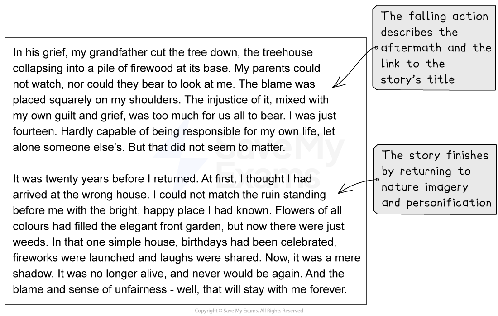

# Model Answer: Narrative Writing

**This revision note is for exams in 2026. If you are sitting your exam from 2027, please switch to the 'First exams 2027' syllabus edition.**

## Model Answer: Narrative Writing

> **Spec point** — `spcpt_cQMZYQmQ3Jn3KwbK`

## Model Answer: Narrative Writing

For your IGCSE English Literature coursework you need to complete three assignments, and Assignment 3 is the narrative writing assignment. The following guide will provide you with a narrative writing model answer.

## Planning your narrative writing

> **Spec point** — `spcpt_Y5Hpc858knndYJZR`

## Planning your narrative writing

Let’s take this narrative writing task as an example of a suitable task for Assignment 3:

***‘Write a story which involves an injustice.’***

We can use a five-part narrative structure to plan our response:

| **Step 1** | [Exposition](https://www.savemyexams.com/glossary/gcse/english-language/exposition-definition/)**/setting** | - A house that nobody has lived in for a long time - Atmosphere is silent and uncared for |
|---|---|---|
| **Step 2** | [Rising action](https://www.savemyexams.com/glossary/gcse/english-language/rising-action/) | - Background information - grandparents’ house - Light, laughter and joy - Narrator and sister playing in a treehouse |
| **Step 3** | **Climax** | - Accident involving the narrator’s sister - Narrator gets the blame |
| **Step 4** | [Falling action](https://www.savemyexams.com/glossary/gcse/english-language/falling-action/) | - Aftermath - leave the house and return to the city - Family crumbles |
| **Step 5** | **Resolution** | - Present day - narrator returns to the house |

## Narrative writing model answer

> **Spec point** — `spcpt_Dr8B7FVkZVVSQ94G`

## Narrative writing model answer

The following model answer demonstrates how to structure, and what techniques to include in, a top-mark response to the above task:

## Unannotated model answer

> **Spec point** — `spcpt_xWdHzrzvJWC3jPzR`

## Unannotated model answer

| The house had been the epitome of life and joy, and yet it was now dead. It was merely a shadow of its former glory, for the house was no longer alive, and never would be again.  Sunlight no longer danced through the windows and sounds of laughter were no longer heard; all that was left were the remains of a long since dead house. Cobwebs littered the wooden slats and broken walls. Dusty light-fittings stared down miserably at a table that would never again be laden with food and fun, and chairs that had not been warm for years stood redundantly, forgetful of their original purpose. As I stood in the hallway, the quiet crept through the empty rooms towards me, mocking me with its oppressive silence.  The house was not always dead. I can wistfully recall all of my visits to this once beautiful place. Every summer holiday, my parents brought me to this house, where my grandparents lived, and their parents before them. Living in the city, I urged for this escape: my summers spent in nature were filled with joy and laughter. The bright sunshine, the gentle winds and the peace that had been introduced to me in this wonderful place were the things I now treasured. My sister and I would spend hours climbing the trees surrounding the house, building dens and having endless adventures, before returning, wild and weary, for our family meal and the analysis of the day. Our favourite spot was our treehouse, lovingly made by my grandfather and decked out by my grandmother with cushions, toys and books. There was a ladder for climbing up and a rope to swing down. My sister, not as confident at climbing as me, was only allowed to climb up and swing down under my supervision.  But one summer I had grown weary of supervising her. I wanted some time alone, to listen to music, mope about and generally be a teenager. My sister became a pest; a fly to be regularly swatted away with an irritated flick of my hand. I resented having to be the responsible older brother. That was why I was slouched on the sofa with my headphones on when my mother rushed past me, swiftly followed by my grandparents. The sun was still bright; the wind still gently grazed the trees, but now it was different. One moment, without supervision, and a slip of a foot meant that our favourite tree would never be scaled again.  In his grief, my grandfather cut the tree down, the treehouse collapsing into a pile of firewood at its base. My parents could not watch, nor could they bear to look at me. The blame was placed squarely on my shoulders. The injustice of it, mixed with my own guilt and grief, was too much for us all to bear. I was just fourteen. Hardly capable of being responsible for my own life, let alone someone else’s. But that did not seem to matter.  It was twenty years before I returned. At first, I thought I had arrived at the wrong house. I could not match the ruin standing before me with the bright, happy place I had known. Flowers of all colours had filled the elegant front garden, but now there were just weeds. In that one simple house, birthdays had been celebrated, fireworks were launched and laughs were shared. Now, it was a mere shadow. It was no longer alive, and never would be again. And the blame and sense of unfairness - well, that will stay with me forever. |
|---|

**Commentary**

- The first paragraph uses personification to set the scene
- The story then shifts to the past, with ambitious word choices
- The climax of the story indicates a shift in tone, with indirect characterisation used to make it believable
- Nature imagery is repeated throughout the story
- The falling action describes the aftermath and links to the focus of the story’s title: “injustice”
- The story finishes by returning to nature imagery and personification

## Summary

> **Spec point** — `spcpt_RczshNQmp6sMSvHz`

## Summary

- Remember, plan the order and the “flow” of your story
- Stick to one setting and no more than two main characters
- Vary your sentence and paragraph lengths
- Employ imagery and literary devices to bring your story to life
- Use [indirect characterisation](https://www.savemyexams.com/glossary/gcse/english-language/indirect-characterisation/) to make your characters realistic and believable
- Consider your story as a “scene” in a film:

  - It is not necessary to know everything about your characters
  - It is better to immerse the reader with vivid “showing” techniques, such as sensory imagery and interesting vocabulary, rather than “telling” them with direct description and [characterisation](https://www.savemyexams.com/glossary/gcse/english-literature/characterisation-definition/)
- Write with technical accuracy
