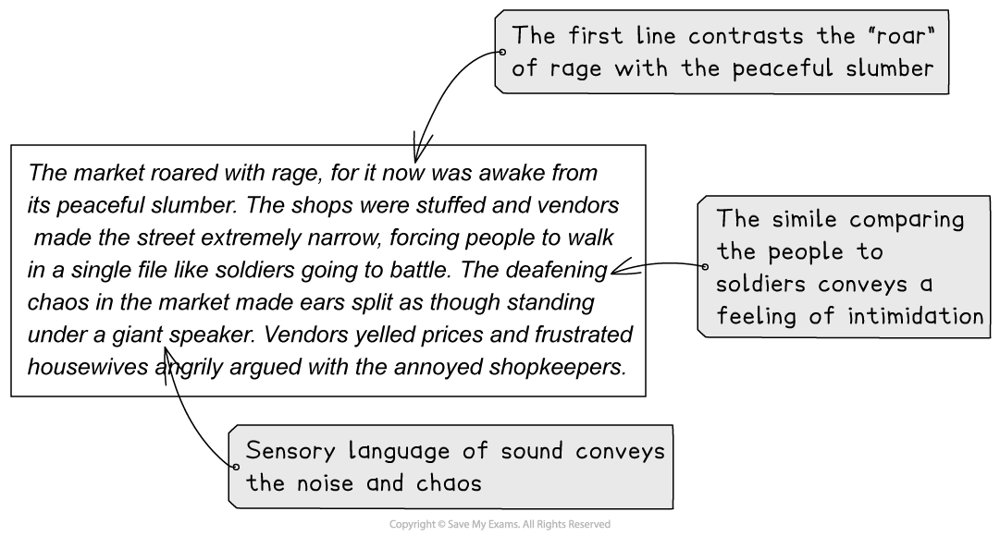

# Assignment 2: Descriptive Writing

**Assignment 2** of your coursework portfolio is a piece of descriptive writing. To get the highest marks, you are required to develop ideas and images which create a convincing and well-defined picture with varieties of focus.

The following guide will provide you with the information you need to complete **Assignment 2**. It includes:

- An overview of Assignment 2
- Examples of Assignment 2
- How to write to describe
- Top tips

## Assignment 2 overview

> **Spec point** — `spcpt_kN55gbdW8gxDZn37`

## Assignment 2 overview

In this assignment you are assessed on your **writing skills only**, and your piece of writing should be between **500 and 800 words** in length.

There are **10 marks** available for **content and structure**, and **15 marks** available for **style and accuracy**, as follows:

| **Content and structure (10 marks)** | **Style and accuracy (15 marks)** |
|---|---|
| - The writing contains many well-defined and developed ideas and images which create a convincing overall picture with varieties of focus | - The writing contains precise, well-chosen vocabulary and varied sentence structures chosen for effect - Language and tone are suitable for the context - Spelling, punctuation and grammar are almost always accurate |

Remember, in descriptive writing, your aim is to enable the reader to **picture what you are describing** in their minds. You are not writing a story, but descriptive writing can include thoughts and feelings, a sense of place and atmosphere and changes in perspective and time.

## Assignment examples

> **Spec point** — `spcpt_YXgNTrpVW4QyttKJ`

## Assignment examples

You may be asked to **describe a busy place**, such as a cafe, a market or a train station, or an important gathering or celebration.

Alternatively, you may be asked to **describe a moment when time stands still**, or a **natural event** such as a sunrise or sunset.

What is important is that your **description is not static**, and better responses tend to be those based on personal experience.

## How to write to describe

> **Spec point** — `spcpt_6vtyysY4nr5F6f6J`

## How to write to describe

Descriptive writing is **observational writing**. This means that the narrator does not interact with their surroundings, or other characters. In fact, no characters are crafted. Descriptive writing is like imagining you are behind the lens of a camera, describing a “snapshot” of a moment.

However, this does not mean that the scene you are describing is static; it is important to note the movements and action you “witness”.

Below is a suggested step-by-step structure for a piece of descriptive writing, including the techniques to use during each of the six steps:

| **Stage** | **Details of descriptive writing structure** |   |
|---|---|---|
| **Step 1** | **Panoramic** | - Broadly describe the scene - Introduce the time and atmosphere |
| **Step 2** | **Zoom** | - Focus your lens on one segment of the “image” - Choose smaller, less obvious details |
| **Step 3** | **Single line** | - Emphasise the key feeling of your description in one line |
| **Step 4** | **Shift** | - Focus your lens on another segment of the “image” - If you started in the foreground, then move to something in the background |
| **Step 5** | **Shift** | - Now move your lens to a final segment of the “image”, or suggest something that is just “off camera” |
| **Step 6** | **Panoramic** | - Zoom out again to look at the scene from a new perspective - How has it changed? Time? Atmosphere? Mood? |

Remember, you *can* include action or movement in your description, but this should not involve any interaction with other characters or settings in your piece of writing. It’s also important that any action or movement you include doesn’t move the “plot” along: a description must not include any story progression. Any action should only cover a short period of “real time”, such as the wind blowing a basket over. Something seemingly inconsequential could move in the background, which is especially effective if you contrast this with things that remain still.

Your paragraphs should be appropriately linked, but should vary in terms of length and structure. Variety and accuracy are key; you are bringing a scene to life for your reader, so they should be able to picture it, hear it, even smell it!

### Tone

When creating a piece of descriptive writing you should attempt to **match** your **tone of voice** with the **mood of the scene**. This means that your **sentences** should **reflect** the **atmosphere**. For example, if the scene is mysterious and frightening, your sentences should reflect this suspenseful mood.

In order to craft a** **tone in keeping with the mood of your description, consider how you can use sentence lengths and types:

- Short sentences reflect tension and unease, e.g. “No sound could be heard.”
- Longer sentences and listing can create a sense of being overwhelmed, or of abundance, e.g. “The market was laden with apples, grapes, oranges, loaves of bread, chunks of cheese and every type of vegetable one could imagine.”

### Style and register

The **style** of your descriptive writing is closely related to the language you use. For example, in a descriptive writing response, the best answers show evidence of **careful word choice** and the deliberate but judicious use of linguistic techniques.

Descriptive writing helps the reader to **visualise** the person, place, or situation being described. Your word choice and linguistic techniques should conjure a vivid, sensory impression in the reader’s mind.

The best way to do this is to:

- Use **vocabulary** that is **useful** to the reader:

  - For example, describing something as “brilliant” or “amazing” is not descriptive
  - Be specific and ambitious in your choice of adjectives
- Use *sensory language* to bring the scene to life:

  - Focus not just on what can be seen, but also what can be heard, smelled or felt
- Emphasise **key ideas** or **impressions** using **language techniques and imagery**:

  - For example, you could use a [simile](https://www.savemyexams.com/glossary/gcse/english-language/simile-definition/)** **to create associations about size or colour
  - [Personification](https://www.savemyexams.com/glossary/gcse/english-language/personification-definition/) is a useful technique when describing weather or objects
- Ensure you describe the important details:

  - For example, you do not need to describe every inch of a person or scene bit by bit; instead, focus on key features

When considering the detail you should include in your description, it is useful to consider the types of things that bring a scene to life. These things are normally rooted in **contrast**. For example:

| **Sound and silence** | - Noise contributes to the reality of a scene:    - Chatter, background noise, the weather or nearby wildlife all bring the scene to life - Using moments of silence can also be effective:    - A momentary lull, or a really purposeful moment of quiet |
|---|---|
| **Movement and stillness** | - Some things may move:    - This could be the main focus of your writing, or something in the background   - It could be human, animal or object — use personification   - Powerful verbs and adverbs can create dynamic movement in a piece of writing   - For example: “The swarming, struggling crowd.” - Other things will remain still:    - Try to focus on things that resist being moved, or whose stillness is in contrast with the movement of something   - Avoid clichés such as “still as a statue” |
| **Light and dark** | - There will be sources of light, so describe them:    - But also describe the way the light hits other things in your description - Where there’s light, there’s also darkness:    - Consider what shadows are cast or where the light does not reach   - Who, or what, is left in the darkness? |

> **Exam Hint**
> Keep using sensory language throughout, but adjust the focus and perspective as your paragraphs develop. Make sure you include description of movement and description of sound to craft a mood effectively.

Let’s consider the following example of an opening paragraph of a piece of descriptive writing:

## Top tips

> **Spec point** — `spcpt_64KxgHxnMvDGFdKq`

## Top tips

- Your description should be closely observed and **focused on imagery**:

  - Try to make use of more striking and original images, rather than relying on stereotypical ideas and images
- Ensure that all of the **words** you choose **contribute** to the **overall atmosphere and effect** you want to create
- Do **not** confuse tenses in a paragraph:

  - If you use a [flashback](https://www.savemyexams.com/glossary/gcse/english-language/flashback-definition/), ensure you have written it in the past tense
  - If you use present tense verbs for effect, then ensure you do this consistently
- Do **not** use dialogue in a descriptive writing piece:

  - Remember that descriptive writing also does not provide background information or develop character interaction
  - When describing people, you should focus on their body language or movements
- **Zoom in and out** of the image you are creating, as if you are behind a camera
- Include some **movement** to contrast and add interest
- Use *sensory language* to create a clear mood, but adjust the focus and perspective as your paragraphs develop:

  - Descriptive writing should include movement and sound, but the “narrator” should be a silent observer
- **Vary** your **sentence** and **paragraph lengths** to keep the style and tone dynamic
- It is effective to repeat ideas related to **colour**:

  - Consider picking out a key detail in order to do this, such as the colour of houses’ roofs
- Remember, this is not a story:

  - You do not need to provide a “happy ending”
