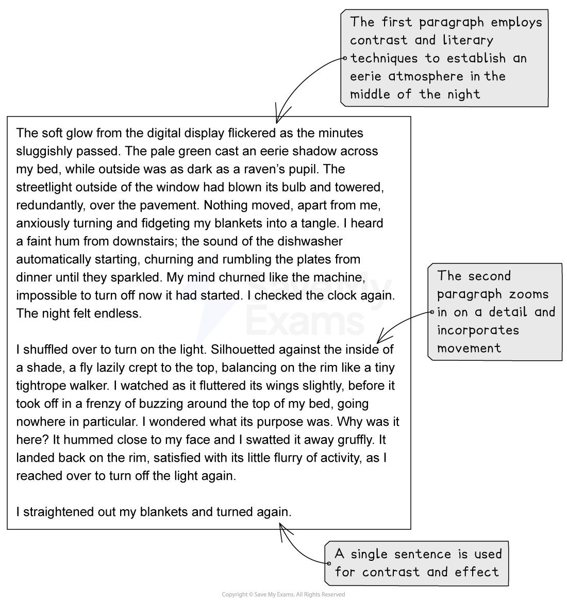
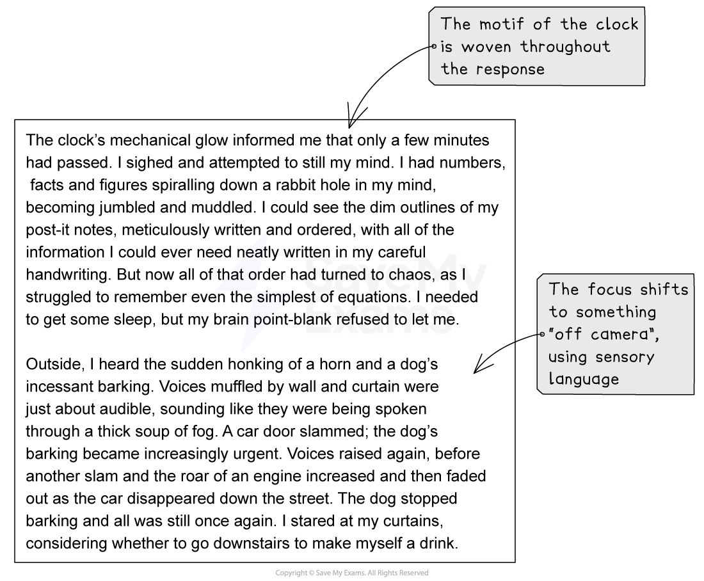

# Model Answer: Descriptive Writing

**Assignment 2** of your coursework portfolio is the **descriptive writing assignment**. The following guide will provide you with a descriptive writing model answer.

## Planning your descriptive writing

> **Spec point** — `spcpt_b4HTwsWPzyDR4SqM`

## Planning your descriptive writing

Let’s take this descriptive writing task as an example of what you could respond to for your coursework:

***“Describe trying to sleep before an important day.”***

We can use the “panoramic, zoom, single line, shift, shift, panoramic” six-step structure to plan our response:

| **Stage** | **Suggested techniques and details** |   |
|---|---|---|
| **Step 1** | **Panoramic** | - Introduce [motif](https://www.savemyexams.com/glossary/gcse/english-literature/motif-definition/) of clock - Dark outside, contrasting with light and stillness - Describe what I can hear and feel |
| **Step 2** | **Zoom** | - Focus on a fly — add movement and sound |
| **Step 3** | **Single line** | - Turn over/re-adjust bedding |
| **Step 4** | **Shift** | - Focus on what is going on in my mind - Use imagery to convey inner thoughts |
| **Step 5** | **Shift** | - Describe what can be heard outside in the street |
| **Step 6** | **Panoramic** | - Wake up —  must have fallen asleep - Describe changes in light and atmosphere - Return to motif of clock — late |

## Descriptive writing model answer

> **Spec point** — `spcpt_9tY6YWm4NNKcMNfF`

## Descriptive writing model answer

The following model answer demonstrates how to structure, and what to include in, a top-mark response to the above task:

**Commentary**

- The first paragraph employs contrast and literary techniques to establish an eerie atmosphere of the middle of the night
- The second paragraph zooms in on detail and incorporates movement
- A single sentence is used for contrast and effect
- The motif of the clock is woven throughout the response
- The focus shifts to something “off camera”, using sensory language
- The final paragraph indicates a shift in time and mood
- It contrasts stillness with activity

## Summary

> **Spec point** — `spcpt_nq7GVVs6W6f48Cqp`

## Summary

- Remember, you are not writing a story, so think of describing a scene as though from behind the lens of a camera
- Employ sensory language, shifts in perspective, [figurative language](https://www.savemyexams.com/glossary/gcse/english-literature/figurative-language-definition/) and contrasts to add interest and detail to your writing
- Do not include dialogue
- Vary your sentence and paragraph lengths
- Make sure you add movement to your description
