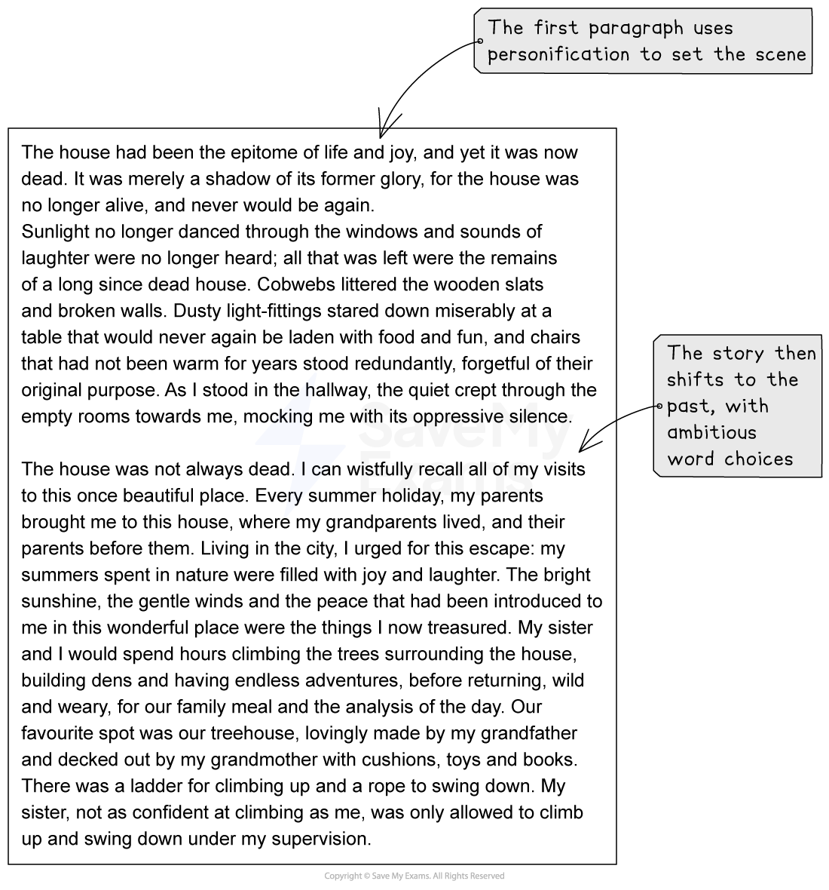
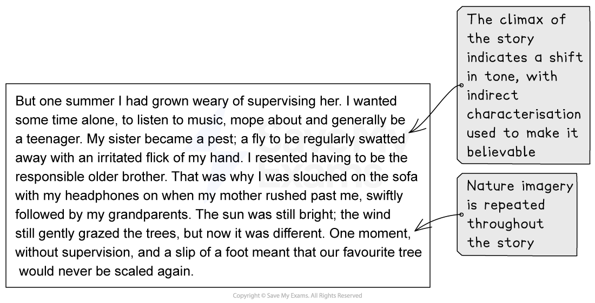

# Model Answer: Narrative Writing

For your IGCSE English Language coursework you need to complete three assignments, and **Assignment 3** is the **narrative writing assignment**. The following guide will provide you with a narrative writing model answer.

## Planning your narrative writing

> **Spec point** — `spcpt_RYwkcFMVpQT56YmX`

## Planning your narrative writing

Let’s take this narrative writing task as an example of a suitable task for Assignment 3:

***‘Write a story which involves an injustice.’***

We can use a five-part narrative structure to plan our response:

| **Step 1** | [Exposition](https://www.savemyexams.com/glossary/gcse/english-language/exposition-definition/)**/setting** | - A house that nobody has lived in for a long time - Atmosphere is silent and uncared for |
|---|---|---|
| **Step 2** | [Rising action](https://www.savemyexams.com/glossary/gcse/english-language/rising-action/) | - Background information — grandparents’ house - Light, laughter and joy - Narrator and sister playing in a treehouse |
| **Step 3** | **Climax** | - Accident involving the narrator’s sister - Narrator gets the blame |
| **Step 4** | [Falling action](https://www.savemyexams.com/glossary/gcse/english-language/falling-action/) | - Aftermath — leave the house and return to the city - Family crumbles |
| **Step 5** | **Resolution** | - Present day — narrator returns to the house |

## Narrative writing model answer

> **Spec point** — `spcpt_292m4p3QHm53YvSM`

## Narrative writing model answer

The following model answer demonstrates how to structure, and what techniques to include in, a top-mark response to the above task:

**Commentary**

- The first paragraph uses personification to set the scene
- The story then shifts to the past, with ambitious word choices
- The climax of the story indicates a shift in tone, with indirect characterisation used to make it believable
- Nature imagery is repeated throughout the story
- The falling action describes the aftermath and links to the focus of the story’s title: “injustice”
- The story finishes by returning to nature imagery and personification

## Summary

> **Spec point** — `spcpt_PRF8PKKrvsvHkPnR`

## Summary

- Remember, plan the order and the “flow” of your story
- Stick to one setting and no more than two main characters
- Vary your sentence and paragraph lengths
- Employ imagery and literary devices to bring your story to life
- Use [indirect characterisation](https://www.savemyexams.com/glossary/gcse/english-language/indirect-characterisation/) to make your characters realistic and believable
- Consider your story as a “scene” in a film:

  - It is not necessary to know everything about your characters
  - It is better to immerse the reader with vivid “showing” techniques, such as sensory imagery and interesting vocabulary, rather than “telling” them with direct description and [characterisation](https://www.savemyexams.com/glossary/gcse/english-literature/characterisation-definition/)
- Write with technical accuracy
