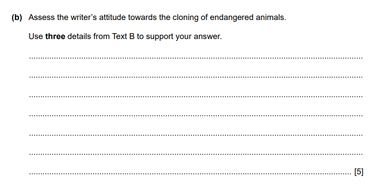

# How to Answer Question 2(b)

## Paper 1: How to answer Question 2(b)

> **Spec point** — `spcpt_4RKPRQc4TYwhgWnk`

## How to answer Question 2(b)

Paper 1: Reading is a **compulsory** exam for the Cambridge IGCSE First Language English, and examiners recommend that you complete the questions in the order they are set.

For exams from 2027, Question 2 is split into two tasks:

- Question 2(a) — a summary task
- Question 2(b) — writer’s attitudes and opinions

The following guide will provide you with the information you need to answer **Question 2(b)** to a high standard. It includes:

- An overview of Question 2(b)
- Breaking down the question
- Steps to success
- Exam tips

## Paper 1: Question 2(b): Overview

> **Spec point** — `spcpt_kwXJf9XdHQxDCHW8`

## Question 2(b): overview

- Source: **Text B**
- Marks: **5**
- Time: approximately **5-10 minutes**
- Skills tested:

  - Implicit meanings (R2)
  - Analyse/evaluate (R3)

## Paper 1: Question 2(b): Breaking down the question

> **Spec point** — `spcpt_WdwVVFz94GXbFwWr`

## Breaking down the question

This question tests you on your ability to understand a writer’s attitudes and opinions. The command word is likely to be “assess”, which means to make an **informed judgement**.

| **Assessment objective** | **What this means** |
|---|---|
| **R2:** demonstrate understanding of implicit meanings and attitudes | This asks you to work out what the writer is suggesting, hinting at, or feeling, even if they don’t say it directly |
| **R3:** analyse, evaluate and develop facts, ideas and opinions, using appropriate support from the text | This means using the text to build an argument. It involves taking facts and meanings from the text and doing something with them |

> **Exam Hint**
> If you are being assessed on R3, the most common mistake students make is simply “lifting” or copying information directly from the text. To get high marks for R3, you must do something *with* the information. Use the “So what?” test: if the text says “It was raining”, do not just write “It was raining”. You should develop it, such as: “The rain made the journey dangerous and miserable.”

Here is an example of Question 2(b):

It is important to **highlight the key information in the question**:

- What have you got to do?
- What have you got to focus on in the text?

You should do this **before** you begin scanning the text for your evidence.

## Paper 1: Question 2(b): Steps to success

> **Spec point** — `spcpt_Gjw2Q4RVmczNVjVv`

## Steps to success

Following these steps will give you a strategy for answering this question effectively:

1. **Read** the **question carefully** and **highlight**:

  - The **command words** (what you have to do):
  
    - Here it is “assess”
  - The **focus of the question** (what you have to look for in the text):
  
    - In the example above,  it is “the cloning of endangered animals”
  - Any other **instructions** you are given:
  
    - Here it is “use three details from Text B to support your answer”
2. **Scan Text B** and **highlight the evidence** that **answers the question**:

  - In the example above, that would be what the writer says about the cloning of endangered animals
3. **Identify** what the **writer feels** about the **question’s focus**:

  - To get full marks, you cannot simply list quotes
  - You must identify how the writer feels **and** support that feeling with a specific detail from the text
4. Use the **key words** from the **question** in your answer:

  - For example: “The writer’s attitude is that they are impressed by the science”
5. **Support each point** with **specific details** from Text B:

  - For example: “The writer’s attitude is that they are impressed by the science because they call it ‘amazing technology’ and an ‘incredible effort’”
6. State **how** this **specific detail supports** your **point**:

  - For example: “The use of positive adjectives shows admiration”

Remember, this is a **5-mark question**, so you should aim to spend no more than 5–10 minutes answering it. You will already be familiar with Text B by answering Question 2(a).

## Paper 1: Question 2(b): Exam tips

> **Spec point** — `spcpt_vzVkczFkt7G26qz3`

## Exam tips

- **Read** the **command words** and the **question carefully**:

  - This will allow you to demonstrate a thorough understanding of the requirements of the task
- The highest level of the mark scheme (Level 3) rewards candidates who demonstrate **clear understanding** of the **writer’s attitude** with **relevant support** from the text:

  - Demonstrating understanding is going beyond simply making a point along with a quote copied from the text
  - You need to *do* something with the quote
- Look for **words or phrases** in the text that give you a **clue** about what the **writer’s attitude** might be:

  - These might be adjectives, adverbs or emotive verbs (words that suggest conflict or strong feeling)
- Ensure you use **three separate pieces of evidence** in your answer, as the question specifically asks for “three details”
- Do **not** summarise:

  - This is not a summary task, so do not just retell what happens
- **Check** the **command word**:

  - If the question asks you to “assess”, ensure you are making a **judgement** about the writer’s view

For more advice on how to apply the skills required for success in this question, please see:

[Question 2(b) Skills: Supporting your Answer](https://www.savemyexams.com/igcse/english-language/cie/25/revision-notes/paper-1-reading/question-2/question-2b-skills-supporting-your-answer-/).

For a model answer to this question, please see [Question 2(b): Model Answer](https://www.savemyexams.com/igcse/english-language/cie/25/revision-notes/paper-1-reading/question-2/question-2b--model-answer/).
