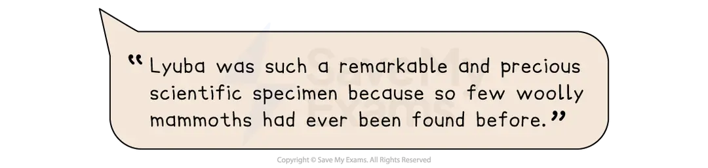

# Question 2(a) Skills: How to Summarise

Paper 1: Reading is a **compulsory** exam for the Cambridge IGCSE First Language English qualification, and examiners recommend that you complete the questions in the order they are set.

For exams from 2027, Question 2 is split into two tasks:

- Question 2(a) — a summary task
- Question 2(b) — writer’s attitudes and opinions

The sections below will explain what summarising is and how to summarise information effectively.

## What is summarising?

> **Spec point** — `spcpt_3tFrCnpc3qDv2ztF`

## What is summarising?

Summarising is an important literacy skill, useful not just for your IGCSE in English Language.

When you summarise, you are **expressing the most important facts or ideas** from a text in shortened form, **using your own words**.

A summary should effectively **explain all of the important information** in a text in a **clear and concise way**, taking only the information that is directly relevant and ignoring less important details.

The key elements of a summary are:

- *Objectivity*: a summary sticks to the facts and is unbiased
- *Concision*: a summary should condense the important information, leaving out unnecessary detail
- **Structure**: a summary should be well-organised, preferably in chronological order, so that it is as clear as possible
- **Accuracy**: the information provided in a summary needs to be correct and reliable

The summary you have to produce in your exam for Question 2(a) needs to get across the information the examiner requires in a clear and accurate way.

This means that you need to distinguish between the important information and the irrelevant information in the text.

However, while summarising as a skill normally allows direct [repetition](https://www.savemyexams.com/glossary/gcse/english-language/repetition-definition/) of the words in a text, for this task in the exam you are asked to **write in your own words** as far as possible. In this way, this task is actually a combination of summarising and *paraphrasing*, which means rearranging a text and putting it into your own words.

## How to summarise in the exam

> **Spec point** — `spcpt_93pVxfRdcrFMTRhT`

## How to summarise in the exam

To complete this task effectively in the exam, it is essential that you understand exactly **what** you are being asked to summarise.

Let’s consider what exactly you are being asked to summarise in this example from the June 2020 exam paper:

| **Exam question** | **What you need to do** |
|---|---|
| *According to Text B, what made Lyuba such a remarkable and precious scientific specimen ****and**** what did scientists hope to discover by studying her?* | Here, there are **two things** you are being asked to summarise:  - What made Lyuba such a remarkable and precious specimen - What scientists hoped to discover by studying her |

Once you have broken down the question, it is possible to go back to the text and **identify the information directly relevant** to the two bullet points above.

Working through the text in logical order will help you to structure your summary. Let’s look at how to do this, using the first three paragraphs of the text:

| **Text** | **Important information (relevant to the focus of the question)** |
|---|---|
| Only a handful have been found before. But none like her. Her name is Lyuba. A one-month-old baby mammoth, she walked the *tundra* about 40,000 years ago, then died mysteriously. Discovered on a riverbank in Siberia, she’s the most perfectly preserved woolly mammoth ever discovered. Lyuba has mesmerised the scientific world with her arrival — creating headlines across the globe.  “Waking the Baby Mammoth”, a new television programme, tells the tale of this single accidental discovery of a frozen baby mammoth in the Siberian *tundra* and how the discovery has enriched our understanding of these extinct magnificent beasts.  The programme begins with the incredibly fortunate discovery of Lyuba by a reindeer herder who feared that disturbing the remains of the dead might lead to a curse. Too often with such findings, the preserved creature would be dug up and sold, leading to irreversible decomposition and the loss of a treasure trove of valuable information. However, the herder had enough foresight to contact authorities, and scientists began the careful retrieval process. Everyone wanted to know how Lyuba had died. What could she tell us about life during the Ice Age and the Earth’s changing climate? | *What made Lyuba such a remarkable and precious scientific specimen:*  - Only a handful of mammoths have ever been found - Most perfectly preserved woolly mammoth ever discovered - Discovered by accident - The man who found her did not disturb her remains or try to sell her - Scientists were able to carefully retrieve her, avoiding damage  *What scientists hope to discover by studying her:*  - Better understanding of these extinct beasts - How she died - What life was like during the Ice Age - Information about climate change |

## Summarising in continuous form

> **Spec point** — `spcpt_v2gvwrkV9dbtZsBf`

## Summarising in continuous form

Normally, when you summarise from a text, you can choose the most appropriate format in which to present your information, such as bullet points. However, in this exam, you are asked to use **continuous writing** and **your own words**. Therefore, you need to structure your answer into clear paragraphs, ensuring that you still convey the important information listed above.

A good way to start this is by using the wording of the question. For example:

You then need to start with the first point from the text, but consider how to modify the words in order to make them your own. For example:

It is also useful to make good use of connectives in order to link your points, to give a sense of overall *coherence* to your answer. For example:

> **Exam Hint**
> Ensure that you cover all of the important points, and avoid any unnecessary information, such as Lyuba being the subject of a new television programme. This won’t get you any marks.

A full model answer to a sample question can be found in [Question 2(a) Summary: Model Answer](https://www.savemyexams.com/igcse/english-language/cie/25/revision-notes/paper-1-reading/question-2/question-2a-summary-model-answer/).
