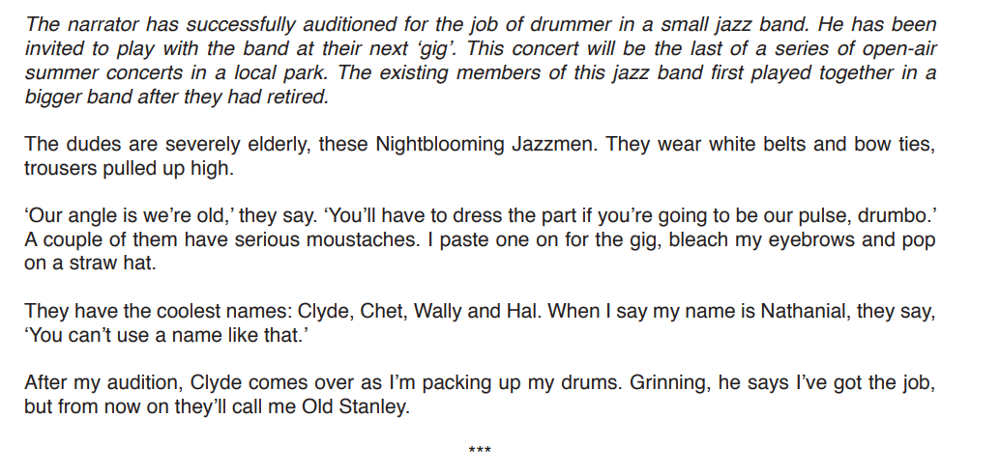
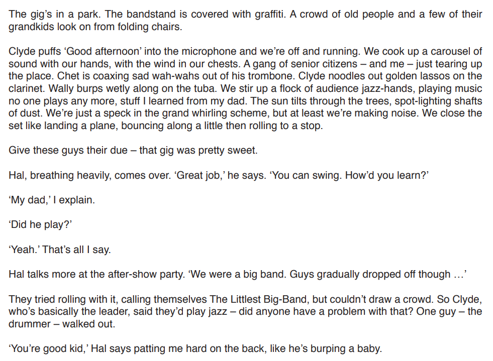
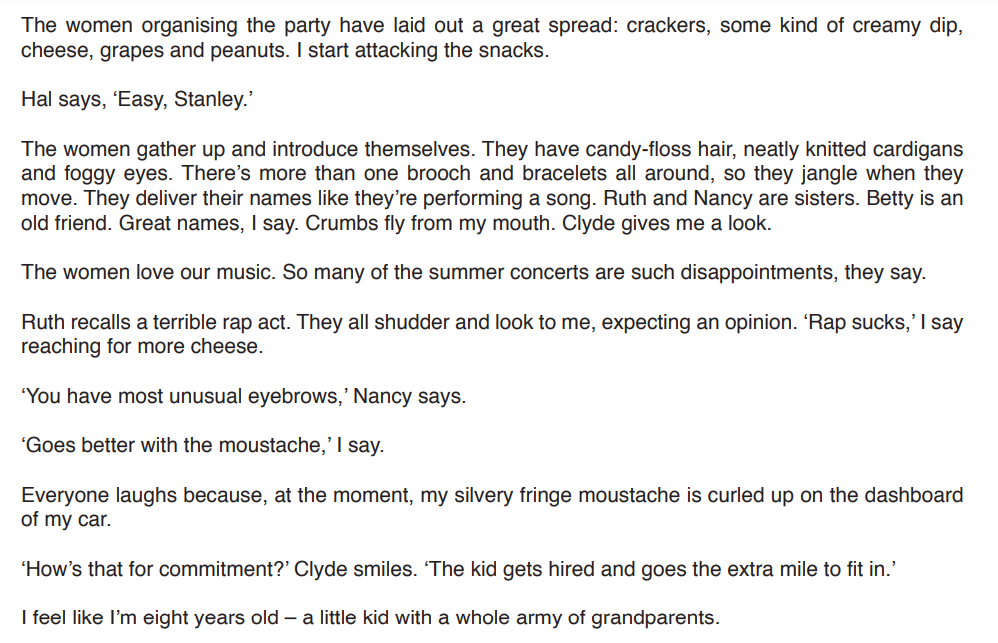

# Question 4 Model Answer: Article

For this task, you will be asked to produce a piece of writing in a particular format, based on what you have read in **Text C**. You may be asked to write in one of six possible formats (genres):

- A letter
- A report
- A journal entry
- A speech
- An interview
- An article

The following guide will demonstrate how to answer Question 4 in the format of an **article**. The task itself is taken from a past exam paper.

## Text C

> **Spec point** — `spcpt_BQv4Yn4txYMPRdbQ`

## Text C

The following text is about a drummer who has been invited to play with a jazz band at their next gig, which is at an open-air summer concert.

**Question:**

## Question 4 article model answer

> **Spec point** — `spcpt_BcHJK2sdrWq5fX8b`

## Question 4 article model answer

> **Worked Example**
> You are a journalist writing an article for a monthly music magazine. You were at the gig in the park, and at the party afterwards, and interviewed band members and some of their audience.
> 
> **Write your magazine article.**
> 
> In your magazine article, you should:
> 
> - explain who the band are, their style, and the history of the band
> - describe the concert, audience reaction and the aftershow party
> - introduce Stanley and consider how he fits in with the band
> 
> Base your article on what you have read in Text C, but be careful to use your own words. Address each of the three bullet points.
> 
> Begin your article: "This month's featured concert..."
> 
> Write about 250 to 300 words.
> 
> **Up to 10 marks are available for the content of your answer and up to 10 marks for the quality of your writing.**
> 
> [20]
> 
> **Answer**
> 
> **REVIEW: The Nightblooming Jazzmen Bloom in Sutton Park**
> 
> *This month's featured concert series at Sutton Park concluded with a charming performance by The Nightblooming Jazzmen*. Aside from their drummer, ‘Old Stanley’, the group consists of retired musicians who share an obvious, comfortable camaraderie.*Dressed in bow ties and moustaches, they exude a retro vibe that perfectly suits their shift towards jazz and swing* — a strategic move to attract larger audiences that has clearly paid off. There are no gimmicks or backing tracks here, only a stripped-back, honest sound that the crowd absolutely lapped up.
> 
> *The setting, a graffiti-covered bandstand, provided a gritty contrast to the music*, yet the atmosphere was electric. The predominantly older crowd remained fiercely loyal, their appreciation evident as the Jazzmen’s talent won over the park. Post-concert, the mood stayed buoyant over crackers and dips, with devoted fans like Ruth, Nancy, and Betty reminiscing about the band's history and their enduring love for the genre.
> 
> *At the after-party, I caught up with ‘Old Stanley’ (Nathanial) to see how he adapts to the group.* Though decades younger, his false moustache and bleached eyebrows reveal a dedicated, endearing effort to blend in. While his social graces lack polish — he spoke enthusiastically with his mouth full — his musical pedigree is undeniable. Having learned from his father, a jazz veteran, Nathanial clearly feels at home. His connection with the band, particularly Hal, is genuine. He is not just a drummer, but a welcome, energetic addition to this unique ensemble.
> 
> **[20]**
> 
> **Commentary**
> 
> - The answer demonstrates the skill of selecting by fitting comfortably within the word limit
> - It uses an engaging, journalistic style suitable for a magazine
> - It expands on original ideas to show evaluation
> - The response flows logically, being guided by the three bullet points

## Summary

> **Spec point** — `spcpt_4RNFXHmyW4STPmJR`

## Summary

- Remember to **read the question carefully** and **highlight** the:

  - **Instructions **(what you have to do)
  - **Focus **of **each bullet point**
- Re-read **Text C** and **highlight** the **relevant information** you can use in your answer
- Address each bullet point in order:

  - Make sure you cover all of the bullet points as equally as possible
  - Base all of your answer on the ideas and details you find in Text C
- Decide on the voice and style you want to create and maintain that in your answer
- Do not just repeat details of what happened:

  - You need to develop your ideas to demonstrate understanding
