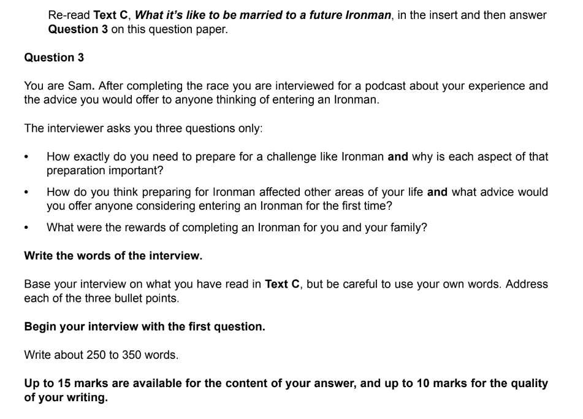

# Question 4 Model Answer: Interview

For this task, you will be asked to produce a piece of writing in a particular format, based on what you have read in **Text C**. You may be asked to write in one of six possible formats (genres):

- A letter
- A report
- A journal entry
- A speech
- An interview
- An article

The following guide will demonstrate how to answer Question 4 in the format of an **interview**. The task itself is taken from a past exam paper.

## Text C

> **Spec point** — `spcpt_WNcfSjgMsN8D4rNj`

## Text C

The following is Text C taken from a past exam paper. It is about a writer’s experience of supporting her husband’s training to compete in an extreme event.

**Question:**

*Example interview question*

## Question 4 interview model answer

> **Spec point** — `spcpt_TyP6CpN4NCZK8f2k`

## Question 4 interview model answer

> **Worked Example**
> You are Sam. After completing the race you are interviewed for a podcast about your experience and the advice you would offer to anyone thinking of entering an Ironman.
> 
> The interviewer asks you three questions only:
> 
> - How exactly do you need to prepare for a challenge like Ironman **and** why is each aspect of that preparation important?
> - How do you think preparing for Ironman affected other areas of your life **and** what advice would you offer anyone considering entering an Ironman for the first time?
> - What were the rewards of completing an Ironman for you and your family?
> 
> **Write the words of the interview.**
> 
> Base your interview on what you have read in **Text C**, but be careful to use your own words. Address each of the three bullet points.
> 
> **Begin your interview with the first question.**
> 
> Write about 250 to 300 words.
> 
> **Up to 10 marks are available for the content of your answer and up to 10 marks for the quality of your writing.**
> 
> [20]
> 
> **Answer**
> 
> **Interviewer: How exactly do you need to prepare for a challenge like Ironman and why is each aspect of that preparation important?**
> 
> **Candidate:** *Preparation is brutal*. You must dedicate immense time to building stamina; I started six months prior to the event. Crucially, I hired an experienced coach to keep me on track and motivated when I felt like quitting. Since Ironman requires diverse skills, you must ensure your training balances cycling, swimming, and running. My advice is not to focus on what you find easy; you gain the most ground by ruthlessly targeting your weakest discipline, however painful that is.
> 
> **Interviewer: How do you think preparing for Ironman affected other areas of your life and what advice would you offer anyone considering entering an Ironman for the first time?**
> 
> **Candidate:** Sacrifices are inevitable. *Training consumed my weekends, meaning I missed precious family moments, including our regular camping trips*. While my partner was incredibly supportive, be warned: your social life will suffer. My advice to first-timers is to involve your family — train together where possible so you don't drift apart. Also, do not underestimate the financial cost; from bikes to wetsuits, the kit is expensive, so you must budget carefully before signing up.
> 
> **Interviewer: What were the rewards of completing an Ironman for you and your family?**
> 
> **Candidate:** Crossing that finish line to the roar of the crowd gave me an overwhelming sense of achievement. Seeing my children there was a cherished memory; I believe I’ve set a strong example of resilience for them. Inspiring my wife to enter next year is the icing on the cake — if I can do it, anyone can! *Finally, on a practical note, the publicity has provided a fantastic boost to my new travel company, proving the pain was worth it.*
> 
> **[20]**
> 
> **Commentary**
> 
> - The response demonstrates the skill of selecting appropriate information to sit comfortably within the word limit
> - The response maintains the conversational yet authoritative tone suitable for an interview
> - It uses direct address and rhetorical strength
> - The response contains the critical development of points required for high reading marks:
> - For example, it develops the point that it helps business by saying that this proves the pain was worth it
> - The structure follows the question and answer format clearly

## Summary

> **Spec point** — `spcpt_XdgjqHr4bt7bfjsF`

## Summary

- Remember to **read the question carefully** and **highlight** the:

  - **Instructions **(what you have to do)
  - **Focus **of **each bullet point**
- Re-read **Text C** and **highlight** the **relevant information** you can use in your answer
- Address each bullet point in order:

  - Make sure you cover all of the bullet points as equally as possible
  - Base all of your answer on the ideas and details you find in Text C
- Decide on the voice and style you want to create and maintain that in your answer
- Do not just repeat details of what happened:

  - You need to develop your ideas to demonstrate understanding
