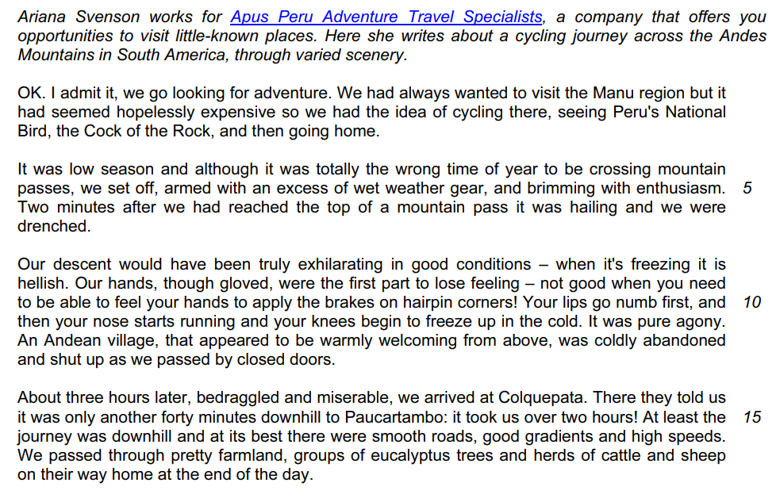
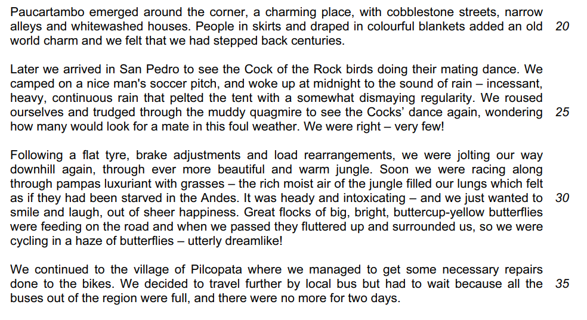
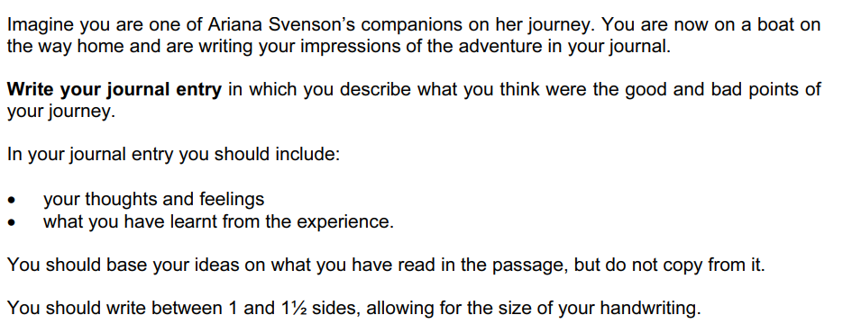

# Question 4 Model Answer: Journal

For this task, you will be asked to produce a piece of writing in a particular format, based on what you have read in **Text C**. You may be asked to write in one of six possible formats (genres):

- A letter
- A report
- A journal entry
- A speech
- An interview
- An article

The following guide will demonstrate how to answer Question 4 in the format of a **journal**. The task itself is taken from a past exam paper.

## Text C

> **Spec point** — `spcpt_kXdHNPk3TvVwyspb`

## Text C

The following example of Text C is about a travel specialist who goes on a cycling journey across the Andes mountain range in South America.

**Question:**

*Example journal entry question*

## Question 3 journal model answer

> **Spec point** — `spcpt_9VyKvVHB4MrY74DG`

## Question 4 journal model answer

> **Worked Example**
> Imagine you are one of Ariana Svenson's companions on her journey. You are now on a boat on the way home and are writing your impressions of the adventure in your journal.
> 
> **Write your journal entry** in which you describe what you think were the good and bad points of your journey.
> 
> In your journal entry you should include:
> 
> - your thoughts and feelings
> - what you have learnt from the experience
> 
> Base your journal entry on what you have read in Text C, but be careful to use your own words.
> 
> Write about 250 to 300 words.
> 
> **Up to 10 marks are available for the content of your answer and up to 10 marks for the quality of your writing.**
> 
> [20]
> 
> **Answer**
> 
> *Now that we are homeward bound, I can reflect on this incredible adventure.* We started out so excited, confident that our wet-weather gear prepared us for anything.*I quickly realised how wrong I was when we hit the mountain pass and the hailstones began!* I normally love the thrill of a descent, but the freezing cold numbed my hands, making it terrifyingly hard to control the bike. I can’t describe the relief of reaching Colquepata. *Although the ride to Paucartambo took longer than the promised "40 minutes," the smooth roads were a joy, and the picturesque town reignited my excitement.*
> 
> The journey was physically tough, with constant downpours and flat tyres, but the jungle changed everything. The humid air and heady scents were the complete opposite of the high Andes, and cycling through a haze of butterflies felt like a cartoon. The bus delay in Pilcopata, *while initially annoying*, became an unexpected bonus. It allowed us to truly immerse ourselves in Peruvian life. It made me realise how we rush around at home, ruled by schedules, whereas nobody hurries in the jungle heat.
> 
> I was, however, shocked to learn how little tourism money reaches the actual townspeople. *This trip has taught me to be an environmentally aware tourist and to buy locally to support the economy.* Despite the grueling challenges, I have grown as a person, learned the value of teamwork, and discovered a part of the world I knew little about.
> 
> **[20]**
> 
> **Commentary**
> 
> - The response demonstrates the skill of selecting relevant information by sitting comfortably within the word limit
> - The response maintains the personal, reflective tone suitable for a journal entry
> - The response explores feelings, not just facts
> - It develops points required for high reading marks:
> 
>   - For example, the fact that the bus was delayed becomes a bonus that highlights the difference between the rushed pace of home and the jungle
> - The response is structured logically

## Summary

> **Spec point** — `spcpt_ZZFgggMmSMm6m7Hc`

## Summary

- Remember to **read the question carefully** and **highlight** the:

  - **Instructions **(what you have to do)
  - **Focus** of **each bullet point**
- Re-read **Text C** and **highlight** the **relevant information** you can use in your answer
- Address each bullet point in order:

  - Make sure you cover all of the bullet points as equally as possible
  - Base all of your answer on the ideas and details you find in Text C
- Decide on the voice and style you want to create and maintain that in your answer
- Do not just repeat details of what happened:

  - You need to develop your ideas to demonstrate understanding
