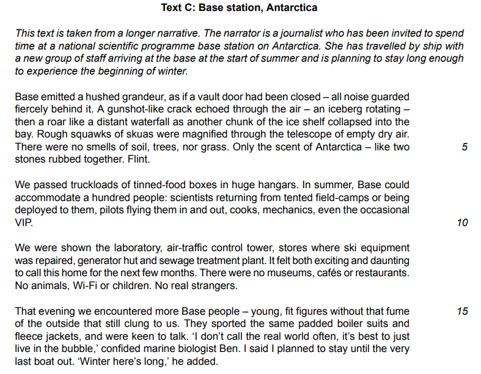

# Question 4 Model Answer: Speech

For this task, you will be asked to produce a piece of writing in a particular format, based on what you have read in **Text C**. You may be asked to write in one of six possible formats (genres):

- A letter
- A report
- A journal entry
- A speech
- An interview
- An article

The following guide will demonstrate how to answer Question 4 in the format of a **speech**. The task itself is taken from a past exam paper.

## Text C

> **Spec point** — `spcpt_52v67wTWh2PRppDj`

## Text C

The following example of Text C is about a journalist who has been invited to spend time at a base station in Antarctica.

## Question 4 speech model answer

> **Spec point** — `spcpt_wnCvZvHQZjV3X3HY`

## Question 4 speech model answer

> **Worked Example**
> You are Simon, the Base commander. You are giving a **speech** for a group of young people to explain to them the opportunities and challenges of living and working on the base station.
> 
> In your speech you should:
> 
> - explain the different kinds of jobs available at Base station and what activities each job might involve
> - outline what they can expect day-to-day life to be like when they first arrive and once they have settled in
> - suggest the challenges and rewards of living and working at the Antarctic base station
> 
> Write the words of the speech.
> 
> Base your speech on what you have read in Text C, but be careful to use your own words. Address each of the three bullet points.
> 
> Write about 250-300 words.
> 
> **Up to 10 marks are available for the content of your answer and up to 10 marks for the quality of your writing.**
> 
> [20]
> 
> **Answer**
> 
> *Good morning everyone! I’m Simon, Base Commander.* I am here today to talk to you about the unique opportunities and challenges of living and working on our Antarctic base station.
> 
> *We offer a variety of vital roles*. You might join us as a scientist collecting climate samples in the field, or a *marine biologist diving with orcas*. Equally important are the mechanics and engineers who maintain our planes and generators; without them, and the pilots who transport us to the camps, we simply could not survive in these conditions.
> 
> *If you decide this life is for you, what can you expect?* Firstly, forget modern luxuries. There are no cafes or Wi-Fi here, and entertainment is limited to card games. However, you will be too busy to notice. You will undergo intense field training, learning to abseil into crevasses to rescue fallen colleagues. You must be self-reliant, pitching your own tents, cooking on camp-stoves, and collecting water supplies. It is physically demanding, but intellectually rewarding; *summer lectures from experts provide incredible perspectives on our research.*
> 
> Be warned, however: the challenges are real. The isolation, particularly during the dark winter months, is severe, and the local wildlife can be dangerous. You will work hard with little leisure time. Yet, the rewards are unmatched. The shared struggle builds a teamwork dynamic where colleagues become family. Furthermore, working in this inspirational landscape develops a profound respect for our planet. *If you have the resilience for this life, I recommend you give it a go!*
> 
> **[20]**
> 
> **Commentary**
> 
> - The response demonstrates the skill of selecting important information by keeping within the word limit
> - The response maintains an enthusiastic, direct address suitable for a speech, engaging the audience directly
> - It develops facts from Text C rather than just repeating the information:
> 
>   - For example, the fact that there are mechanics and pilots is developed in the point that, without them, they could not survive
> - The response is logically structured for the benefit of the reader

## Summary

> **Spec point** — `spcpt_twC7666mFGrK3pbW`

## Summary

- Remember to **read the question carefully** and **highlight** the:

  - **Instructions **(what you have to do)
  - **Focus **of **each bullet point**
- Re-read **Text C** and **highlight** the **relevant information** you can use in your answer
- Address each bullet point in order:

  - Make sure you cover all of the bullet points as equally as possible
  - Base all of your answer on the ideas and details you find in Text C
- Decide on the voice and style you want to create and maintain that in your answer
- Do not just repeat details of what happened:

  - You need to develop your ideas to demonstrate understanding
