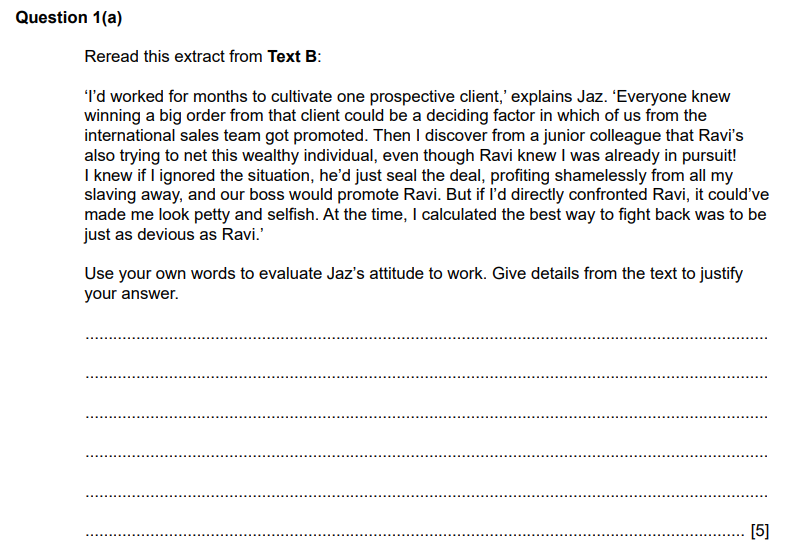

# Question 1(a): What the Question is Asking

## Paper 2: How to answer Question 1(a)

> **Spec point** — `spcpt_fYcV5NQs4rqspBSS`

## How to answer Question 1(a)

Section A of Paper 2 of your Cambridge IGCSE First Language English qualification is called Directed Writing and consists of one question that is divided into two parts — 1(a) and 1(b):

- Question 1(a) — a structured question
- Question 1(b) — a piece of discursive/argumentative/persuasive writing

The following guide will provide you with the information you need to answer **Question 1(a)** to a high standard. It includes:

- An overview of Question 1(a)
- Breaking down the question
- Steps to success
- Exam tips

## Paper 2: Overview of Question 1(a)

> **Spec point** — `spcpt_RzPvbZBYjCPTB3HK`

## Overview of Question 1(a)

- Source: **Text A or Text B**
- Marks: **5**
- Time: approximately **5-10 minutes**
- Skills tested:

  - Analyse/evaluate (R3)
  - Writer's effects (R4)

## Paper 2: Question 1(a): Breaking down the question

> **Spec point** — `spcpt_HHJD8ZnjbQpdRhYx`

## Breaking down the question

This question tests you on your ability to **analyse** and **understand** a text before moving on to the longer writing task. You may be asked to:

- **Analyse**: this means to examine a specific focus in detail
- **Evaluate**: this means to make a judgement

You are tested specifically on:

| **Assessment objective** | **What this means** |
|---|---|
| **R3:** analyse, evaluate and develop facts, ideas and opinions, using appropriate support from the text | This means using the text to build an argument. It involves taking facts and meanings from the text and doing something with them |
| **R4: **demonstrate an understanding of how writers achieve effects and influence readers | This means analysing the writer’s craft. It involves you considering **how** the writer writes a text and **why** they make the choices they do. |

> **Exam Hint**
> Both Question 1(a) and 1(b) will be based on one or two texts totalling 550–650 words in length. For Question 1(a), make sure you only focus on the extract from the text given to you in the question. You are not expected to use the whole of the text in this answer.

Here is an example of Question 1(a):

It is important to **highlight the key information in the question**:

- What have you got to do?
- What have you got to focus on in the text?

You should do this **before** you begin scanning the extract for your evidence.

## Paper 2: Question 1(a): Steps to success

> **Spec point** — `spcpt_9dKwcNwWDgxRDw86`

## Steps to success

Following these steps will give you a strategy for answering this question effectively:

1. **Read** the **question carefully** and **highlight**:

  - The **command words** (what you have to do):
  
    - Here it is “evaluate”
  - The **focus of the question** (what you have to look for in the text):
  
    - Here it is “Jaz’s attitude to work”
  - Any other **instructions** you are given:
  
    - Here it is “Give details from the text to justify your answer”
2. **Scan the extract** and **highlight the evidence** that **answers the question**:

  - Here, that would be what the writer says about his work
3. **Identify** what the **writer/subject feels** about the **question’s focus**:

  - To get full marks, you cannot simply list quotes
  - You must identify how the writer/subject feels **and** support that feeling with a specific detail from the text
4. Use the **key words** from the **question** in your answer:

  - For example: “Jaz’s attitude to work is that they are very competitive”
5. **Support each point** with **specific details** from the extract:

  - For example: “Jaz’s attitude to work is that they are very competitive as they were ‘in pursuit’ of a ‘wealthy individual’ that a colleague was also trying to ‘net’”
6. State **how** this **specific detail supports** your **point**:

  - For example: “The use of hunting imagery suggests that Jaz views the workplace as a battleground or a chase”

Remember, this is a **5-mark question**, so you should aim to spend no more than 5–10 minutes answering it.

## Paper 2: Question 1(a): Exam tips

> **Spec point** — `spcpt_PFGBGFBF5kRGS4dM`

## Exam tips

- **Read** the **command words** and the **question carefully**:

  - This will allow you to demonstrate a thorough understanding of the requirements of the task
- The highest level of the mark scheme (Level 3) rewards candidates who demonstrate **clear understanding** of the **writer/subject’s attitude** with **relevant support** from the text:

  - Demonstrating understanding is going beyond simply making a point along with a quote copied from the text
  - You need to *do* something with the quote
- Look for **words or phrases** in the text that give you a **clue** about what the **writer/subject’s attitude** might be:

  - These might be adjectives, adverbs or emotive verbs (words that suggest conflict or strong feeling)
- Ensure you **use your own words** in your answer:

  - Here, you could look at the subject’s actions and label them with an adjective that is not in the text, such as “ruthless”
- Do **not** summarise:

  - This is not a summary task, so do not just retell what happens
- **Check** the **command word**:

  - If the question asks you to “evaluate”, ensure you are making a **judgement** based on what you read
- Do **not repeat** the same point:

  - For example, do not give three examples of Jaz being “hard-working”; this does not demonstrate range
  - Make **3–4 distinct points**
- Keep your **answer concise**:

  - This question is only worth 5 marks
  - Do not write an introduction or conclusion

For more advice on how to apply the skills required for success in this question, please see:

[Question 1(a) Skills: Evaluation](https://www.savemyexams.com/igcse/english-language/cie/25/revision-notes/paper-2-writing/section-a-directed-writing/question-1a-skills-evaluation-/).

For a model answer to this question, please see [Question 1(a): Model Answer](https://www.savemyexams.com/igcse/english-language/cie/25/revision-notes/paper-2-writing/section-a-directed-writing/question-1a-model-answer-/).
