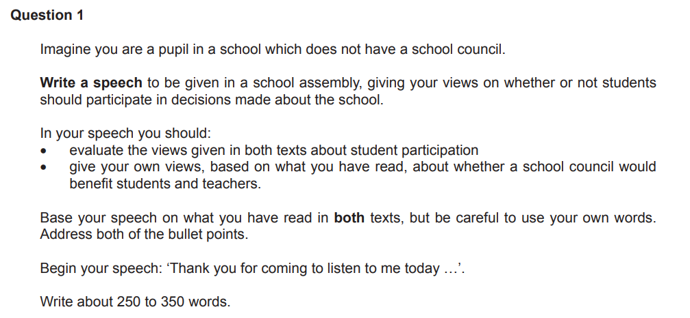

# Question 1(b) Model Answer: Speech

Question 1(b) is a **directed writing** task. You will be asked to write a *discursive*, **argumentative** or **persuasive** piece based on two reading texts.

You will be asked to write in a specific form. This will be one of:

- A speech
- A letter
- An article
- A report

The following guide will help you to structure your response in the style of a **speech**.

## Addressing the reading assessment objectives

> **Spec point** — `spcpt_5cCyfHg33Fvt52YY`

## Addressing the reading assessment objectives

Up to 10 marks are available in this task for your ability to **evaluate** both the **explicit** and **implied ideas**, **opinions** and **attitudes** expressed in one or two texts, and **assimilate** them to write a developed and sophisticated response.

Let’s take a look at how you do this, using the following example:

Your response here has to be based on the ideas, opinions and attitudes contained in the following two texts:

This task asks you to **evaluate** the **views** given in **both texts** about **student participation**, and **give your own views** on the subject, **based on what you have read**. Your response might use the following ideas from these texts:

**Text A:**

- Student representation was “once fashionable”, but it may just be a passing fad
- School councils take up too much time and energy from schools and teachers when they have more important things to be getting on with
- If student representation is fake or just to tick a box, then it has no substance, especially if views and ideas are not acted upon
- Teachers are accountable to parents and should put education first
- Even some students are disillusioned with the idea of student representation when nothing is acted upon, especially given the time and effort involved
- Experienced teachers should make decisions, not children — trust should be placed in the people appointed to run the school and deliver the education

**Text B:**

- An “enlightened” approach is needed to make school councils work and it takes real commitment
- Student participation is very popular and well regarded
- Student participation works when children are involved in “real” issues
- Students can take responsibility for difficult problems such as behaviour or bullying
- Participation can make a difference to students’ attitudes to school
- Attendance and results are improved by participation
- Students can learn important skills such as negotiation, communication and decision-making
- Students can have a fresh eye on issues
- Decisions made may have a major impact on them, so students are motivated to participate

## Planning your response

> **Spec point** — `spcpt_bWMPFyHJ9RXPfKpj`

## Planning your response

Before you write your response, you should spend five minutes **planning** your written response. In your plan:

- **Decide** on your “voice” and **point of view**:

  - Write a **statement** that **summarises your point of view**, based on your reading
- Note down which **points** you can **develop** that **support your point of view**
- Decide whether you are going to make a **counter-argument**, and note down which **points** you can **develop to support this**
- Return to your main argument, ensuring that you have included ideas and opinions from **both texts** (if more than one)
- Note down the points you can make to address the second bullet point in the task
- Note down how you are going to start and finish your response, ensuring that it establishes the correct style and tone

## Question 1(b) speech model answer

> **Spec point** — `spcpt_8CmTQyc9s3f8XK49`

## Question 1(b) speech model answer

The following model answer demonstrates a top-mark response to the above task:

> **Worked Example**
> **Question 1(b)**
> 
> Imagine you are a pupil in a school which does not have a school council.
> 
> **Write a speech** to be given in a school assembly, giving your views on whether or not students should participate in decisions made about the school.
> 
> In your speech you should:
> 
> - evaluate the views given in both texts about student participation
> - give your own views, based on what you have read, about whether a school council would benefit students and teachers
> 
> Base your speech on what you have read in **both** texts, but be careful to use your own words. Address both of the bullet points.
> 
> Begin your speech: 'Thank you for coming to listen to me today...'
> 
> Write about 250 to 350 words.
> 
> Up to 10 marks are available for reading and up to 25 marks for writing.
> 
> [35]
> 
> **Answer**
> 
> *Thank you for coming to listen to me today. I am here to argue that students must participate in decisions about our school.* As you are aware, we currently do not have a school council, which I believe denies us the vital opportunity to influence how our community is run.
> 
> However, participation must be meaningful. The effectiveness of a council depends entirely on how well it is managed. *If a school pays lip service to student feedback without acting on it, the exercise is pointless.* If representatives invest time only to be ignored, they will inevitably feel disillusioned and powerless. We need a voice that is actually heard.
> 
> I appreciate that parents and teachers may feel education should come first, leaving ‘big decisions’ to the professionals. Yet, this view is short-sighted. *As the people who spend the most time here, we should be empowered to make informed decisions about our environment.* Being young does not render us incapable of providing intelligent, constructive feedback.
> 
> Furthermore, representation brings tangible benefits. *It makes students feel valued and develops crucial life skills like negotiation and decision-making — assets for our CVs.* Students can also offer fresh perspectives on challenging issues like bullying. Evidence suggests that when students are entrusted with responsibility, it leads to better attitudes, improved attendance, and higher results.
> 
> Having critiqued the teachers' guide on setting up councils, I worry it underestimates the significant time commitment required. We must be realistic: effective participation requires hard work. We need a council that has a genuine say on real issues, not just a token gesture. Ultimately, we deserve to be trusted with the responsibility of shaping our own education.
> 
> Thank you for listening.
> 
> **[35]**
> 
> **Commentary**
> 
> - The response fits within the recommended word count, gaining marks for structure (W2)
> - The response maintains a persuasive, rhetorical tone suitable for a speech
> - It retains the critical evaluation of the source material
> - Ideas and opinions from both texts are implied in the response
> - The response uses conventions of a speech, such as inclusive pronouns and direct address, to connect to the audience
> - The argument is sustained throughout
> - Spelling, grammar and punctuation are accurate

## Summary

> **Spec point** — `spcpt_Mm9c6Xt7YCyqfjgB`

## Summary

- Remember to read the question carefully and **highlight**:

  - **What** you are writing, **who** your audience is and **why** you are writing
  - The **focus** of **each bullet point**
- Read the text(s) and highlight the relevant information that could be developed in your answer:

  - Bullet-point this information in your own words
- **Plan **your writing, focusing on one main idea or opinion per paragraph
- Address each bullet point in order:

  - Make sure you cover all of the bullet points as equally as possible
- Decide on the voice and style you want to create and maintain that in your answer
- Do not just repeat details from the text(s):

  - You need to evaluate and develop the ideas, opinions and attitudes in the text(s) — you are not summarising them

## Persuasive Theory

> **Spec point** — `spcpt_VYxfXrPYCX7djPrV`

## Persuasive theory

The three types of persuasion are:

- Emotional
- Authoritative
- Logical

In order to persuade your examiner, you need to **demonstrate** your point of view.
