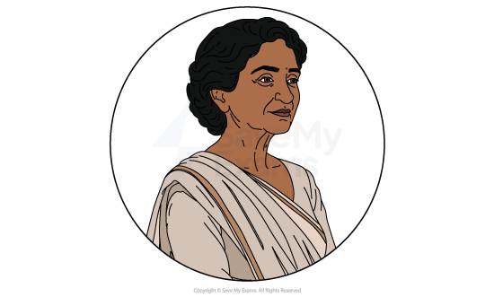
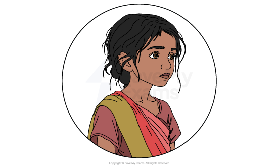
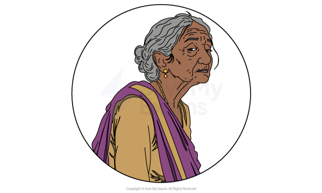
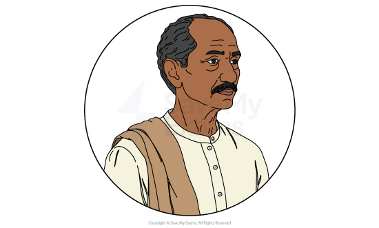

# Fire on the Mountain: Characters

## Fire on the Mountain: Characters

The exam question on Fire on the Mountain may ask you to focus on a particular character or theme. Understanding Anita Desai’s choices in shaping her characters, and the environments in which they live, will help you produce a convincing analysis and interpretation.

It is important to remember that, in Desai’s novel, characters are often used to embody ideas, social roles, and attitudes. The ways they respond to isolation, landscape, and emotional pressure, as well as the narrative perspective and descriptive language used to present them, raise important questions and allow Desai to explore the novel’s central themes.

Below you will find profiles of:

- Nanda Kaul
- Raka
- Ila Das
- Ram Lal

## Fire on the Mountain: Characters: Nanda Kaul

> **Spec point** — `spcpt_3RWnN6qc4P96t7J5`

## Nanda Kaul

- Nanda is Fire on the Mountain’s [protagonist](https://www.savemyexams.com/glossary/gcse/english-literature/protagonist-definition/), and who much of the novel follows:

  - She is a retired widow, a mother, grandmother and great-grandmother
- Nanda lives alone in a house that was once reserved for British military families, and then to different English “maidens”:

  - Now, it is only Nanda, and her servant Ram Lal
- The home is atop a hill in Carignano, part of Kasauli in India:

  - The garden has been left bare, and Nanda likes the peace of a barren environment that gives her a view all around the area
- Nanda was married to the Vice Chancellor of a college nearby, and is held in high esteem by others, like her childhood friend Ila Das
- As the narrative continues, we learn that Nanda has many children and grandchildren, as well as great-grandchildren, but she feels little affection for them, and is unsure she loves them:

  - When she learns Raka, her great-granddaughter, is set to visit, she worries that looking after a child will be letting “that noose slip once more round her neck”, showing she does not want to get trapped into childcare again
- Later in the narrative, we learn she was mistreated by her husband and her time in *solitude* is her attempt to put the past behind her:

  - She was expected to be the perfect wife and mother, with no freedom or privacy to her life
  - She now values those two things above anything else

- When Raka arrives, she feels no interest or warmth for her:

  - Nanda is happy that Raka seems to want to be left alone, and initially is happy to do so

- As time goes on, Nanda finds herself eager to engage with Raka, trying to force them to spend time together:

- As she struggles to connect with her, she leans on stories of her own father’s exploration and the glamorous animals they had once had in her home
- It is revealed at the end that all these stories were lies, a desperate attempt to make Raka like her
- By the novel’s end, Nanda seems like she may leave her home to Raka when she dies

- The final part of the novel sees Nanda spending time with her friend Ila Das:

  - Nanda is agitated by nearly everything about Ila, but feels obliged to have her over for tea
  - She barely engages in conversation when they are together, especially irritated by Ila’s blissful views of a past Nanda hates
  - As much as she seems to dislike her, she is sympathetic to the struggles Ila has
- Fire on the Mountain ends with Nanda slumped by the phone, shocked by the news of Ila’s death, and the disappointment and sadness she feels over her own life

## Fire on the Mountain: Characters: Raka

> **Spec point** — `spcpt_BDDJjGtztDDKGVBM`

## Raka

- Raka is Nanda’s great-granddaughter, a small child, although no age is given in the novel:

  - She has come to stay with Nanda after suffering with a bout of *typhoid* that was nearly fatal, and left her very weak
- She is small and frail, thin, with “somewhat bulging eyes”, according to Nanda, comparing her to a mosquito when they first meet
- Raka isn’t interested in building a relationship with Nanda:

  - She, even more than her great-grandmother, likes to be left alone
  - Raka very quickly leaves the house and goes exploring down the hillsides, the ravine and other surrounding areas to Carignano
- She enjoys making her way through the mud and trees of Kasauli, rather than playing or engaging in what others expect a child to like
- Raka is often left hungry with the meals at Carignano, and enjoys the time she gets to forage for fruit and berries in the area around the home
- She also shows little fear, even after Ram Lal warns her about the ravine, the jackals, and other things like snakes:

  - Raka is only more intrigued once she is warned
- Raka likes Ram Lal, with whom she engages in much conversation, much more than she does Nanda:

  - From him, she learns about the animals, and some myths of the local area
  - He also talks to her of forest fires, and she is extremely interested in them
  - Fire seems to hold great charm to Raka, and she is drawn to it, including a burnt-out cottage in the nearby area
- She only shows fear when she sees the adults at the Kasauli Club, the local social club, dancing and revelling together, clearly drunk:

  - This behaviour reminds her of her life at home, where her father relentlessly beats her mother
  - She runs home and hides under the covers of her bed, Desai suddenly showing the traumatised child that she is
  - This might be why she seems drawn to “destroyed and barren spaces”, compared to the cosy comfort of family and Carignano
- The last moment of the novel is Raka finding Nanda and trying to triumphantly show her that she has started a forest fire:

  - She sees no danger or trouble in this, instead feeling proud
  - The violence of the forest fire could perhaps correspond to the violence Raka has witnessed at home

## Fire on the Mountain: Characters: Ila Das

> **Spec point** — `spcpt_Mc3XjWMbKwRYpSwx`

## Ila Das

- Ila is a childhood friend of Nanda, one that Nanda is reluctant to spend time with, but feels obliged to
- Ila is presented as tragic, bullied all her life for her high-pitched voice and strange appearance:

  - This is shown happening to her in childhood, by teachers and students, and then in the present day of the novel, as young people in the street abuse and mock her openly as she walks by
- She once lived well, but is now struggling in poverty:

  - She walks home from Carignano and is too poor to buy grain for dinner
  - The shopkeeper recognises her, and is so concerned by her state that he gives her free garlic and chillies with grain
- She was raised in a wealthy household, but her parents died and left all their money to their three sons, her brothers, leaving Ila and her sister to struggle
- Nanda’s husband manages to get Ila a job at the college:

  - Unfortunately, after his death, Ila resigns after being unfairly overlooked for promotion
  - This takes her away from the security of the college
  - She has recently retrained as a welfare officer, and spends her days trying to convince locals to have vaccinations and to stop arranging child marriages
- Nanda is concerned about a man — Preet Singh — she describes having had confrontations with:

  - Ila visited his family and tried to convince them not to marry off their daughter to a wealthy man
  - Later, the shopkeeper recalls how Preet Singh was abusive in his description of Ila
- She leaves Nanda’s, but spends too long in the bazaar, and it is dark and cold as she nears home
- She tells herself she is not scared, but is shaken and worried as she walks alone
- Just as she is a turn away from home, a figure jumps out from the dark:

  - She is attacked, raped and killed by the man, whom she sees is that same man that she spoke of to Nanda, and the same man the shopkeeper described

## Fire on the Mountain: Characters: Ram Lal

> **Spec point** — `spcpt_Y5dyXCK3Q9wBkwG7`

## Ram Lal

- Ram Lal is a cook and servant at Carignano
- He is an older man, calm and quiet, loyal to Nanda
- He builds a positive relationship with Raka, the only one in the novel who does:

  - It appears his lack of interest in whether she likes him or not, and his desire to fulfil his duties above all else, makes him interesting to Raka
- He retains a *nostalgic* view of the structures that were in place during the British occupation of India:

  - He seems to still be in awe of the English, and he uses words like “*Memsahib*” to describe Nanda, showing his *deference* to Nanda and those traditions from the British Empire
- Ram Lal seems to have a lot of knowledge of the area, something else that attracts Raka to him:

He talks of the ravine, the locals at the Pasteur Institute, wild animals and even folkloric demons like the *churails* that are said to live off the flesh of the dead

**Sources**

Desai, A. (1999) *Fire on the Mountain* (Vintage)

### Sources

Desai, Anita. (1999). Fire on the Mountain. Vintage.
