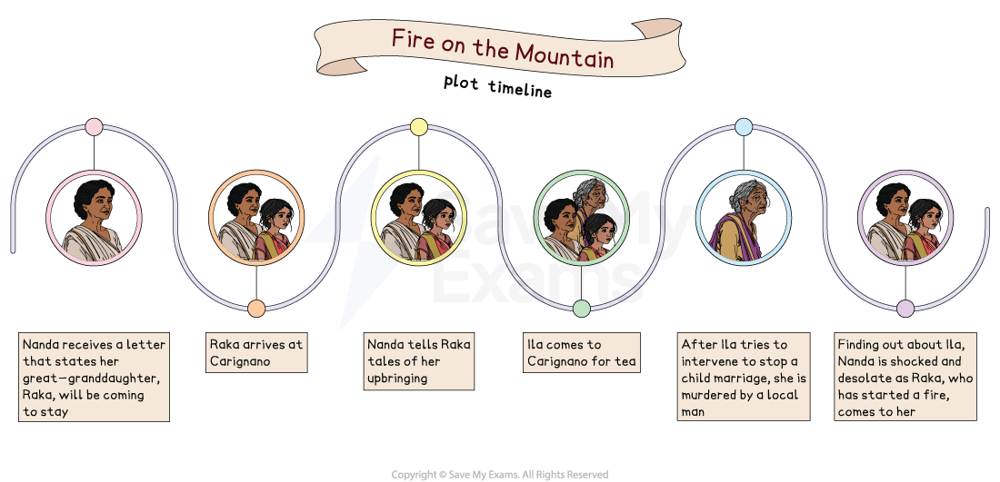

# Fire on the Mountain: Plot Summary

## Fire on the Mountain: Plot Summary

To be best prepared for exam questions on Fire on the Mountain, it is important that you understand the key points within the plot of the novel. While you will not be asked to retell the story, it will be easier to give strong answers if you understand when things happen, and which characters are involved, so that you can build answers supported by accurate textual references.

Below you will find:

- An illustrated plot timeline of Fire on the Mountain
- An overview of the novel
- A plot summary broken down by chapter

## Fire on the Mountain: Plot Summary: Plot timeline

> **Spec point** — `spcpt_zQhCxFmqkNjZfDNx`

## Fire on the Mountain: Plot timeline

*Fire on the Mountain plot timeline*

## Fire on the Mountain: Overview

> **Spec point** — `spcpt_6jDDckvjz6XPq4HG`

## Overview of Fire on the Mountain

Fire on the Mountain is the story of Nanda Kaul, a widow who has retired to a life of *solitude* in an old *colonial* house named Carignano, high up in the Indian Himalayan mountains. She only has her servant Ram Lal for company.

She spends her days reading, drinking tea and enjoying the peace of the land around her, all until her daughter sends her a letter, informing her that her great-granddaughter, Raka, is being sent to spend the summer with her as she continues her recovery from *typhoid*.

Nanda is annoyed by this, and uninterested in the child, until Raka’s desire to be left alone, and her joy of exploring, gradually unsettle and intrigue Nanda, who finds her irresistibly interesting.

As time goes on, old wounds from a chequered past open up, and Nanda starts to feel the stress which she had planned to escape by living alone in the mountains. When an old friend is an unwanted visitor, a tragic conclusion is set in motion.

## Fire on the Mountain: Chapter-by-chapter plot summary

> **Spec point** — `spcpt_tVm57Vyj7mfdD7zh`

## Fire on the Mountain: Chapter-by-chapter plot summary

Fire on the Mountain is split into three parts, with chapters within each of them.

### PART I: Nanda Kaul at Carignano

#### Chapter 1

- The reader is introduced to the main character, Nanda Kaul
- Nanda is an older Indian woman who has bought a house, named Carignano, in her retirement and wants to live in peace, undisturbed by others:

  - We see this in how she feels about the postman as he walks nearby her house
  - She is annoyed at his slow pace and his proximity to her house, and at the possibility that he will disturb her *solitude*

#### Chapter 2

- The history of the house is told:

  - Multiple past owners and inhabitants are mentioned, all of whom were English
  - It was initially occupied by the English military, but soon passed down to different English maidens
  - After India’s independence from Britain was declared in 1947, it was put up for sale, and Nanda bought it

#### Chapter 3

- The cook of the house, Ram Lal, comes home
- The postman delivers a letter to a frustrated Nanda, who has already resolved to say no to whatever request it holds

#### Chapter 4

- Nanda reads the letter from her daughter Asha, whom she appears to dislike:

  - She is described as both “the least loved” and “most exasperating” of her daughters
- Asha sent her daughter, Tara, to reconcile with her husband, a diplomat, and move to Geneva
- Tara’s daughter, Nanda’s great-granddaughter, is recovering from a serious attack of *typhoid*, and is still weak and unwell:

  - Asha and Tara have agreed that Raka, the child, needs to recuperate somewhere peaceful
  - They have decided that Raka will come to stay with Nanda for the summer
- Nanda is angry and disappointed with this, just wanting to be left alone in peace

#### Chapter 5

- Nanda thinks of years of motherhood and being a wife:

  - She does not want the trouble of looking after children again
  - She goes to tell the cook, Ram Lal, about her great grandchild’s visit

#### Chapter 6

- A woman named Ila Das calls
- Nanda is annoyed by the phone ringing, which it rarely does, and the sound of Ila’s voice
- Ila wants to visit, and Nanda thinks she has the perfect excuse to prevent Ila coming by mentioning she has to prepare for her great-granddaughter’s visit:

  - Unfortunately for her, this only makes Ila more determined to visit
  - They agree she can come visit, but only after the child is settled
  - Nanda will send a note to Ila when she can come
- As the call ends, Ila cannot decide if Nanda seemed annoyed or just joyless

#### Chapter 7

- Nanda thinks of times in the past when she would try to rest and her house would be full of sound:

  - She sounds tired just thinking of the children and her husband wanting attention
- She reminisces about a time where she had managed to walk in her garden unnoticed, in peace

#### Chapter 8

- Sat on the veranda in the late afternoon shade, Nanda reads small sections of a book
- A part named “When a Woman Lives Alone” talks of a lived-in and untidy house, which should be how a house looks when a woman lives alone:

  - This makes Nanda smile
- She walks into the garden and enjoys its calm beauty
- She turns back and goes to read in the drawing-room
- She thinks of how she likes Carignano, her house, and how she did not like the house she lived in when she was married to the Vice Chancellor:

  - She did not enjoy the busy, crowded house
  - There were many servants, guests and children, all noisy
- She is glad that life is over, but is worried that Raka’s arrival may bring more of that chaos back into her life

#### Chapter 9

- Nanda recalls the day she moved into Carignano, after her husband died
- She had once been a person who felt she had a calling to care for others, but once she was alone in the house, that all disappeared
- It is clear she puts no effort or energy into maintaining the house or making changes to its garden:

  - She prefers it being a bit dishevelled and the garden growing however it wants
- She tells Ram Lal about her great-granddaughter arriving the following day:

  - He calls her “*Memsahib*”, showing his *deference* to her
  - This term indicates that Nanda was married to a man of high standing
- She asks if he will cook for Raka:

  - They discuss what he could make
- Nanda leaves, and Ram Lal notes aloud that they are both old

#### Chapter 10

- Nanda decides not to go to meet Raka, sending Ram Lal to greet her instead:

  - She would rather not be seen, and then discussed, by the locals on her route
- After bumping her leg and bemoaning the signs of bruising that come with an ageing body, she tries to remember Raka:

  - She fails, not recalling which child was which as she thinks of the children, grandchildren and others in her family
- Nanda is consumed by how unfair it is that she now has not only to meet this child, but to care for her too

### PART II: Raka comes to Carignano

#### Chapter 1

- Raka arrives at Carignano:

  - She is small and shy, with big, round eyes
  - Raka is astounded by the silence
- After an awkward standstill, they embrace, feeling they must:

  - Nanda is shocked by how thin and bony Raka is and finds herself exclaiming so, involuntarily

#### Chapter 2

- Raka begins her stay by getting to know her bedroom
- She climbs out of the window and explores the garden and grounds:

  - She is interested in the plants, the buildings, and the town of Kasauli down below

#### Chapter 3

- Raka questions Ram Lal about the factory:

  - It is called the Pasteur Institute, and Ram Lal explains that it is where doctors make the serum for injections
- She learns about the jackals down at the ravine
- Raka and Nanda share tea:

  - Nanda comments on how pale Raka is, but she chooses not to reply
  - She thinks Raka is seething, but does not want to be drawn into why and get involved in the child’s life

#### Chapter 4

- Nanda notes that Raka goes off in the grounds and around the area quietly, without stopping to bother Nanda:

  - She is annoyed that Raka is her responsibility and that she will be forced to show an interest in her whereabouts and activities
- Nanda writes a letter to Asha to tell her Raka is here and safe, but nothing more
- She resolves to distance herself from Raka
- Nanda finds it *irksome* that Raka has disappeared for so long:

  - She finds herself concerned by where she went and how long she was away
- Nanda is impressed by how little interest Raka has in her:

  - She feels jealous that Raka is as unbothered and “ignored her so calmly”, believing Raka is what Nanda wishes to be

#### Chapter 5

- Raka climbs down the hillsides and explores around the ravine
- She sees a snake, and is confused by the sound of the crickets she disturbs
- Raka is tough and rather than being put off by her own sweat and blood, it seems to interest her

#### Chapter 6

- Raka slides down the hill next to Ram Lal as he prepares her outdoor bath:

  - She talks to him, and tells him of the snake she saw down the ravine
  - Ram Lal reminds her that he told her not to go down to the ravine
  - Raka wants to see a jackal as she’s never seen one
- A dust-storm hits the house
- Ram Lal takes Raka inside, then worries about the storm knocking over the bath or spreading the fire that was boiling it:

  - He tells Raka how fires have spread in the past, burning a cottage that Raka thought was a hut
- The dust passes and Raka has her bath as Nanda watches through the window

#### Chapter 7

- Raka looks to go off on another solo foraging trip, but Nanda decides she is going with her:

  - Raka cannot hide her dismay, which Nanda notices
- We find out that Raka uses these walks to find food:

  - She picks berries and other things as she is usually still hungry after her meals
- Nanda suggests a walk to Monkey Point:

  - She describes many of the places they walk past, but Raka does not seem to engage in conversation
- They reach their destination, and Nanda laughs at the *langurs*:

  - Raka, too, laughs loudly at the faces the monkeys pull
- As they leave the *langurs* behind, Raka is disappointed that her great-grandmother continues to talk to her about the local area, like a tour guide
- Nanda asks Raka if she would like to go to school, even a boarding school, here:

  - Raka is shocked and runs off, rejecting the idea of it
- Raka waits at the end of the hill for Nanda, and Nanda catches up:

  - Nanda is shocked by the clear rejection by Raka
  - Nanda meant it as a genuine invitation to come live in the hills with her

#### Chapter 8

- They reach the foot of Monkey Point:

  - Nanda tells Raka she cannot climb it herself, but is happy to watch Raka do it
  - Nanda is anxious watching her climb, but also amazed and full of admiration
- Raka is annoyed she had to come here with her great-grandmother, as she had planned to do so alone:

  - She is annoyed about the thought of boarding school, but her negative feelings soon wash away in the peace atop the hill
- They walk home together in silence
- Ram Lal meets them at the gate:

  - Raka runs to him, asking what’s for dinner

#### Chapter 9

- After tea, Raka goes off exploring once more:

  - Nanda pretends to show no interest, but rushes to observe her once she believes the child will not see her watching
- When Raka returns, Nanda asks her why she never goes to the club:

  - Raka thinks about bad memories of being forced to socialise
  - When she got ill, her parents stopped pushing her to spend time with other children
  - Raka replies that Nanda never goes to the club either
  - Nanda enjoys this, calling Raka “*exactly* like me”
- Both Nanda and Raka are embarrassed and uncomfortable after this positive outburst, and they go back to ignoring each other
- As they sit together on the veranda, it is Raka that breaks the silence:

  - She almost shouts that the pair need to leave, so that the *hoopoes* can come out and feed on the apricots fallen from the trees
  - Nanda seems unhappy at this softness

#### Chapter 10

- Ram Lal explains the club to Raka, about how it was once a place of splendour
- Raka does end up at the club, but not in the afternoon when the other children were there:

  - Raka climbs out of her window at night, overhearing the music from the club and going to investigate
  - She is wary, but cannot resist the urge to look, sneaking into the ballroom and hiding

#### Chapter 11

- Raka is surprised to see none of the elegance described to her by Ram Lal:

  - There appears to be a party going on, with loud revelry and wild dancing, all of which perturbs Raka
- There are men and women in colourful outfits and masks
- One seems to spot her and runs towards her
- Raka flees, knocking things over and crying as she runs away
- As she flees, she has memories of her father coming home drunk from parties and beating her mother:

  - She remembers wetting herself as she cowered in bed hiding from it all
- She nearly turns to run to the ravine, but instead goes home to bed

#### Chapter 12

- The experience at the club seems to cause a change in Raka:

  - It is one that a watchful Nanda notices
- They both see a forest fire in the distance one evening
- It worries Raka, but Nanda is not concerned
- The pair have a rare conversation:

  - Raka is anxious to find out what will happen if the fire spreads
  - Nanda thinks the fire brigade will put it out, but does concede that some houses, and indeed villages, could be burned down in a fire this big
- Raka spends all night waking up and checking on the fire:

  - Nanda is kept up by the sound of Raka walking back and forth to her window
- The fire peters out in the night

#### Chapter 13

- Nanda observes with some jealousy that Raka is so interested in spending time with Ram Lal:

  - She notes that Ram Lal manages to keep Raka safe and secure, while remaining interesting and curious to her, something Nanda will not make an effort to do
- Ram Lal and Raka talk about her exploring down by the ravine
- He warns her of *churails*, who live off the flesh of the dead:

  - Raka is seemingly scared, and Ram Lal describes them as “bigger than any man”, with red eyes and “feet [that] are turned backwards”
  - He claims to have known a woman who turned to stone looking at their feet
  - He promises to show Raka the stone woman, and Raka is eager to see
- All of a sudden, many *langurs* appear and come to take off with loose food like apricots from the trees or potatoes from the kitchen
- They are chased away, leaving behind only a mother and her child:

  - Ram Lal is ready to throw a stone at them, but Raka grabs his arms and begs him to stop, which he does
- Nanda, having watched, is hurt that Raka had no interest in her “Nani” coming to see this all happen

#### Chapter 14

- Nanda receives a letter:

  - Raka’s mother has had another breakdown, and her grandmother Asha was flying to Switzerland to be with her newest grandchild
  - This means Raka will likely be staying with Nanda for longer
- Nanda chooses to keep this secret from Raka, annoyed that Raka already has secrets from her
- Nanda ponders Raka’s comfort in her home, and the possibility that she could leave Carignano to Raka in her will:

  - She does not like the thought, as that would require inviting over her lawyer
  - She did not want anyone to come, but she also doesn’t want Raka to go

#### Chapter 15

- A storm comes in, bringing winds and ice-cold rain
- The bad weather seems to unsettle Raka, who starts pacing and touching at things in the house that she has never touched before
- Nanda tells her about her father, Raka’s great-great-grandfather, in Tibet:

  - He went there alone, to explore, and spent time with the locals
  - Raka is fully engaged in the story, enough to forget the storm completely

#### Chapter 16

- Nanda continues on, but now about herself and moving to Carignano:

  - She explains that she found it all overwhelming and eventually felt she needed to break free from all the people and possessions
  - Raka is amazed that she left the house and these things behind, but is just as quickly bored of the story, so Nanda stops
- They watch the rain until it stops, and then go out to the veranda:

  - Nanda recalls how Raka’s mother used to sing “rainy days are lily days!”
  - Raka does not understand what she means, but Nanda tells her to wait and see, then sends her off for her walk

#### Chapter 17

- The next morning, Raka sees what she meant, as the ground is completely covered in lily petals
- Raka asks about whether her mother used to visit often, and then asks about the letter that came recently:

  - Nanda tells her that her mother is sick again, and in a nursing home in Geneva
  - Nanda is annoyed with herself for not cushioning the news, but cannot tell if Raka is upset by it or not

#### Chapter 18

- Raka goes out for another walk, looking to go to the burnt house on the hill
- She finds that she likes the burnt house up in the hill, and while she admits to herself that Carignano was the best house she’d lived in, she also feels constrained by it:

  - She likes Kasauli for its “destroyed and barren spaces”
- She runs from the burnt house, the caretaker coming out afterwards, calling her the “crazy one from Carignano”

#### Chapter 19

- Nanda discusses why she likes Kasauli, especially as it is so different to Kashmir
- Raka engages, asking if she lived in a houseboat, and then if Nanda would like to go back to Kashmir:

  - Nanda says no, that one “does not go back”
- Nanda continues to talk about Kashmir and her home there, and again starts to talk about her adventurous father:

  - Raka feels like a “fish” on a “hook” as Nanda keeps talking, keeping her there at lunch for longer than she would like
- Nanda tells her of her father’s private zoo, as he collected animals, and Raka is very interested in hearing about the wild bear he had:

  - But just as quickly, Raka loses interest
  - Nanda notices, and has started to learn how to keep Raka invested in her stories
- Raka finds herself annoyed by this change in her great-grandmother:

  - She had grown accustomed to her being quiet, and is not enjoying her becoming so much more talkative

#### Chapter 20

- Nanda finds herself almost obsessing over Raka:

  - She waits for her to come home from another walk, and Raka bumps into her as she wanders back in
- Nanda is desperate to keep Raka engaged and interested in conversation, but continues to struggle to find the right words:

  - She talks about her own animals that she kept when she was a mother
  - Now she is talking a lot, trying to find something that interests Raka
  - Raka, on the other hand, is desperate to escape the clutches of Nanda

#### Chapter 21

- Ila Das calls, inviting herself over, and they agree she will come for tea tomorrow

### PART III: Ila Das leaves Carignano

#### Chapter 1

- Nanda and Raka await Ila Das’s arrival:

  - Nanda is impatient, especially annoyed that she is ready for her tea and Ila Das isn’t there and ready
- She is heard coming before she arrives, as boys from school are let out just as she approaches:

  - The boys treat her horribly, poking fun at her, kicking her umbrella away, and only dispersing when Ram Lal scares them off

#### Chapter 2

- Nanda seems to think that this kind of abuse from people happens every time Ila Das goes out
- Ila Das was what Nanda describes as one of the “few favoured natives” during the time of the British Empire:

  - These families had servants and lived with decadence
- Nanda seems to dislike Ila Das as she is chaotic:

  - She also clearly hates her voice
- She and Ila were friends as children, and went to the same school:

  - Her voice caused problems then, too, being incredibly high-pitched
- Ila, on the other hand, is delighted to see Nanda

#### Chapter 3

- Nanda enjoys it as Ila hugs and kisses Raka:

  - Raka hates it, although quietly and subtly enough not for Ila to notice, but Nanda does, and feels both annoyed and tickled by it

#### Chapter 4

- Ila talks about the house Nanda grew up in, and how wonderful her parents were
- Ila plays the piano and sings, much to the dismay of both Raka and Nanda

#### Chapter 5

- Ila talks about her love of music, while Nanda says she “greatly” prefers silence
- Ila continues to talk about the old home with the Vice Chancellor, which seems to just annoy Nanda:

  - Raka, who is incredibly bored, notices that her great-grandmother is also not enjoying any minute of it
- Suddenly, when telling a story about playing badminton with the Vice Chancellor, Ila falls silent

#### Chapter 6

- Nanda rises, and then changes the topic, while sending Raka to get Ram Lal to clear away tea
- Ila is shrunken and haunted, memories changing her tone:

  - The history of Ila’s family is recalled, and how when her parents died, the inheritance went all to the three boys, and none to Ila or her sister
  - The boys wasted it all, and the girls were forced into work
  - Ila got a job at the college, Nanda suggesting to her husband that he hire her
- It appears Ila left the college after not being made the principal when it was widely expected that she would:

  - A new Vice Chancellor had come in and wanted to show he was different, so didn’t hire Ila, whom everyone knew would have got the job if the old Vice Chancellor had still been alive
  - Ila then resigned, but life got much worse for her from there
  - She struggled for many years, before getting a government job

#### Chapter 7

- Nanda now shows concern, asking if Ila is making ends meet:

  - Her sister, Rima, has fallen ill and can no longer work
  - Ila is trying to earn more, and sends some money to Rima
- Feeling sad for Ila, Nanda nearly offers for her to come and stay in Carignano with her

#### Chapter 8

- Ila starts to talk about tales as a welfare officer:

  - She talks of how the poverty-stricken children suffer in India
  - She also speaks of a local priest, who still encourages child marriage
  - Ila voices her hatred of the priest

#### Chapter 9

- With everyone else busy, Raka has broken free:

  - She sees that nobody is watching and sneaks into the kitchen to steal some matches

#### Chapter 10

- Ila leaves, and Nanda feels now protective of her, wondering how she survives any of the harshness that life throws at her

#### Chapter 11

- Ila Das walks through the bazaar to get home, and is pushed and mocked by different young people

- She stops to buy some grain, and the shopkeeper worries about her:

  - He often gives her chillies or garlic cloves for free with her grain, as he can see she is struggling, and buys barely half of what he believes would actually keep her fed
- The shopkeeper recalls Preet Singh, a local man who lives in Ila’s village, complaining about Ila:

  - He claimed Ila was trying to stop him marrying his daughter off to a rich landowner
  - Preet Singh had spat and cursed at Ila
- Ila finds the price of grain too expensive, and moves on, wondering how she will eat tonight

- Ila is wary of walking home, scared but trying to convince herself she isn’t

#### Chapter 12

- It is now dark, and Ila realises she has lingered too long at the bazaar
- She feels saddened, by her age, because she is alone, and for the situation of her life
- She wishes she had asked Nanda to stay at Carignano, or the shopkeeper for a little grain for dinner:

  - She feels her upbringing, and the pride that comes with it, stopped her
- As she rests before turning to home, a dark figure appears:

  - It knocks her down and clamps its hands around her throat
  - She is just able to see that it is Preet Singh, the angered father, who has attacked her
  - He pins her down and rapes her

#### Chapter 13

- Back at Carignano, Nanda is annoyed to hear the phone ring, and ignores it:

  - Ram Lal answers and brings it to her
  - The police have found her name and number on a card in Ila’s belongings
  - They ask her to come to the police station to identify her now deceased body
- Nanda is shocked and starts to spiral:

  - She reveals now that she had lied about her father going to Tibet, lied about the animals kept in the house
  - She thinks about how her husband never loved her or treated her well
  - We see the reason Ila stopped talking about badminton was because she mentioned Miss David, whom Nanda’s husband truly loved and continued an affair with
  - Nanda struggles to love her children, not understanding them
- Nanda sits, broken by the news and the pressures of her life
- Raka comes over to tell her to look, to look at what she has done:

  - She has set the forest on fire
- The novel ends with the ravine and surrounding areas ablaze, and smoke spiralling up the mountain

**Sources**

Desai, A. (1999) *Fire on the Mountain *(Vintage)

### Sources

Desai, Anita. (1999). Fire on the Mountain. Vintage.
