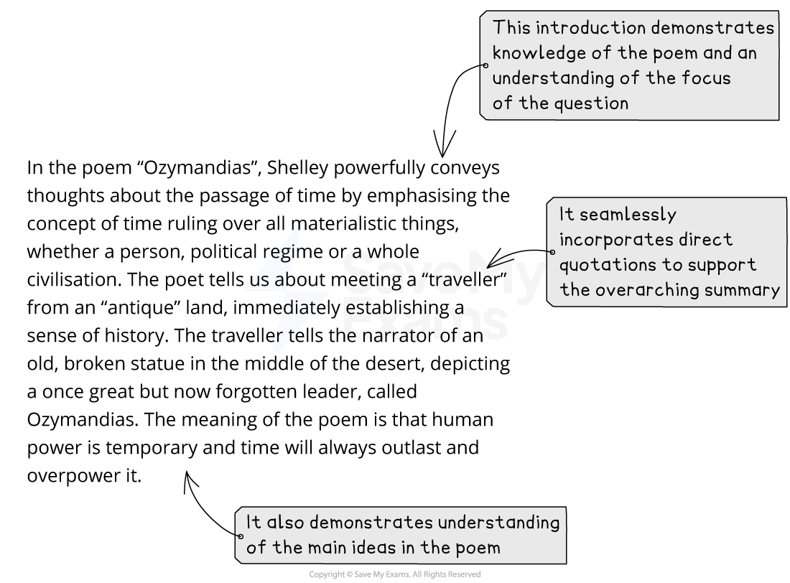
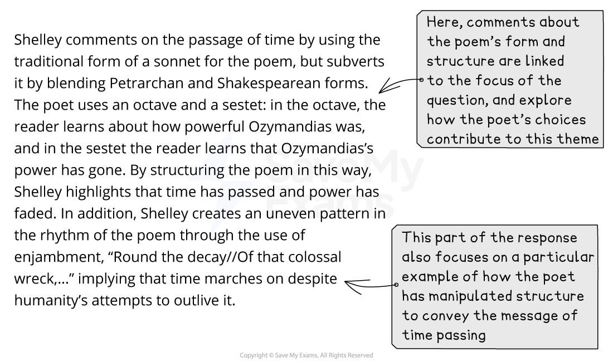
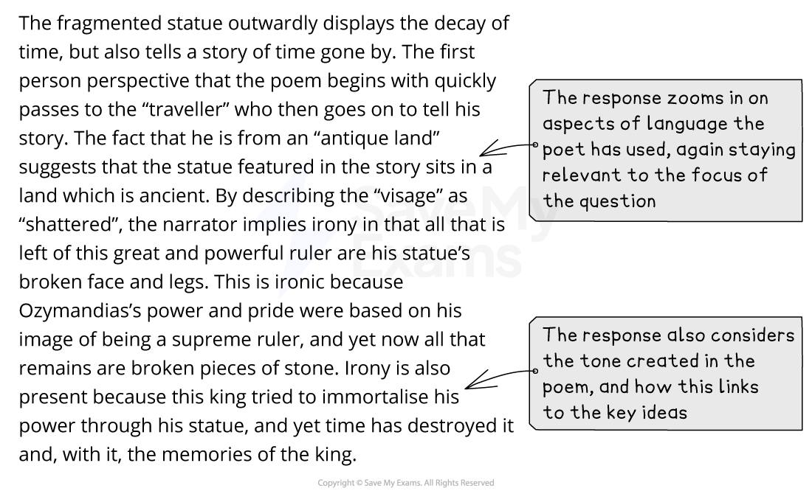
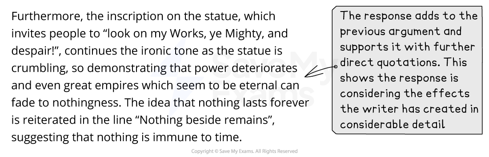
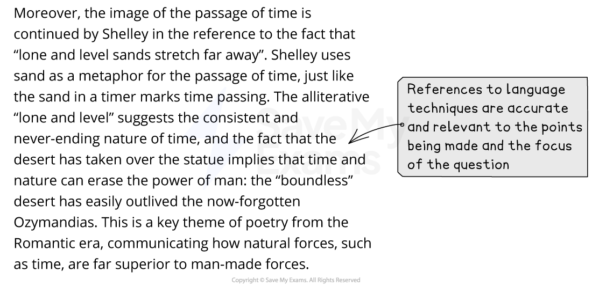
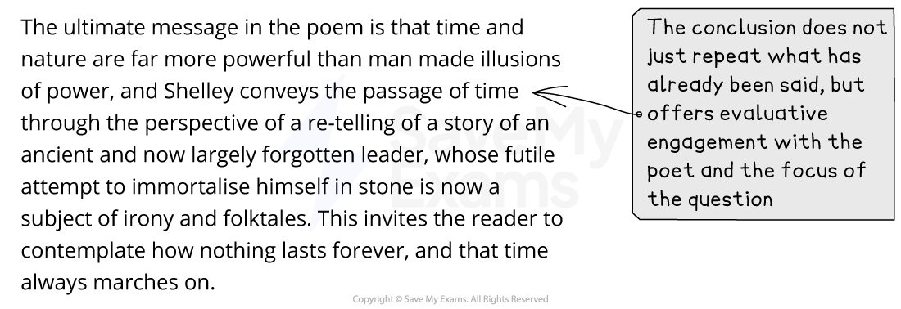

# Section A: Mark Scheme & Model Answer

## Poetry and Prose: Section A: Mark scheme and model answer

> **Spec point** — `spcpt_Vjr6Wfg5CdXgy2Qg`

## Section A: Mark Scheme and Model Answer

The best way to improve any essay is to know how you are assessed, and what skills you are being assessed on. This page has been created to give you a sense of what examiners are looking for in a full-mark response. It contains:

- Overview
- Mark scheme
- Example task
- Model answer
- Unannotated model answer

## Poetry and Prose: Section A: Mark scheme overview

> **Spec point** — `spcpt_YSnFkCVS9qDx4r7p`

## Overview

Section A (Poetry) will require you to answer one question from a choice of two. Each of the questions will feature one of the poems you have studied in your poetry anthology. You will be asked to explore, or analyse, how a poet has achieved particular meanings or ideas. Your response must also be supported with direct quotations or close reference to the poem.

## Poetry and Prose: Section A: Mark scheme

> **Spec point** — `spcpt_MdSWdN8XqBzXNy3x`

## Mark scheme

The mark scheme for any question in Literature in English is quite broad and can seem difficult to understand. This is because there is no “correct answer” for any essay: the exam board does not provide points that need to be included in any essay; instead, examiners use the mark scheme to place an answer into a level.

The questions in Paper 1 are equally weighted, and each question tests all four Assessment Objectives.

In simple terms, to achieve the highest marks (Band 8 = 23–25 marks), this means:

| **AO1** | - Demonstrate your knowledge by incorporating well-selected references to the text skillfully and with flair in your answers - This means using quotations and indirect references to the poem to support your views or arguments |
|---|---|
| **AO2** | - Sustain a critical understanding of the text by showing individuality and insight - This means showing that you understand the main ideas, settings, events and characters, and that you appreciate the deeper meanings of the poem |
| **AO3** | - Respond sensitively and in considerable detail to the way the writer achieves her/his effects - This means that you are able to explore how writers use language, structure and form to convey impressions and ideas |
| **AO4** | - Sustain a personal and evaluative engagement with the task and text - This means that you are able to give a personal response to the question and text, and support your response with references to the text |

> **Exam Hint**
> Although there are four specific assessment objectives assessed in this task, it is not the case that a certain number of marks are awarded for any one objective. Instead, the examiners are looking for a well-constructed and coherent essay that seamlessly combines all of the skills covered by the Assessment Objectives.

## Poetry and Prose: Section A: Example task

> **Spec point** — `spcpt_MKbHRKqnT97gFHfh`

## Example task

The following task is written in the style of a question you might get on your exam paper. It is based on the poem “Ozymandias” by Percy Bysshe Shelley.

| “Ozymandias”  I met a traveller from an antique land  Who said: Two vast and trunkless legs of stone  Stand in the desert…Near them, on the sand,  Half sunk, a shattered **visage** lies, whose frown,  And wrinkled lip, and sneer of cold command,  Tell us that its sculptor well those passions read  Which yet survive, stamped on these lifeless things,  The hand that mocked them, and the heart that fed:  And on the **pedestal** these words appear:  “My name is Ozymandias, king of kings:  Look on my works, ye Mighty, and despair!”  Nothing beside remains. Round the decay  Of that colossal wreck, boundless and bare  The lone and level sands stretch far away.  *How does Shelley powerfully convey to you thoughts about the passage of time in “Ozymandias”?* |
|---|

## Poetry and Prose: Section A: Model answer

> **Spec point** — `spcpt_ghtCc2p5s9cmcfnK`

## Model Answer

Below you will find a full-mark model answer for this task. The commentary labelled in each section of the essay illustrates how and why it would be awarded full marks. Despite the fact it is an answer to the above question on “Ozymandias”, the commentary is relevant to any of the other poems, because it is modelling how to structure an answer incorporating the relevant Assessment Objectives.

## Poetry and Prose: Section A: Unannotated model answer

> **Spec point** — `spcpt_6nm5B9qxtBrVD6c8`

## Unannotated model answer

| *In the poem “Ozymandias”, Shelley powerfully conveys thoughts about the passage of time by emphasising the concept of time ruling over all materialistic things, whether a person, political regime or a whole civilisation. The poet tells us about meeting a “traveller” from an “antique” land, immediately establishing a sense of history. The traveller tells the narrator of an old, broken statue in the middle of the desert, depicting a once-great but now forgotten leader, called Ozymandias. The meaning of the poem is that human power is temporary and time will always outlast and overpower it.*  *Shelley comments on the passage of time by using the traditional form of a sonnet for the poem, but subverts it by blending Petrarchan and Shakespearean forms. The poet uses an octave and a sestet: in the octave, the reader learns about how powerful Ozymandias was, and in the sestet the reader learns that Ozymandias’s power has gone. By structuring the poem in this way, Shelley highlights that time has passed and power has faded. In addition, Shelley creates an uneven pattern in the rhythm of the poem through the use of enjambment, “Round the decay/Of that colossal wreck,...” implying that time marches on despite humanity’s attempts to outlive it.*  *The fragmented statue outwardly displays the decay of time, but also tells a story of time gone by. The first person perspective that the poem begins with quickly passes to the “traveller” who then goes on to tell his story. The fact that he is from an “antique land” suggests that the statue featured in the story sits in a land that is ancient. By describing the “visage” as “shattered”, the narrator implies irony in that all that is left of this great and powerful ruler are his statue’s broken face and legs. This is ironic because Ozymandias’s power and pride were based on his image of being a supreme ruler, and yet now all that remains are broken pieces of stone. Irony is also present because this king tried to immortalise his power through his statue, and yet time has destroyed it and, with it, the memories of the king.*  *Furthermore, the inscription on the statue, which invites people to “look on my Works, ye Mighty, and despair!”, continues the ironic tone as the statue is crumbling, so demonstrating that power deteriorates and even great empires that seem to be eternal can fade to nothingness. The idea that nothing lasts forever is reiterated in the line “Nothing beside remains”, suggesting that nothing is immune to time.*  *Moreover, the image of the passage of time is continued by Shelley in the reference to the fact that “lone and level sands stretch far away”. Shelley uses sand as a metaphor for the passage of time, just like the sand in a timer marks time passing. The alliterative “lone and level” suggests the consistent and never-ending nature of time, and the fact that the desert has taken over the statue implies that time and nature can erase the power of man: the “boundless” desert has easily outlived the now-forgotten Ozymandias. This is a key theme of poetry from the Romantic era, communicating how natural forces, such as time, are far superior to man-made forces.*  *The ultimate message in the poem is that time and nature are far more powerful than man-made illusions of power, and Shelley conveys the passage of time through the perspective of a re-telling of a story of an ancient and now largely forgotten leader, whose futile attempt to immortalise himself in stone is now a subject of irony and folktales. This invites the reader to contemplate how nothing lasts forever, and that time always marches on.* |
|---|
