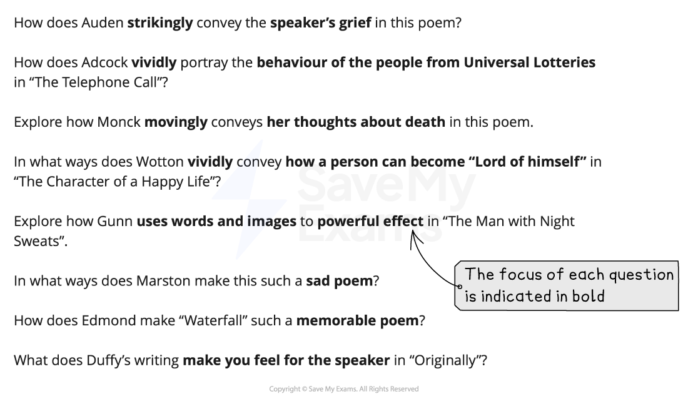

# Section A: What The Question Is Asking

## Poetry and Prose: Section A: What the question is asking

> **Spec point** — `spcpt_vXsDrmQNVmcM4bsd`

## Section A: What The Question Is Asking

Section A of Paper 1: Poetry and Prose is the **poetry** section. You must ensure you select the correct page and question numbers in the exam paper that relate to the poetry anthology you have studied. The guide below will enable you to approach the Section A **poetry question** with confidence. It is divided into:

- Overview
- Breaking down the question
- Top tips

## Poetry and Prose: Section A: Overview

> **Spec point** — `spcpt_2GvgKqzhBHVScd6F`

## Overview

You should answer one question in Section A from a choice of two. Each option will give you one of the poems you have studied in your poetry anthology printed on the exam paper. This Section is worth 25 marks and assesses all four Assessment Objectives. You have 45 minutes to answer this question.

In your response you are expected to:

- Demonstrate your knowledge of the poem through reference to detail and the use of accurate, relevant quotations from the poem
- Show that you understand the main ideas and explicit meanings in the poem, as well as the implied or hidden meanings
- Analyse, in detail, the choices the writer has made in terms of their use of language, structure and form to **convey** impressions and ideas
- Shape your writing in such a way as to communicate your engagement with the poem
- Demonstrate your understanding of the poem and the question
- Be sensitive to imagery, sound and language to develop an informed, personal response to the poem

The suggested timings for the Section A poetry question are:

| 10 minutes | - Decide on the question you are going to answer - Highlight the key words in the question you choose - Re-read the poem - Annotate in the margins - Make a brief plan of the structure of your answer |
|---|---|
| 30 minutes | - Follow your plan or annotations - Write your response |
| 5 minutes | - Re-read and check your response |

It is important to read and check your work, rather than to try to write as much as you can in the time allowed. Answers that are shorter, but more focused and *concise*, are often more successful.

## Poetry and Prose: Section A: Breaking down the question

> **Spec point** — `spcpt_Gg55CtBs7zSRDTw9`

## Breaking down the question

For this question, you will always be asked to write a response that explores how a poet conveys their meanings and message in their poem, focusing on a specific aspect or theme. The most common mistake students make in exams is not thoroughly understanding the question. By paying close attention to the question and understanding it thoroughly, you can enhance your exam performance significantly.

Below are a range of examples of Section A Poetry questions taken from past CIE IGCSE papers:

## Poetry and Prose: Section A: Top tips

> **Spec point** — `spcpt_8ZBxWQR72CJBKPpR`

## Top tips

- Highlight the key words in the question:

  - The most successful answers maintain a clear focus on the key words in the question
  - Therefore, pay particular attention to what the question is asking you to do
  - Then, as you read through the poem, highlight and annotate key words and phrases directly relevant to the focus of the question
- Quotations are intended to support your points, but should not be a point in themselves:

  - The strongest answers show a detailed knowledge of the text, by integrating precise and *concise* quotations and indirect textual references to support points
  - You need to be able to analyse and explain the relevance of the quotations you have chosen to your argument and to the question you are answering
- You should structure your response and your use of quotations in chronological order, and ensure that you respond to every section of the poem:

  - You should aim to select 6–7 relevant quotations that contain a range of language and/or structure devices that you can comment upon and analyse
  - A high-level response will incorporate these quotations into the explanations of meaning
- Do not ignore the final stanza:

  - This is often where the poet emphasises their message or attitude
- Do not just state your ideas:

  - The most convincing responses sustain a critical engagement with the ways in which writers achieve their effects
  - Therefore, it is important that your explanation and analysis is supported with reasons
  - Use words such as “because”, “as” or “since” to offer reasons as to how the writer’s choices of language and structure achieve the particular effects that you mention
  - Make sure you link all of your ideas and reasons to the question
- Embed your quotations into your sentences:

  - Avoid unnecessary phrases such as “This is shown by the quote…” as this is just a waste of words
  - Instead, try: “Atwood expresses her belief that nature will overcome the suburbs by referring to the ‘future cracks in the plaster’”
- Ensure your introduction demonstrates that you have understood the task and that you have a thorough knowledge of the poem:

  - You can do this by defining the focus of the question and summarising the main themes of the poem
- Do not waste words on general topic sentences that do not make a specific point:

  - For example: “Human activities seem pointless by the way Atwood describes them”:
  
    - This does not make any specific point that the examiner could reward with a mark
- Make sure you stick to the given poem and the focus of the question:

  - Do not refer to or make comments about any of the other poems in the anthology
- Avoid being narrative:

  - You do not get any marks for just re-telling the poem
- Make sure every paragraph answers the question:

  - Do not just write down everything you know about the poem without any focus on the question
  - Make every sentence count!
- Ensure you include analysis of the use of structure and the form of the poem:

  - Writing just about the poet’s use of language can limit your marks
- In addition, avoid “feature-spotting”:

  - Listing techniques a poet has used without analysis will not get you marks
- Your conclusion should be relevant and should summarise your personal response to the poem and the task:

  - The strongest answers provide evidence of an informed and sensitive personal response to the text, which focuses directly on the key words of question
  - It should not just repeat points you have already made
- Avoid lengthy discussion of the historical context of the writer and/or the time in which the poem was written:

  - Context is not explicitly assessed in this IGCSE
  - Instead, your wider background knowledge should be used to inform your personal response to the poem
