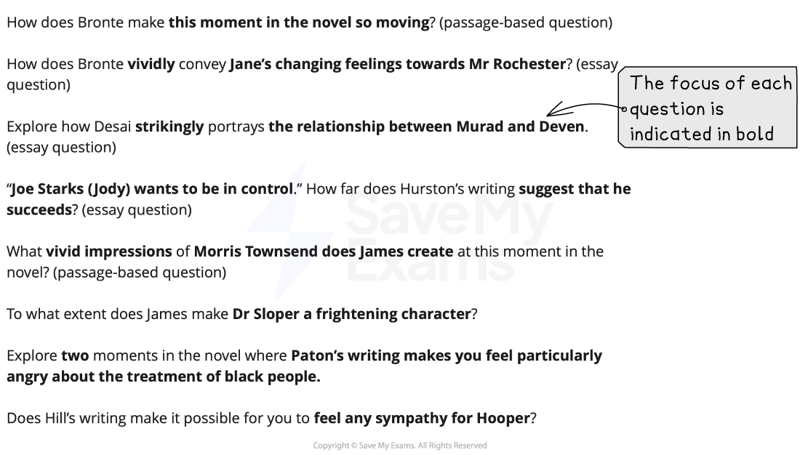

# Section B: What The Question Is Asking

## Poetry and Prose: Section B: What the question is asking

> **Spec point** — `spcpt_hwHJsPcNrp2Psb2W`

## Section B: What The Question Is Asking

Section B of Paper 1: Poetry and Prose is the prose section. You must ensure you select the correct page and question numbers in the exam paper that relate to the prose text you have studied. The guide below will enable you to approach the Section A **prose question** with confidence. It is divided into:

- Overview
- Breaking down the question
- Top tips

## Poetry and Prose: Section B: Overview

> **Spec point** — `spcpt_rktbZhwnBW7hrgNr`

## Overview

You should answer one question in Section B from a choice of two. The first option will give you a passage from the text and ask you to consider how the writer achieves a certain effect within this passage. The second option will not have a passage attached, but is an “essay”-style question. This Section is worth 25 marks and assesses all four Assessment Objectives. You have 45 minutes to answer this question.

In your response you are expected to:

- Demonstrate your knowledge of the text through reference to detail and the use of accurate, relevant quotations
- Show that you understand the main ideas and explicit meanings in the text, as well as the implied or hidden meanings
- Analyse, in detail, the choices the writer has made in terms of their use of language, structure and form to **convey** impressions and ideas
- Shape your writing in such a way as to communicate your engagement with the text
- Demonstrate your understanding of the text, and the question
- Be sensitive to imagery and language to develop an informed personal response to the text

The suggested timings for the Section B prose question are:

| 10 minutes | - Decide on the question you are going to answer - Highlight the key words in the question you choose - If you decide to answer the passage-based question, annotate the key words and phrases in the passage you might want to explore in your answer - If you decide to answer the essay question, write a brief plan, using bullet points or a mind map |
|---|---|
| 30 minutes | - Follow your plan or annotations - Write your response |
| 5 minutes | - Re-read and check your response |

It is important to read and check your work, rather than to try to write as much as you can in the time allowed. Answers that are shorter, but more focused and *concise*, are often more successful.

## Poetry and Prose: Section B: Breaking down the question

> **Spec point** — `spcpt_WJpnwM4nZZtXWXxV`

## Breaking down the question

For this question, you will always be asked to write a response that explores how a writer conveys their meanings and message in the text, focusing on a specific aspect or theme. The most common mistake students make in exams is not thoroughly understanding the question. By paying close attention to the question and understanding it thoroughly, you can enhance your exam performance significantly.

Below are a range of examples of Section B Prose questions taken from past CIE IGCSE papers:

## Poetry and Prose: Section B: Top tips

> **Spec point** — `spcpt_ThTT68zZBcXbT7qb`

## Top tips

- Highlight the key words in the question:

  - The most successful answers maintain a clear focus on the key words in the question
  - Therefore, pay particular attention to what the question is asking you to do
- If you choose to answer the essay question, it is important that you do not just use the extract printed for the previous question as evidence in your response:

  - This will limit your marks as there will be insufficient material to draw upon
  - Some of these types of questions also make it clear that you must not use the printed passage as evidence in your answer
- Quotations are intended to support your points, but should not be a point in themselves:

  - The strongest answers show a detailed knowledge of the text, by integrating precise and *concise* quotations and indirect textual references to support points
  - You need to be able to analyse and explain the relevance of the quotations you have chosen to your argument or to the question you are answering
- If answering the passage-based question, you should structure your response and your use of quotations in chronological order, and ensure that you respond to every section of the extract:

  - You should aim to select 6–7 relevant quotations that contain a range of language and/or structure devices that you can comment upon and analyse
  - A high-level response will incorporate these quotations into the explanations of meaning
- If answering the essay question, you should show that you have extensive knowledge of the text as a whole, and include both direct quotations and indirect references to the text (as relevant to the focus of the question)
- Do not just state your ideas:

  - The most convincing responses sustain a critical engagement with the ways in which writers achieve their effects
  - Therefore, it is important that your explanation and analysis is supported with reasons
  - Use words such as “because”, “as” or “since” to offer reasons as to how the writer’s choices of language and structure achieve the particular effects that you mention
  - Make sure you link all of your ideas and reasons to the question
- Embed your quotations into your sentences:

  - Avoid unnecessary phrases such as “This is shown by the quote…” as this is just a waste of words
  - Instead, try: “The writer creates sympathy for the character by describing her as ‘small and weak’.”
- Ensure your introduction demonstrates that you have understood the task and that you have a thorough knowledge of the text:

  - You can do this by defining the focus of the question
- Do not waste words on general topic sentences that do not make a specific point:

  - For example: “The writer uses adjectives to create sympathy for the character.”
  - This does not make any specific point that the examiner could reward with a mark
- Avoid being narrative:

  - You do not get any marks for just re-telling the story
- Make sure every paragraph answers the question:

  - Do not just write down everything you know about the novel without any focus on the question
  - Make every sentence count!
- Ensure you include analysis of the use of structure and the form of the text:

  - This is especially important when considering, for example, a writer’s use of dialogue
- In addition, avoid “feature-spotting”:

  - Listing techniques a writer has used without analysis will not get you marks
- Your conclusion should be relevant and should summarise your personal response to the text and the task:

  - The strongest answers provide evidence of an informed and sensitive personal response to the text, which focuses directly on the key words of questions
  - It should not just repeat points you have already made
- Avoid lengthy discussion of the historical context of the writer and/or the time in which the text was written:

  - Context is not explicitly assessed in this IGCSE
  - Instead, your wider background knowledge should be used to inform your personal response to the text
