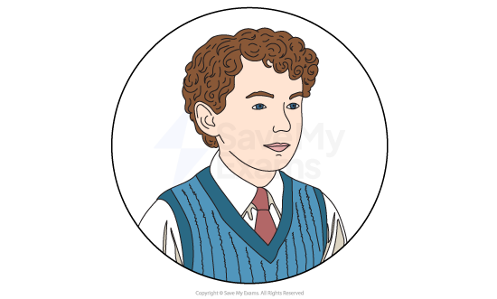
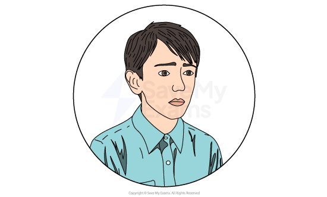
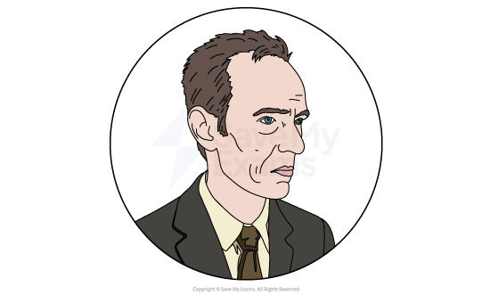
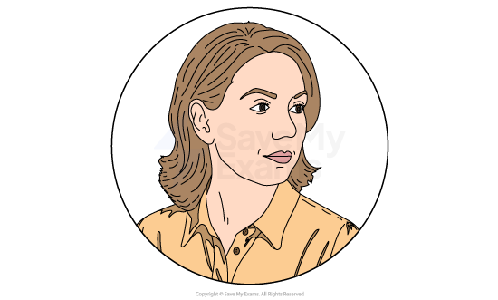
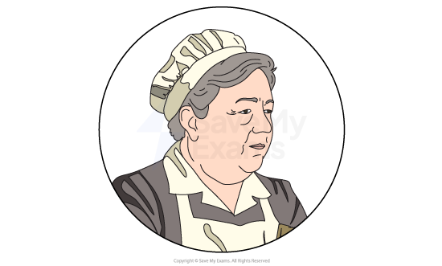
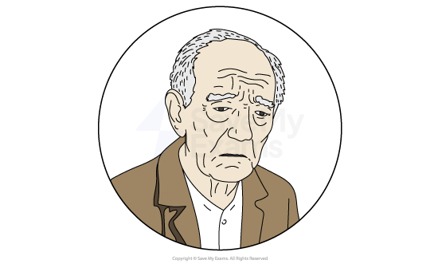

# I'm the King of the Castle: Characters

Hill’s main characters in this book reflect personality traits such as selfishness, vulnerability, lack of insight and even evil and feed into larger themes such as power, cruelty and lack of love.

It is important not only to learn about each character individually, but also how they compare and contrast to other characters in the novel.

You should look at:

- How characters are established
- How characters are presented:

  - Physical appearance or suggestions about this
- Their actions and motives
- What they say and think
- How they interact with others
- What others say and think about them
- Their relationships to other characters

Below you will find character profiles of:

**Main Characters:**

- Edmund Hooper
- Charles Kingshaw
- Mr Joseph Hooper
- Mrs Helena Kingshaw
- Anthony Fielding

**Other characters: **

- Mrs Alice Boland, a housekeeper
- Mr Joseph Hooper senior (Edmund’s grandfather)

## I'm the King of the Castle: Characters: Main characters

> **Spec point** — `spcpt_dzkgdmBymR3mZW4W`

## Main characters

### Edmund Hooper

*Edmund Hooper*

- Edmund Hooper, an 11-year-old boy, is the [antagonist](https://www.savemyexams.com/glossary/gcse/english-language/antagonist-definition/) in the novel:

  - He is first introduced to the reader as a cold, unfeeling child not disturbed by the sight of his grandfather on his deathbed
  - When taken to the deathbed, he tells his father “I am never afraid” and privately observes that the dying man looks like “one of his dead old moths”
- He displays a sense of pride and possessiveness over the country house his father has inherited:

  - He tells Charles “When my father dies…this house will belong to me, I shall be master”
- When Charles Kingshaw, a boy of a similar age, arrives with his mother, Edmund is immediately antagonistic towards him, sending him a note telling him he is unwanted at the house
- He first displays his cruelty when teasing Charles about his fear of a crow that had attacked him
- Edmund plays on Charles’ fears and shows his *sadistic* tendencies by locking him in the room containing the dead moth collection:

  - Later by leaving a dead, stuffed crow on his bed
- Edmund is very observant about what Charles is doing, admitting to Charles “I see everything”:

  - He is also manipulative and clever at taking advantage of situations
  - He falsely accuses Charles of pushing him into a pool in the woods and bashing him
- Edmund operates with cunning and ambition
- The author gives us few clues as to Edmund’s appearance:

  - He has a thin neck
  - He has square teeth with ridges down them and a gap in between them at the front
  - He is half a head shorter than Charles
- In the book’s afterword, the author describes Edmund as evil

### Charles Kingshaw

*Charles Kingshaw*

- Charles, almost 11 at the start of the novel, is the victim in the story:

  - Edmund Hooper plays on his fears and insecurities to relentlessly bully him
- In her afterword, the author talks about his bitter misery and suffering
- Little is given away in terms of his physical description, apart from that he is half a head taller than Edmund
- When we meet Charles, it is on his arrival at the latest of many new homes:

  - His sense of not belonging is apparent, describing Warings as “one more strange house in which we do not properly belong”
  - He is defined by a deep sense of not belonging
- After he fights Edmund, he shows self-awareness by reflecting that he is too vulnerable to deal with enemies
- He realises he is isolated but wants to prove to himself he can get by in this place:

  - But when he is attacked by a crow while out exploring, he feels his own extreme isolation
- In some ways he likes being alone because people are unpredictable
- He also feels misunderstood by his mother:

  - He realises she sees “some other person” when she looks at him
  - This estrangement turns into active dislike; he is ashamed of her behaviour with Mr Hooper and feels she has betrayed him for security
- He reveals a lack of self-confidence by having no good opinion of his chances against Edmund, or anyone else:

  - He is not cowardly, just realistic and resigned to the idea that the world is stacked against him
- This fatalistic, defeatist attitude continues with him:

  - He doesn’t give in, but accepts he will be beaten
- Charles is only truly confident and capable when removed from the social hierarchy of Warings and placed in the natural world:

  - While Edmund is terrified by the wood and the storm, Charles takes charge
  - He takes pride in his physical ability to climb
- He adheres to a moral code that ultimately disadvantages him against the amoral Edmund:

  - Unlike Edmund, who lies smoothly to the adults, Charles cannot make himself understood or believed
  - He does not fully exploit Edmund’s moments of weakness; for example, at the castle, he reaches out to help Edmund rather than pushing him
- However, whilst physically brave, Charles is psychologically fragile and deeply susceptible to Edmund’s psychological torment
- Charles’ ultimate decision to drown himself is presented not as a moment of panic, but as a calm, logical solution to an insoluble problem:

  - He realises that, with the marriage of his mother to Mr Hooper and the prospect of attending Edmund’s school, there is no hope of escape
  - His decision is his final assertion of *autonomy* in a world where he has no other control

### Mr Joseph Hooper

*Mr Joseph Hooper*

- Mr Hooper is Edmund’s father, a 51-year-old widower, who has inherited Warings, the house in which the novel is based:

  - He is described by Charles Kingshaw as being very tall and thin and dark, like a crow
  - Later, we are told he has receding hair and he himself thinks he has “seaweed-coloured eyes, a jutting nose and fine, thin lines”
  - on his forehead and around his mouth
  - He is “very tall and thin and grey, like some terrible bird”
- When we first meet him, his father is still alive although on his deathbed, and Mr Hooper is said to be acquiring a “dynastic sense” of his impending inheritance
- He knows himself to be an “ineffectual man, without any strength or imposing qualities”:

  - He is a boring man, who is liked and generally well-regarded
- Revealing himself to be blind to what is going on under his own roof, Mrs Kingshaw and he reflect on how well the boys are getting on together:

  - Both adults willfully ignore the hostility between the boys
  - They congratulate themselves on how well the boys have settled
- Later, Mr Hooper reflects that he has made a “good choice” in proposing to Mrs Kingshaw, and he is impatient for the register to be signed and the boys packed off to school:

  - His impatience is explicitly linked to his repressed sexuality
- Overall, Mr Hooper is depicted as a lonely, insecure and emotionally repressed figure who uses his house and his new relationship to bolster a fragile sense of self-worth

### Mrs Helena Kingshaw

*Mrs Helena Kingshaw*

- Mrs Kingshaw, a widow aged 37, arrives at Warings with her son Charles to take up the position of housekeeper:

  - She is depicted as a woman driven by a desperate need for security and social status, often at the expense of her son’s well-being
- We learn that Mrs Kingshaw and Charles have had lots of false starts before arriving at Warings, and she is keen that they make a success of this opportunity:

  - She is keen that her chance at a better future should not be compromised by Charles’ behaviour
- She focuses on her future rather than what might be best for Charles, suggesting that she is self-absorbed:

  - When she fears Charles might disrupt the harmony of the household, she thinks “Do not spoil everything for me…do not take away my chance”
- Mrs Kingshaw seems to know what to say and what to do to make Mr Hooper like and increasingly depend on her:

  - She carefully cultivates a [persona](https://www.savemyexams.com/glossary/gcse/english-literature/persona-definition/) that appeals to Mr Hooper’s vanity
  - She acts helpless to make him feel strong
  - She works to ingratiate herself, ensuring Mr Hooper hears her speaking
- The suggestion is that she is being manipulative in pursuit of her goals of security, a stable home and a step up the social ladder via her relationship with Mr Hooper
- She is blind to what is happening to her son:

  - She is described as seeing “some other person” when she looks at Charles, rather than who he really is
  - She dismisses his fears about Edmund as “silly” or “naughty”, refusing to listen when he tries to tell her the truth about the bullying
- She takes the view that she needs to think of herself a bit more
- Charles remembers his mother coming to his school for speech day and sports day wearing earrings and “slippery-looking” dresses and one of his fellow pupils described her as “an old tart”:

  - She is also featured shortening the hem of a dress to make herself look younger, and pledging to take good care of her appearance
- Later, Mrs Kingshaw reflects that she is not a woman who can cope easily alone
- When Charles’ body is found after his suicide, Mrs Kingshaw comforts Edmund and tells him everything will be all right:

  - She does not mourn him immediately or blame Edmund

- This suggests that her priority remains the stability of her new family unit with the Hoopers, even in the face of her son’s death

### Anthony Fielding

*Anthony Fielding*

- Fielding, as he is generally referred to, is a local farmer’s son, who appears towards the end of the book:

  - Her serves as a crucial *foil* to both Charles and Edmund, representing a normalcy and resilience that the other two boys lack
- We assume him to be around the same age as Edmund and Charles, judging by his willingness to play the same sort of games Charles wants to play
- He is a confident, open and kind boy
- When Charles first meets Fielding near a local church, we are told Fielding’s face is very small and brown as a nut, suggesting a life spent outside
- Charles is envious of his ease when helping to deliver a calf
- Charles realises that Edmund would not be able to intimidate Fielding as he is described as “invulnerable” to his bullying:

  - When he meets Edmund, Fielding tells him he is not frightened of much
  - Edmund had never met anyone so honest about himself and is confused by Fielding
- The suggestion is that of the books characters, only Fielding has goodness and innocence, openness and warmth:

  - He has known normal human love, given and received, and taken it for granted

## I'm the King of the Castle: Characters: Minor characters

> **Spec point** — `spcpt_m7G9pK4ZwYdQm8JF`

## Minor characters

### Mrs Alice Boland

*Mrs Boland*

- Mrs Boland is an older housekeeper who, we presume, Mr Hooper inherits along with the house
- She remains and carries out housekeeping duties after Mrs Kingshaw’s arrival:

  - This suggests Mr Hooper was looking for a social and romantic companion when seeking out Mrs Kingshaw
- She is said to have a thin, attentive face
- She shows this attentiveness when noticing Charles is looking peaky and puts this down to the shock of seeing Edmund fall from the castle walls:

  - However, while she notices his physical state, she lacks deeper understanding and she quickly turns her attention back to the television set
  - This further highlights Charles isolation

### Mr Joseph Hooper senior

*Mr Hooper senior*

- Edmund’s grandfather only appears in the book on his deathbed, or in [flashback](https://www.savemyexams.com/glossary/gcse/english-language/flashback-definition/):

  - He comes across as a cold, overbearing man full of his own importance
- The old man is on his deathbed at the start of the book, with his son about to inherit the house:

  - His skin is described as “already dead…old and dry”
  - He is further described as “bleached and grey-ish white”
- The current Mr Hooper tells Edmund that his grandfather was one of the most important moth collectors of his day, known and respected the world over:

  - But he hated it violently, remembering being lectured and instructed on it and being “forced to watch insects being removed from poison-fume bottles with tweezers”
- His father had told him he must learn the value of what he was to inherit:

  - The text states he “had not dared to rebel”, suggesting his father was a strict disciplinarian
- Edmund suspects he has not been brought to look at the moth collection before because his father had quarrelled with his grandfather

### Sources

Hill, S. (1970) I’m the King of the Castle. 1989 edn. Penguin.
