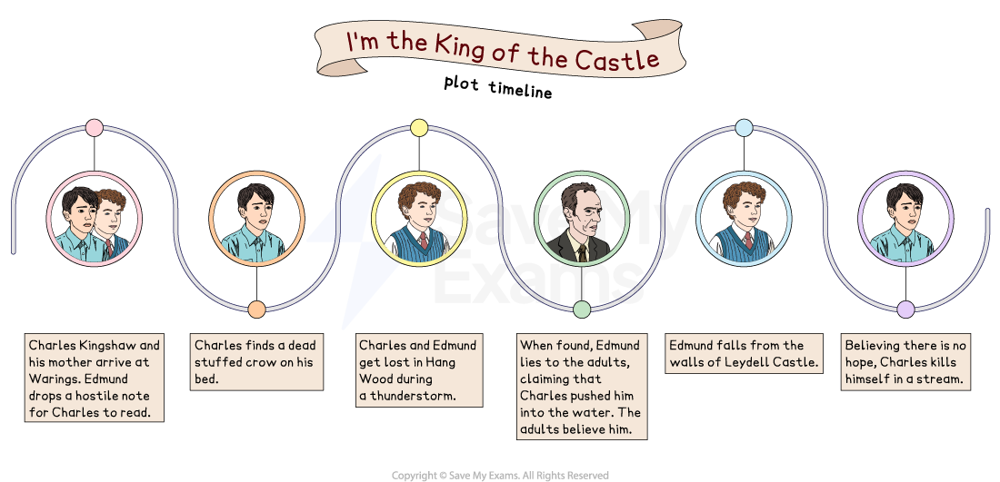

# I'm the King of the Castle: Plot Summary

## I'm the King of the Castle: Plot Summary

> **Spec point** — `spcpt_WYBN8s5N6CPDyDXP`

## I'm the King of the Castle Plot Summary

*Plot summary*

## I'm the King of the Castle: Overview

> **Spec point** — `spcpt_tw2sD6f5TJsd26p2`

## Overview of I’m the King of the Castle

I’m the King of the Castle, published in 1970, explores how a combination of childhood bullying and parental negligence can lead to tragedy. Taking its title from the children’s power game in which higher ground is seized after a struggle, it focuses on the relationship between two 11-year-old boarding school boys, Edmund Hooper and Charles Kingshaw.

Charles and his widowed mother Helena (Mrs Kingshaw) arrive at Warings, an English country house impressive in size but somewhat neglected, close to the fictitious village of Derne. The house is owned by Joseph Hooper, who recently inherited it following the death of his father. A widower, he lives there with his son Edmund. Charles’ mother is to become the housekeeper.

When the newcomers arrive, Edmund makes it immediately clear to Charles that he doesn’t want him there. The boys fight and Charles, a child with a nervous disposition and multiple fears, is shocked by Edmund’s *belligerence* and cruelty. Their relationship then unfolds through a series of gothic set-pieces, such as a room full of dead moths on display and a stuffed, dead crow left on a bed, as Edmund uses *psychological* torture to play on Charles’ fears. Meanwhile, Mr Hooper and Mrs Kingshaw grow closer and become increasingly blind to Edmund’s cruelty and the impact it is having on Charles.

Edmund blocks Charles’ plans to escape from him at every turn and even follows him into the woods when Charles attempts to run away. Later, Charles tries to help Edmund after they climb a ruined castle’s walls, but Edmund falls and hurts himself. He accuses Charles of pushing him, an accusation that seems to be believed by Charles’ mother.

Charles makes a new friend, a working-class farm boy called Fielding, and is delighted to have at least a part of his life that is unique to him. But his joy is short lived as an ever-observant Edmund moves in on the relationship and Mrs Kingshaw invites Fielding and his mother to tea.

When Mr Hooper and Mrs Kingshaw reveal that they are to be married and that Charles will be attending the same boarding school as his arch enemy Edmund, Charles sees no hope for the future and heads to the nearby woods, where he drowns himself in a pool.

> **Exam Hint**
> You will be given an extract from the novel on the exam paper, with a choice of two questions. One of these questions will be about the printed extract. However, you are still expected to demonstrate a thorough understanding of the text as a whole, and how characters and/or events in the extract relate to the wider novel.

## I'm the King of the Castle: Chapter-by-chapter plot summary

> **Spec point** — `spcpt_Y3RW8Y2Dx28mhQ2v`

## I’m the King of the Castle: Chapter-by-chapter plot summary

### Chapter 1

- Joseph Hooper and his 11-year-old son Edmund move into Warings, an “ugly” and uncared for country house, inheriting it after the death of Joseph’s father
- Joseph tells Edmund that* *he is looking into getting someone in to take care of them, along with a companion for Edmund:

  - Edmund is against the idea

- His father warns Edmund not to go into the Red Room, where a valuable display of dead moths collected by Joseph’s father, is kept
- Later, against his father’s wishes, Edmund enters the room:

  - He opens the case containing the largest moth in the collection and picks it up
  - The moth disintegrates into dust

### Chapter 2

- Joseph tells Edmund of the imminent arrival of a housekeeper and her son who is the same age as him
- When the widow Helena Kingshaw and her son Charles arrive, Edmund, who is watching from an upstairs window, throws down a note which Charles reads:

  - It says  “I DIDN’T WANT YOU TO COME HERE”

- The boys meet and Edmund taunts Charles about his family’s lack of a house and Charles’ claims about his dead father
- The row escalates and the boys fight:

  - Charles gets a bloody nose
  - After Edmund leaves, Charles begins to cry

- Later, Edmund is forced by his father to show Charles around the house

### Chapter 3

- A week later, Charles heads out to explore the woods and fields around the house
- He gets scared when a large crow flaps around his head and then lands on his back when he falls over
- When he eventually gets away from the bird and returns to the house, Edmund teases Charles for being frightened
- Later, Charles awakens to find a shape on his bed:

  - It is a stuffed, dead crow put there by Edmund
  - Charles is terrified but refuses to scream out in case Edmund is listening

- Later, Edmund finds Charles looking in the window of the Red Room:

  - He offers to show Charles the room after supper
  - Charles feels forced to accept the offer even though he is terrified of moths

- Once they are in the room, Edmund locks Charles in:

  - Charles starts to cry, his fear made worse by a live moth flapping around
  - Eventually he is released by Mr Hooper and his mother, telling them he got locked in

### Chapter 4

- A week later Charles finds a remote room in the house where he can escape from Edmund and concentrate on his own interests, such as model-making
- Edmund discovers that Charles is using the room and challenges him about it
- He also finds that Charles has collected items together which suggest he is planning to run away
- Meanwhile, Mr Hooper and Mrs Kingshaw are growing ever closer and start planning a cocktail party:

  - The chapter ends with the [irony](https://www.savemyexams.com/glossary/gcse/english-language/irony-definition/) of the parents congratulating themselves on how well the boys have settled

### Chapter 5

- Mrs Kingshaw tells Charles she is going to London for the day with Mr Hooper to buy items for the cocktail party
- Charles plans to use their absence as the time to make his escape
- Charles leaves the house early on the day of the London trip and heads for the nearby Hang Wood

### Chapter 6

- Charles moves further into the woods, but before long Edmund finds him
- He continues to mock Charles about his status in the house and calls his mother a servant
- Edmund invites himself along and the boys go deeper into an adjoining forest;

  - They come across a deer, follow it and are soon lost

- For the first time Charles hears a note of fear in Edmund’s voice as they lose their bearings and he, Edmund, is alarmed by a rumble of thunder

### Chapter 7

- Charles realises Edmund is scared:

  - Edmund admits to hating thunder, saying it makes him feel sick

- Charles thinks this may make Edmund ashamed and could change their relationship in future with him becoming the leader
- But after the storm has died down, Edmund acts as if nothing has happened and re-takes the leadership role as they continue on
- They come across a pool and Edmund decides to swim:

  - Charles follows him in

- Later, the boys realise they might be more lost than they thought and Edmund starts to panic over their predicament, screaming and punching the ground:

  - Charles slaps him to try and bring him back to his senses

- Charles tries to find a route out of the forest:

  - While trying different escape options, in vain, he considers abandoning Edmund,   but can’t do so as he feels a responsibility for him

- He returns to find Edmund lying flat on his face in the pool with blood coming from a head wound:

  - He is barely conscious, having banged his head on a stone

- Edmund gradually comes back around

### Chapter 8

- Edmund boasts about receiving expensive Christmas gifts from his father and teases Charles that his mother has designs on Mr Hooper
- Charles catches a fish for them to eat, but it is inedible
- When they sleep, Edmund has nightmares and calls for his mummy:

  - Charles is forced to slap him again

- Charles taunts Edmund about him being scared and the prospect of him being left alone in the forest

### Chapter 9

- Having gained the upper hand over Edmund, Charles begins to enjoy life in the forest
- But then they are found by rescuers

### Chapter 10

- Upon being discovered by the adults, Edmund immediately lies, claiming that Charles pushed him into the stream and “bashed” him:

  - The adults readily believe this story
- Frustrated at being ignored, Charles shouts that he wishes Edmund had died, which horrifies the adults
- Charles lunges at Edmund, but is physically restrained by Mr Hooper:

  - During the confusion, Edmund sneakily kicks Charles’ ankle
- Mrs Kingshaw sends both boys to their rooms:

  - Alone, Charles realises the adults do not know him at all and will always believe Edmund
- Mrs Kingshaw visits Charles in his bedroom and hints at a “lovely surprise” for his future:

  - Charles works out his mother’s secret: that she intends to marry Mr Hooper and he will be forced to live at Warings forever

### Chapter 11

- Over breakfast, Mr Hooper reveals that the plan is that Charles will be moving schools and in future will attend the same one as Edmund:

  - Charles is horrified and fantasises about being back in the forest

- Seeking solitude, he hides in a remote shed but the door locks behind him and he knows Edmund has found him and locked him inside
- Charles becomes frightened, imagining a number of horrific scenarios
- He falls asleep but is awoken by Edmund calling his name from outside:

  - Edmund taunts Charles about the type of creatures that may be in the shed with him

- Edmund tells him how awful it will be for him at his new school, revealing that he, Edmund, will be “head of *Dorm*” next year and will be able to make Charles’s life hell
- Edmund eventually lets him out

### Chapter 12

- Mr Hooper has planned a trip for the four of them to the ruined Leydell Castle
- Once there, Mr Hooper and Mrs Kingshaw sit on a bench together while the boys head off to explore
- Charles, who is a confident climber, scales the castle walls and declares himself king of the castle:

  - He attempts to coax Edmund into following him
  - Edmund, not keen on climbing, is reluctant but does eventually climb up beside Charles

- Edmund becomes paralysed by fear and wets himself:

  - Charles tries to help him but Edmund falls from the wall

### Chapter 13

- Charles is sure Edmund is dead
- He is worried that it will be thought that he pushed him and, as she drives him home, he tells his mother this isn’t the case:

  - She blames him for climbing up there in the first place
  - At home, Charles thinks things may turn out okay with Edmund dead

- Later on, following a nightmare, Charles leaves his bedroom and is carried downstairs by Mr Hooper:

  - His mother tells him that Edmund isn’t dead

### Chapter 14

- Charles’ mother wants him to visit Edmund in hospital but he refuses to go
- He tells his mother that, far from being his best friend, he hates Edmund:

  - She dismisses his remarks as “silliness”

- At the hospital Edmund, who has a broken leg, is pleased that Mrs Kingshaw has chosen to be with him rather than Charles
- Charles goes for a walk and meets another boy, Fielding, the son of a local farmer
- They spend time together and Fielding shows him various things at the farm:

  - Charles is impressed with Fielding’s ease and self-assurance
  - He is introduced to Fielding’s mother who also seems to be easy-going
  - He is pleased to have found a friend who is nothing to do with Edmund

- Back home, Charles’ mother tells him Edmund is coming home the next day:

  - Edmund doesn’t come home as he has a temperature
  - Charles is pleased and goes to find his new friend Fielding

### Chapter 15

- On his return home, Edmund continues to be hostile to Charles
- Charles fears Edmund’s plotting after Edmund accuses Charles of pushing him off the castle wall and threatens retribution
- Charles remembers being beaten up at school for no apparent reason by a boy called Crawford, but reflects that Crawford was simply brutal whereas Edmund’s bullying is a “reign of terror”
- In speaking to his mother, Charles detects a new “sharpness and impatience” and decides she is acting this way to please Mr Hooper
- Charles meets Fielding who is with his father:

  - They are taking a calf to market
  - Part of Charles wants to accompany them, but he concludes the market would hold “all kinds of new terror for him”

- Returning home, Edmund tells Charles he knows all about Fielding:

  - Charles reflects that he now has nothing that he can call his alone

- Mrs Kingshaw is shortening the hem of a dress in an attempt to look younger
- Mr Hooper takes Charles on the train to London to buy his new school’s uniform
- On returning home, Charles is horrified to find Edmund playing with his model:

  - He becomes hysterical and is slapped by Mr Hooper

- Later, the boys argue, with Edmund telling Charles he doesn’t own anything in the house:

  - Charles lunges at Edmund who throws the model at the wall, breaking it
  - Mrs Kingshaw arrives and tells Charles he should be ashamed of himself

### Chapter 16

- In a telephone conversation overheard by Mr Hooper and Charles, Mrs Kingshaw, keen to let Mr Hooper know she has “retained her pride”, tells a friend she hasn’t made up her mind about future plans
- Mr Hooper is anxious about Mrs Kingshaw’s phone conversation:

  - Keen for her to stay at Warings, he comes to a decision

- The four of them go for a drive to an unstated destination for a “splendid treat”
- Edmund has already told Charles that their parents plan to marry:

  - Charles thinks this is the “worst thing in the world”

- Their destination is revealed to be a circus:

  - Mrs Kingshaw knows Charles was extremely frightened of circuses in the past, but for some reason assumes that not to be the case any longer
  - Charles is terrified by all the sights and sounds and is violently sick

- Later, Mrs Kingshaw tells Charles she has invited Fielding and his mother to tea:

  - Charles, who wants to keep Fielding to himself, is horrified

- The adults have talked about plans for their wedding day and for driving the boys to school:

  - Charles dreads the idea of being alone with Edmund at school

- The Fieldings come to tea:

  - Edmund realises he will not be able to scare Fielding or intimidate him
  - The boys go to the Red Room
  - Fielding is interested in its contents, but not in any way horrified or scared

- Edmund suggests they go to the attic but Charles, remembering the stuffed crow, is scared to go:

  - Fielding, recognising his unease, suggests going to his family’s farm instead
  - Edmund follows him but Charles, unwilling to share Fielding and his farm with Edmund, stays behind

- After they have gone, Charles goes to Edmund’s bedroom and steals his battle chart:

  - He takes it outside and shreds and burns it

### Chapter 17

- The house is full of suitcases in preparation for the boys’ departure for school and their parents’ honeymoon
- Edmund has not said anything to Charles about him destroying his battle chart:

  - Charles anticipates Edmund’s revenge and his fear is heightened when Edmund slips a note under his bedroom door telling him that something will happen to him

- Later, at dawn, Charles heads to the woods and finds the pool he swam in with Edmund:

  - He thinks of the things Edmund has done and about the wedding and his new school
  - He enters the pool and drowns himself

- Edmund finds the body and feels triumphant that he has made Charles do it
- Mrs Kingshaw tells Edmund not to look at the scene and tells him that everything is all right

### Sources

Hill, S. (1970) *I’m the King of the Castle*. 1989 edn. Penguin.
