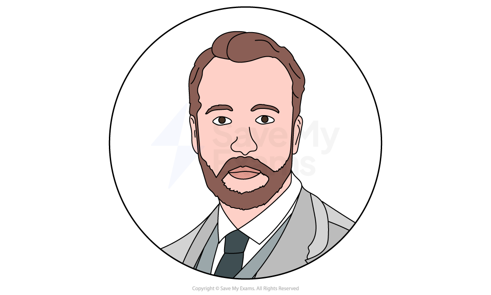
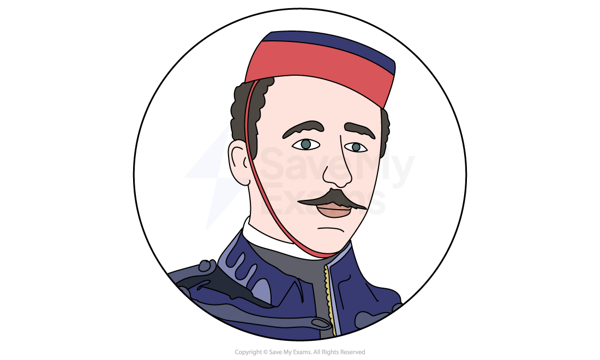
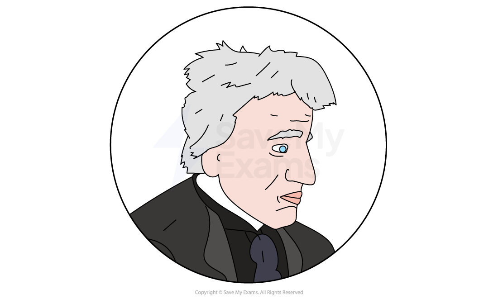
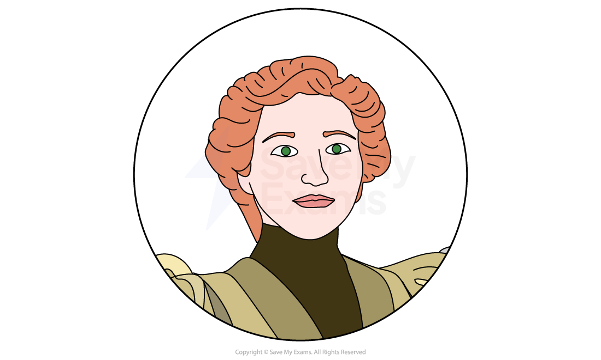
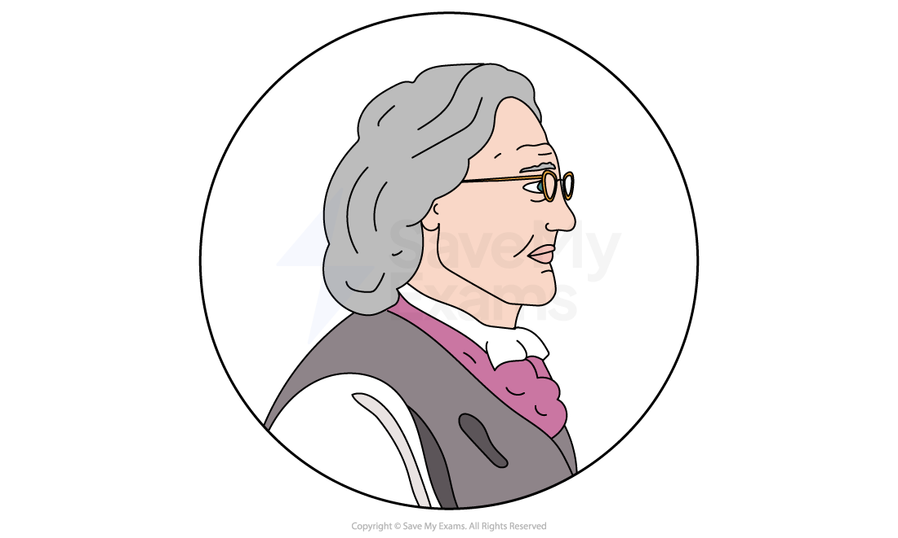

# The War of the Worlds: Characters

## The War of the Worlds: Characters

> **Spec point** — `spcpt_Nv6ChqXpjfDtnVy3`

## Characters

H.G. Wells created a range of different characters to provide his readers with information about wider issues in society at the time the novel was written (1895–8).

Many of the characters in the novel are known only by their role, rather than by a name, reflecting H.G. Wells’s interest in presenting the collective experiences of the characters as representations of humanity. They serve to express a viewpoint or [symbolise](https://www.savemyexams.com/glossary/gcse/english-language/symbolism-definition/) an institution such as the church or the military (Aldiss, 2005), so [characterisation](https://www.savemyexams.com/glossary/gcse/english-literature/characterisation-definition/) is fairly limited in the novel.

Here, you’ll find a summary of the key characters in The War of the Worlds:

### Main characters

**The narrator **

**The artilleryman**

**The curate **

**The narrator’s brother **

**The narrator’s wife **

**Ogilvy**

### Minor characters

**Henderson **

**The innkeeper**

**The Elphinstone sisters**

## The War of the Worlds: Characters: The narrator

> **Spec point** — `spcpt_MJqNnWyZy5r4vvGp`

## The narrator

*The Narrator*

The narrator is integral to the plot because he tells the story of the Martians’ invasion of Britain:

- As the story is told from his point of view, he provides insight into what happens throughout

- The narrator shares with readers that he is a “...recognised writer on philosophical themes” and not a scientist
- From the outset, the narrator witnesses the Martians’ arrival and is in a prime position to reveal the events and share his observations:

  - “... another jetting out of gas from the distant planet. I saw it.”
- Wells shows the narrator to be a considerate and thoughtful character, someone who wants to help not only himself but also humanity
- He shows a keen interest in the other human characters, describing feeling a great responsibility to support others, particularly his wife (whom he becomes separated from) and his brother, whose experience he imagines:

  - “My younger brother was in London… he heard nothing of the arrival [of the Martians] until Sunday morning.”
- The narrator seems somewhat detached from his emotions, perhaps in response to the incredible events he witnesses:

  - In Chapter 7 of Book One, he says “At times I suffer from the strangest sense of detachment… I seem to watch it all from the outside…”
- The narrator believes that the Martians serve as a warning to humans on earth, and he wants the human race to be prepared for future invasions:

  - Towards the end of the novel, he says “...the destruction of the Martians is only a reprieve…” and that maybe “...the future is ordained”

## The War of the Worlds: Characters: The artilleryman

> **Spec point** — `spcpt_Dh73z2sv24TmD8t7`

## The artilleryman

*The artilleryman*

- The artilleryman is one of the main military characters in the story, whose weapon is used in defence against the Martians
- The outward appearance of the artilleryman is one of strength and *doggedness*, but Wells represents duality in his character: he is both fragile and tenacious:

  - After a horrific encounter with a “Heat-Ray”, he is rescued by the narrator “in a perfect passion of emotion”, sobbing and weeping
  - Later, his tactical and military training help to protect them both
  - After being separated following a Martian encounter, the two men meet again and the artilleryman seems more resilient and determined to fight the Martians: “I tell you, I’m grim set on living” and “...we’ve got to live and keep independent…”
- The artilleryman is focused on survival and fears the human race has relented too easily, commenting that people “...haven’t got any spirit in them…”
- However, as the novel progresses, the narrator realises that the artilleryman is somewhat lazy and greedy, taking breaks for food and drink and commenting “Let us knock off a bit…” and “Oh, one can’t always work”

## The War of the Worlds: Characters: The curate

> **Spec point** — `spcpt_3QGYkjDgRH3VTDYZ`

## The curate

*The curate*

- The curate, representing organised religion in the novel, is profoundly affected by the Martian attack, which challenges his religious views:

  - He is distressed, asking the narrator, “What does it mean? What do these things mean?”
- While the curate is troubled by the attacks and seeks a religious explanation, Wells contrasts his response with the narrator’s more philosophical, rational and intellectual approach
- Both men are fortunate to survive the Martians’ attack and take shelter together in an abandoned house
- After being in close proximity for a number of days, the narrator reveals how irritating his companion’s *foibles* are:

  - The narrator “...grew very weary and irritable…”, describing the curate as displaying “...selfish despair”
  - The narrator eventually isolates himself from the curate in the house to preserve his sanity
- The character of the curate is selfish, egocentric and childish as he consumes a lot of the food in the house, despite their vulnerable situation
- The curate’s reckless behaviour results in the narrator hitting him with a shovel and he is discovered and killed by a Martian

## The War of the Worlds: Characters: The narrator's brother

> **Spec point** — `spcpt_WZKYhQ8zH5mZJqzs`

## The narrator’s brother

*The Narrator's brother*

- The narrator’s brother is a London-based medical student, who serves the narrative function of presenting a Londoner’s view of the Martians’ arrival:

  - “...he heard nothing of the arrival until Saturday morning”
- The narrator’s brother is seemingly unaware of the threat that the Martians pose, trying impulsively to see the narrator:

  - His ambitions fail due to the malfunctioning railways and the bicycle’s tyres
- *Fortuitously*, he meets the Elphinstone sisters and rescues them from an attack by robbers, showing a chivalrous and determined side to his character
- With the sisters, the narrator’s brother sails away from England to safety

## The War of the Worlds: Characters: The narrator's wife

> **Spec point** — `spcpt_SfwFnJZhQm4fP9z7`

## The narrator’s wife

*The Narrator's wife*

- The narrator’s wife is the only significant female character in the novel but is unnamed throughout
- She functions as an [archetype](https://www.savemyexams.com/glossary/gcse/english-language/archetype-definition/) of a Victorian wife, a passive *foil* to the narrator to present his character and voice, and her viewpoint is never presented to the reader
- Later in the novel, the narrator’s wife and her husband are accidentally separated, and the narrator’s determination to find her drives the story forward, showing his dedication to her
- At the end of the novel, they find each other at their home:

  - Readers encounter her voice for the only time when she says with great emotion, “I came… I knew, I knew…”
- The novel ends with the narrator holding his wife’s hand, [symbolising](https://www.savemyexams.com/glossary/gcse/english-language/symbolism-definition/) both their love and  the restoration of order

## The War of the Worlds: Characters: Oglivy

> **Spec point** — `spcpt_vxbhxNSQMh78Jrb4`

## Ogilvy

*Ogilvy*

- Ogilvy is a “well-known astronomer” who serves the narrative function of [exposition](https://www.savemyexams.com/glossary/gcse/english-language/exposition-definition/) – telling the narrator (and readers) about the early days before the Martian attack
- He is portrayed as skilled and intelligent – someone who is “immensely excited” by what he has seen
- The astronomer is assured and convincing and says to the narrator how life on Mars is unlikely, as he “scoffed at the vulgar idea of its having inhabitants…”, stating that “The chances against anything manlike on Mars are a million to one”
- Despite his knowledge, it is ironic that Ogilvy is one of the first to die from a Martian attack, incinerated by the Martians’ Heat-Ray guns:

  - Ogilvy is presented as both arrogant and naive

## The War of the Worlds: Characters: Minor characters

> **Spec point** — `spcpt_vYskZC9DD6VX3x6V`

## Minor characters

## Henderson

- Henderson is a journalist who comes across Ogilvy on his travels
- He believes what Ogilvy tells him about the cylinder and sends a message to London about what he has discovered
- Henderson is one of the peace party group who approaches the cylinder with a white flag but is mercilessly killed
- Wells uses his fate to show the dangers of rash or impulsive actions

## The innkeeper

- The innkeeper owns the local pub in Horsell Common called The Spotted Dog
- He lends his horse and cart to the narrator so he can take his wife to Leatherhead to stay with family
- The innkeeper is killed and found by the narrator when he returns the horse and cart, reflecting the fate of those who act in kindness in the novel

## The Elphinstone sisters

- The narrator’s brother intervenes when the sisters are being robbed, and they later escape to another country

> **Exam Hint**
> Examiners’ reports often comment on Wells’ use of minor characters and their perspectives such as the narrator’s brother, the curate, the artilleryman or Oglivy, as well as the reaction of the Martians (another “character” in the novel).
> 
> Take time to revise all the characters.

#### Sources

Wells, H. G. (2005). The War of the Worlds. Penguin Classics.
