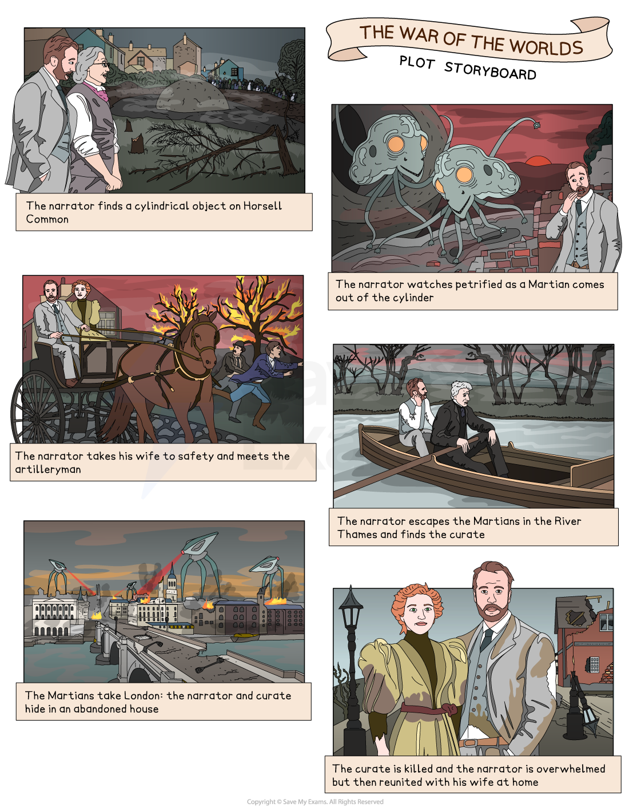

# The War of the Worlds: Plot Summary

## The War of the Worlds: Plot storyboard

> **Spec point** — `spcpt_xmMsv5kkYhF2dZd6`

## Plot storyboard

*Plot storyboard*

## The War of the Worlds: Plot summary

> **Spec point** — `spcpt_6GKKxhqqP9g9swgw`

## Plot summary

The War of the Worlds is a science-fiction novel written between 1895 and 1897. It was serialised in a British publication, Pearson’s Magazine, before being published as a hardback book in 1898. The book’s chapters are split into two sections: Book One is entitled The Coming of the Martians and Book Two is called The Earth Under the Martians.

The story is narrated in hindsight, around six years after the event, and is told from the perspective of an unnamed male narrator who describes an invasion of Martians over about a month.

Close to the start of the novel, the narrator witnesses different flashes over several nights. One morning, a large object crashes onto Horsell Common, close to the narrator’s home. This event causes a lot of speculation and ultimately marks the visible arrival of the Martians. The event causes the narrator to flee to his home to tell his wife about what he has witnessed.

The military arrive to try and take control after the Martians have invaded. The narrator has some terrifying experiences, which result in him meeting an artilleryman and the curate, both of whom are significant in the story. At this point, the focus of the narrative changes and the narrator adopts the viewpoint of his London-based younger brother. London is slow to respond to the invasion, mainly because the city is unaware of what has happened until the Martians attack it with a poisonous “Black Smoke”.

Towards the end of the story, the narrator, along with the curate, takes shelter in the ruins of a demolished house. As the narrator leaves and makes his way towards London, he meets the artilleryman again who claims that humankind is finished. His plan is to build an underground community for survivors but the narrator continues on his journey to London, unsure of the artilleryman’s plans.

The novel concludes with the narrator realising that the Martians have not survived. They have all been “...slain by the putrefactive and disease bacteria against which their systems were unprepared.” In the epilogue, the narrator discovers that his wife has survived. He considers what the Martian invasion means for humankind and wants humanity to be prepared for any such future invasions.

## The War of the Worlds: Chapter-by-chapter plot summary (Book One)

> **Spec point** — `spcpt_54tXdz7jdJMR6mRX`

## Chapter-by-chapter plot summary

### Book One: The Coming of the Martians

### Chapter One: The Eve of the War

- The story begins with the narrator explaining how Earth has always been watched by creatures from other planets
- The narrator discusses life on Mars and advises people to not judge alien life too harshly, particularly as little is known about it
- Ogilvy, a friend of the narrator, invites him to his observatory to view some strange occurrences –  they see red flares and “projections”
- One night the narrator and his wife go for a walk and everything seems normal and safe to them both

### Chapter Two: The Falling Star

- Ogilvy witnesses a green streak of light and believes it to be a meteorite
- The narrator describes what they find – a hot, cylindrical object and Ogilvy hears strange sounds from inside
- Ogilvy tries to get the attention of different people to tell them what he has witnessed but they think he is crazy
- Finally, Ogilvy meets a journalist called Henderson who agrees to accompany him back to the crater to see what has happened

### Chapter Three: On Horsell Common

- The narrator approaches the object, believing that it could be something from Mars, despite Ogilvy saying this is highly unlikely
- Many spectators gather about Horsell Common to try and work out what has happened, interfering with what Ogilvy and other astronomers are trying to do
- The narrator walks to the train station to meet the owner of the land

### Chapter Four: The Cylinder Opens

- The narrator returns to Horsell Common and, along with many spectators, sees that the cylindrical object – the “Thing” – is unscrewing
- Tentacles start to emerge, and there is something with eyes like “two luminous discs” inside
- A Martian comes out of the object followed by another
- The narrator runs off and watches from a short distance, observing the strangeness of the scene in front of him

### Chapter Five: The Heat-Ray

- The narrator continues watching from a distance: his “actions” were “paralysed” as  Martians unleash their power: the humans are incinerated
- As night falls, the narrator observes the light and the smoke, as well as “hissing” sounds and feels true fear, “unprotected and alone”, and runs off, seeking safety elsewhere

### Chapter Six: The Heat-Ray in the Chobham Road

- Many shops close in one of the towns affected by the Heat-Ray attack (Woking) but residents do not seem to realise what is happening despite people being killed
- Both Henderson and Ogilvy, before dying, send messages to newspapers that military support is required at Horsell Common, where the strange cylindrical object is

### Chapter Seven: How I Reached Home

- The narrator runs out of the woods but falls
- He loses *consciousness* for a period of time but feels more “normal” again
- When the narrator gets home, despite fearing how she will react, he tells his wife what has happened
- He offers reassurance, suggesting that the Martians won’t be able to survive on Earth due to Mars’s conditions being very different

### Chapter Eight: Friday Night

- The narrator is amazed at how little people’s lives have changed: he mentions the “... dovetailing** **of the commonplace habits…” and how such entrenched behaviours merge with the Martians’ arrival
- People continue to visit the Martians but don’t  return
- Another flash is seen to the north-west of Horsell Common

### Chapter Nine: The Fighting Begins

- The soldiers seem unaware of Martians’ physical form, much to the narrator’s dismay
- Newspapers are not reporting anything new, suggesting they are not taking things seriously but the Heat-Ray causes widespread damage
- The narrator plans to leave the area and go to Leatherhead with his wife when he pays a pub landlord to rent his horse and cart to drive his wife to their relatives’ home

### Chapter Ten: In the Storm

- The narrator returns to his home and there is a ferocious storm and the narrator sees an “otherworldly” object, a large tripod, heading in his direction
- The narrator has witnessed some horrific sights, including the dead pub landlord, and secures himself against a door in his house, “shivering violently”

### Chapter Eleven: At the Window

- The narrator observes how the landscape outside has been destroyed and spots someone in his garden, the artilleryman, one of the only military men to survive the attack
- The narrator gives the artilleryman some food and they watch what is happening outside, including the “vivid green vapour” in the air

### Chapter Twelve: What I Saw of the Destruction of Weybridge and Shepperton

- The narrator and the artilleryman leave together and on their journey, encounter a range of military men who are finding it difficult to get local residents to take the events seriously
- The narrator is outraged, telling people that “Death is coming! Death!”
- When the two men reach Weybridge, they witness further destruction, including a piece of machinery destroying a church

### Chapter Thirteen: How I Fell In With the Curate

- Different Martian cylinders keep arriving and the narrator continues on his journey towards London, finding a boat to travel on the river and passing through devastated towns
- The narrator falls asleep on the boat and when he wakes, the curate is sitting opposite him, questioning, “What do these things mean?”

### Chapter Fourteen: In London

- At this stage, the narrator begins to imagine his brother’s experience
- It is clear that Londoners are unaware of the events, much to the narrator’s surprise
- Newspapers and locals are misrepresenting the threat the Martians pose, but the narrator’s brother finally realises how dangerous they are

### Chapter Fifteen: What Had Happened in Surrey

- The narrator and the curate try to hide to be safe and the narrator questions the Martians’ intentions and wonders if they intend to “exterminate” the human race
- There is continuous disruption, including another cylinder falling from the sky, and deadly Black Smoke everywhere

### Chapter Sixteen: The Exodus from London

- The narrator’s brother leaves London and comes across two sisters who are in danger
- They present him with a gun and trust him, witnessing horrific scenes together, but eventually find a place of safety

### Chapter Seventeen: The Thunder Child

- The narrator’s brother and his two companions travel to Essex and the sea, making their way towards a steam boat
- A navy ship, Thunder Child, is under attack by the Martians, the Black Smoke and the Heat-Ray, but it manages to keep going, despite being on fire
- The steam boat escapes and the narrator’s brother spots “something flat and broad, and very large” in the sky

## The War of the Worlds: Chapter-by-chapter plot summary (Book Two)

> **Spec point** — `spcpt_ncBcz7n5QRdb4M5Z`

## Chapter-by-chapter plot summary

### Book Two: The Earth Under the Martians

### Chapter One: Underfoot

- The narrator continues to worry about his wife as he is isolated in an abandoned house with the curate, someone he finds annoying
- Both men leave, the curate encouraged by the narrator, but spend time dodging dead bodies and Martians
- They hide in a shed and a ditch to avoid being caught before taking shelter in another house where they are trapped after another cylinder lands

### Chapter Two: What We Saw from the Ruined House

- Both the narrator and the curate observe what the Martians are doing, watching “one of the great fighting-machines, deserted by its occupant”
- The narrator describes the appearance of the Martians: “a sort of mechanical spider” with “three long tentacles”
- He observes how the Martians don’t eat but survive by injecting human blood

### Chapter Three: The Days of Imprisonment

- The relationship between the narrator and the curate suffers considerably after being stuck together for a few weeks and the curate becomes depressed: “He would weep for hours”
- The narrator describes the curate as “one of those weak creatures… anaemic… hateful…’
- As they understand how the Martians are feeding on the blood of humans, any escape is dangerous

### Chapter Four: The Death of the Curate

- The two men continue to struggle and the narrator has to ration the food to stop the curate eating it all
- The curate’s unreasonable and destructive behaviour leads the narrator to attack him, attracting the attention of the Martians
- One of them enters the house and drags the body of the curate away while the narrator hides in the cellar in a coal pile, narrowly avoiding capture

### Chapter Five: The Stillness

- The narrator is isolated and alone in the house: the Martian has stolen all of the food, the water is black and a strange red plant is taking over parts of the building
- Eventually, the narrator looks out and sees that the land is empty of Martians but the red plant is growing everywhere

### Chapter Six: The Work of Fifteen Days

- The narrator is left “tottering on the mound” surveying his surroundings – he feels as if things have changed significantly and that he is on “another planet”
- He witnesses the red plant growing everywhere and how contact with water changes its appearance
- He sees “no sign of the Martians” or humans anywhere, only “ blackened, desolate ruins”

### Chapter Seven: The Man on Putney Hill

- The narrator encounters a deranged man on the hill, who he recognises as the artilleryman, who explains that the Martians have moved on, commenting that “We’re down, we’re beat”
- The artilleryman believes the Martians will take over the world and plans to live underground in London, hoping to establish a community beneath the earth
- The narrator resolves to return to London to see if he can join forces with his peers and learn about the Martians’ behaviour

### Chapter Eight: Dead London

- When the narrator returns to London, he is shocked at the carnage everywhere: dead bodies, smouldering ruins and black smoke
- He comes across an *inert* fighting machine, followed by a dead Martian and realises the attack has ended and the Martians have been “slain by the putrefactive and disease bacteria”
- He is happy that humans have succeeded and hopes that London will once again be “alive and powerful”

### Chapter Nine: Wreckage

- The narrator loses his grasp on reality and is supported by a group of people
- Others return from overseas, delighted that the Martians have gone, but the narrator seems to have lost his memory of the past few days
- Printed newspapers are largely empty, aside from some advertisements and news of a flying machine
- He returns to his home and finds his wife – they are the lucky few to have survived

### Chapter Ten: The Epilogue

- The narrator regrets not knowing the answers to many questions he has about the Martians’ invasion
- He considers what might happen in the future – that Earth could be attacked again and that people should be prepared
- The novel ends with the narrator holding his wife’s hand, signalling the restoration of humankind

#### Sources

Wells, H. G. (2005). *The War of the Worlds*. Penguin Classics.
