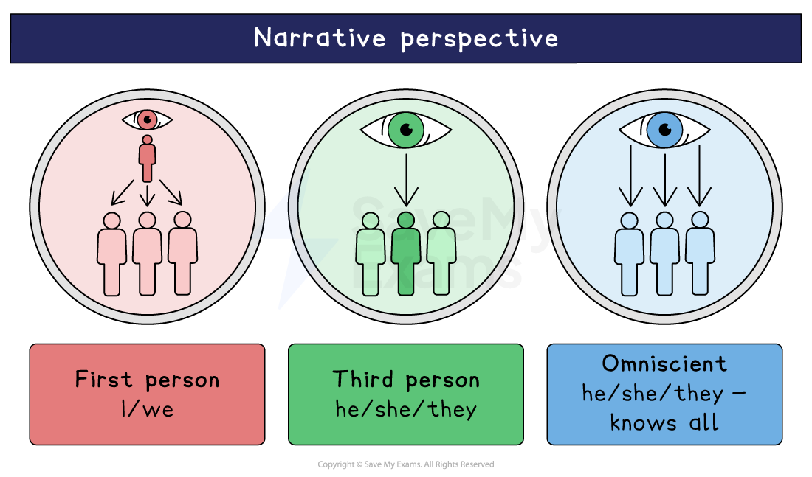

# Things Fall Apart: Writer's Methods and Techniques

In your exam question on Things Fall Apart, examiners will assess your ability to demonstrate a close knowledge and understanding of the text and engage with the text in a personal and informed way. This means that you will be required to write about how you believe Achebe creates meaning and conveys ideas across the novel.

There is no assessment on language analysis as such. Examiners are looking for an exploration of how Achebe’s overall aims were achieved. Achebe conveys ideas through several methods and techniques in Things Fall Apart:

- **Tragedy**
- **Narrative perspective **
- **Setting**
- [Symbolism](https://www.savemyexams.com/glossary/gcse/english-language/symbolism-definition/) **and** [motifs](https://www.savemyexams.com/glossary/gcse/english-literature/motif-definition/)

## Things Fall Apart: Writer's methods and techniques: Tragedy

> **Spec point** — `spcpt_TKvSH4cWrjW38Xvv`

## Tragedy

- Achebe’s novel is [structured](https://www.savemyexams.com/glossary/gcse/english-language/structure/)<u>** **</u>as a tragedy which presents the downfall of tragic hero, Okonkwo, as well as the destruction of the *Igbo* culture
- The [exposition](https://www.savemyexams.com/glossary/gcse/english-language/exposition-definition/)<u>** **</u>portrays Okonkwo as a typical tragic hero: he has status and popularity in his village
- In the [rising action](https://www.savemyexams.com/glossary/gcse/english-language/rising-action/), Okonkwo’s [fatal flaw](https://www.savemyexams.com/glossary/gcse/english-language/hamartia/) is exposed in interactions with his family, and readers see the pressure he feels about his son:

  - His extreme, stereotypical views on masculinity expose him as an aggressive and merciless father and husband
  - Despite advice, he refuses to reflect on or alter his behaviour
- Typically, the tragic hero’s inner turmoil and guilt leads to his downfall:

  - In the resolution, Okonkwo, feeling powerless, takes his own life

## Things Fall Apart: Writer's methods and techniques: Narrative perspective

> **Spec point** — `spcpt_nmczJrMK7cd7gB4F`

## Narrative perspective

- Achebe uses a neutral [third-person](https://www.savemyexams.com/glossary/gcse/english-language/third-person/)<u>** **</u>[omniscient perspective](https://www.savemyexams.com/glossary/gcse/english-language/omniscient-narrator/), so readers hear the thoughts and feelings of multiple characters
- By revealing the feelings of both father and son, Achebe presents both [perspectives](https://www.savemyexams.com/glossary/gcse/english-language/perspective/)<u>** **</u>on the conflict between them, which raises themes about identity:

  - The narrator explains that Nwoye was causing “his father great anxiety for his incipient laziness”, adding “that was how it looked to his father”
  - But we also hear of Nwoye’s reactions to his father: “Nwoye had felt for the first time a snapping inside him like the one he now felt.”
- However, the *omniscient perspective* also creates an emotional distance between the reader and the community of Umoifia:

  - For example, the use of the third-person pronoun in “Darkness held a vague terror for these people”
- The *District Commissioner* perspective is heard too:

  - "One of the most infuriating habits of these people was their love of superfluous words, he thought”
- The narrator weaves information about **Igbo** culture throughout the novel to give context to events and emphasise key traditions:

  - Proverbs are used to express beliefs, such as: “The Ibo people have a proverb that when a man says yes, his *chi* says yes also”
  - This reflects ideas about fate and personal independence

## Things Fall Apart: Writer's methods and techniques: Setting

> **Spec point** — `spcpt_qWbGGsw2yShr55D2`

## Setting

- The story is set in a fictional, rural community called Umuofia in Nigeria:

  - The community is made up of nine farming villages
- Villages are identified by parental lineage (as either “fatherland” or “motherland”) highlighting the importance of ancestry and cultural identity:

  - For example, Okonkwo is exiled to Mbanta, his mother’s village, in a bid to help him connect with the “feminine”
- The story is set in the 19th century during British *colonisation*
- Achebe draws attention to different cultures and how the **Igbo** belief systems change as a result of Christian *missionaries*:

  - When the *missionaries* remain safe in the Evil Forest, a cursed place the villagers fear, some members of the community question **Igbo** beliefs, and convert
- The *District Commissioner*’s book, the title of which ends the novel, raises cultural themes by presenting the British perspective on Africa:

  - The title, “The Pacification of the Primitive Tribes of the Lower Niger”, suggests a savage land, and dismisses **Igbo** borders

> **Exam Hint**
> When you write your answer on Things Fall Apart, it is best to track the development of a character or theme across the whole novel, and to note how the events follow the typical structure of a tragedy. This will help you to form a critical and informed personal engagement to the question asked.

## Things Fall Apart: Writer's methods and techniques: Symbolism and motifs

> **Spec point** — `spcpt_Dmg8Q5QDgXwkBfMJ`

## Symbolism and motifs

### Proverbs and fables

- **Igbo **traditions related to spiritual and moral values are described throughout
- **Igbo **beliefs in the **chi**, for example, are described:

  - The proverb, “when a man says yes his **chi** says yes also” relates to themes of fate and free will
  - This shows Okonkwo’s fatal flaw from an **Igbo** perspective, rather than a Western one
- Characters in the novel illustrate the oral storytelling traditions of the **Igbo**:

  - The villagers remember stories, like Ikemefuna’s tale of the twins
  - This is contrasted with the British prioritising of reading and writing

### Drums

- Throughout the novel the sound of drums indicates important events, such as festivals and the popular wrestling competitions
- The narrator [personifies](https://www.savemyexams.com/glossary/gcse/english-language/personification-definition/)<u>** **</u>the drums, signifying them as integral to the village:

  - “It was like the pulsation of its heart” and “It was the *ekwe* talking to the clan”
- Present-tense verbs suggest the drums may outlast the humans: they are described as “beating” and “persistent and unchanging”

### Animal imagery

- Achebe describes the significance of the natural world in rural Igbo villages:

  - Fables about animals [symbolise](https://www.savemyexams.com/glossary/gcse/english-language/symbolism-definition/)<u>** **</u>traditional belief systems
  - Mothers tell stories about the tortoise shell, a bird who challenged the world, or a vulture who pleads with the “Earth and Sky”
- The importance of animals even leads to violent protest:

  - Villagers burn a church after a convert is believed to have killed a python, a sacred animal in **Igbo** religion

- The idea of “locusts” represents the traditional **Igbo** culture, and its destruction:

- There is much feasting and celebration when a swarm of locusts arrive (they are a delicacy) because, it is explained, they rarely come
- But the elders describe the British settlers as “locusts” too:

  - This may [connote](https://www.savemyexams.com/glossary/gcse/english-language/connotation-definition/) to the colonists as an invading “swarm” or “plague”

> **Exam Hint**
> Remember, in the exam question on Things Fall Apart, instead of just focusing on [characterisation](https://www.savemyexams.com/glossary/gcse/english-literature/characterisation-definition/), it is a good idea to consider Achebe’s choices. For example, you could write about how the **third-person **narrative voice works alongside Achebe’s presentation of cultural differences, as it offers a balanced perspective.

#### Sources

Achebe, Chinua. (1994). Things Fall Apart. Anchor Books.
