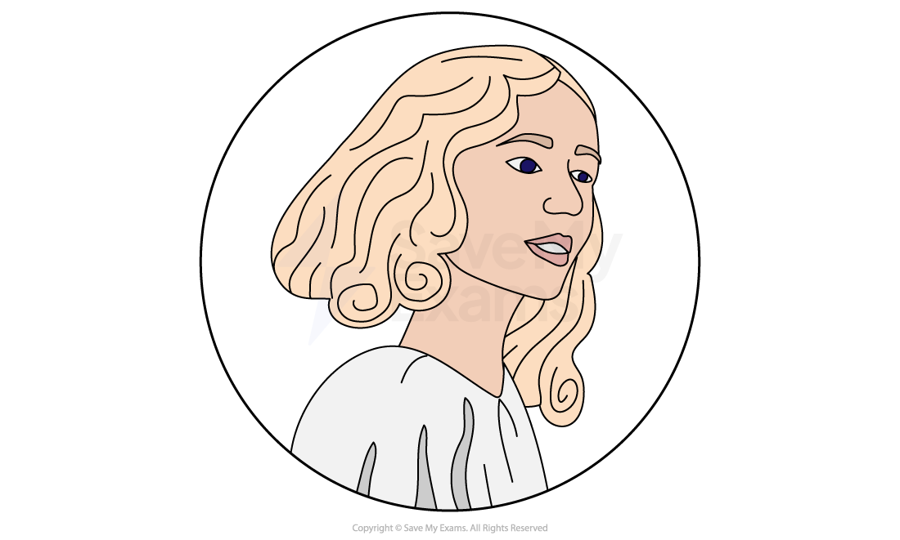
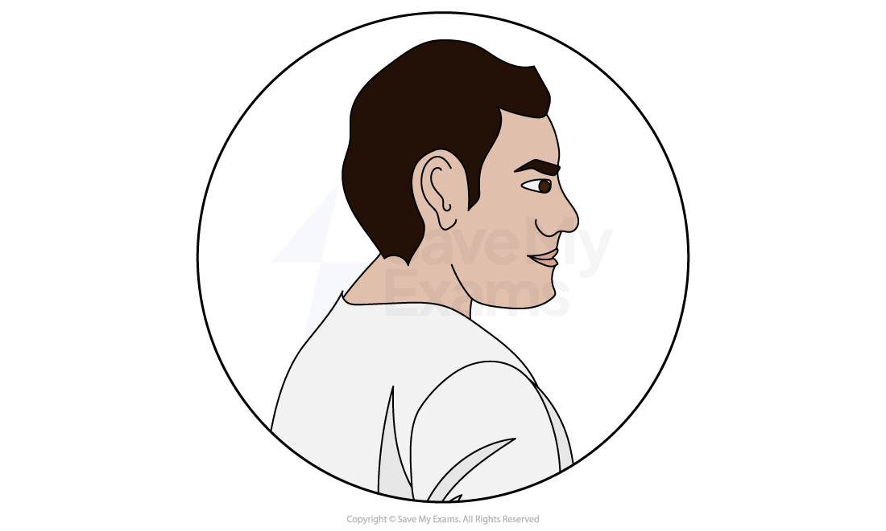
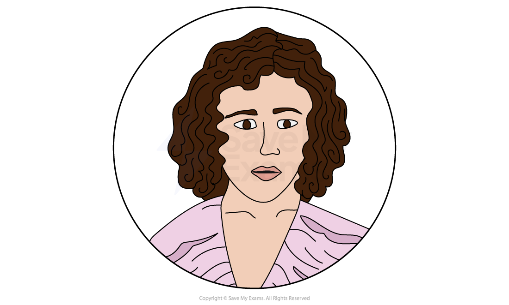
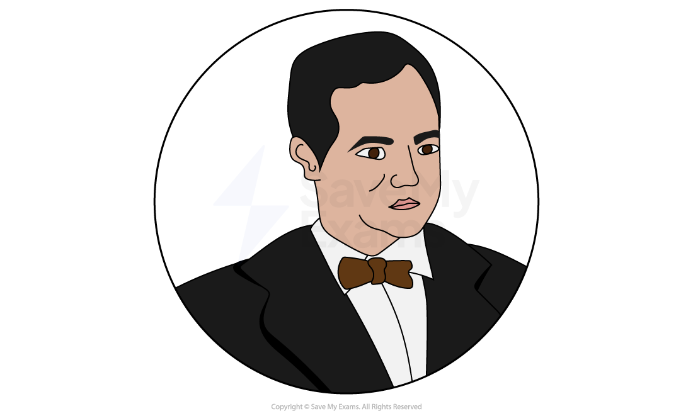
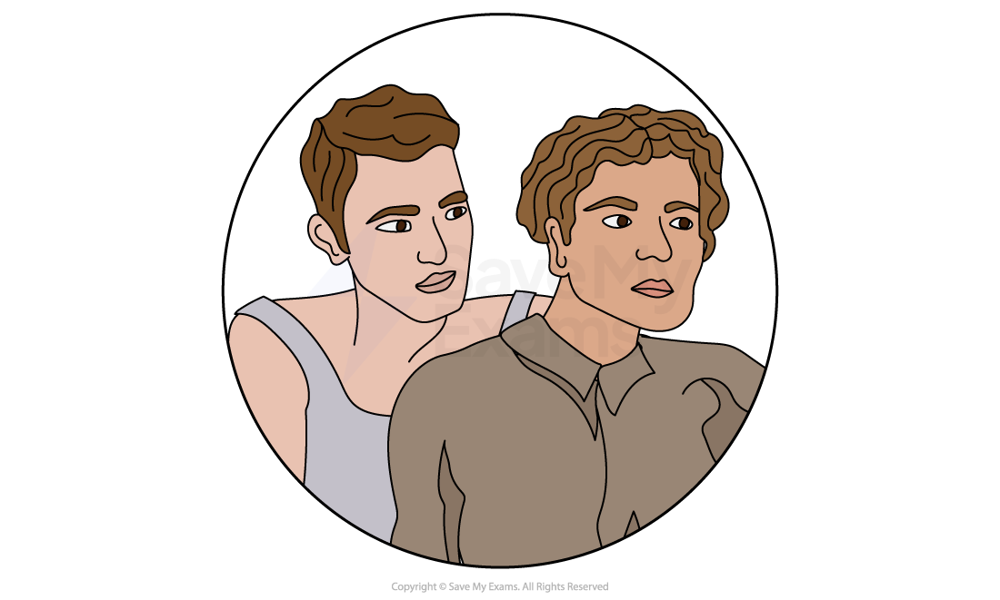

# A Streetcar Named Desire: Characters

## A Streetcar Named Desire: Characters

> **Spec point** — `spcpt_xxVbsJypbTYrvVH6`

## Characters

It is vital that you understand that characters are often used [symbolically](https://www.savemyexams.com/glossary/gcse/english-language/symbolism-definition/) to express ideas. Tennessee Wiliams uses all of his characters to symbolise various ideas prevalent in his society, and the differences between characters reflect contemporary debates. Therefore, it is very useful not only to learn about each character individually, but how they compare and contrast to other characters in the play.

It is important to consider the range of strategies used by Williams to create and develop characters within A Streetcar Named Desire*. *These include:

- How characters are established
- How characters are presented:

  - Physical appearance or suggestions about this
  - Their actions and motives
  - What they say and think
  - How they interact with others
  - What others say and think about them
- How far the characters conform to or subvert stereotypes
- Their relationships to other characters

Below you will find character profiles of:

**Main characters**

- *Blanche DuBois*
- *Stanley Kowalski*
- *Stella Kowalski*
- *Harold Mitchell (Mitch)*

**Other characters**

- *Eunice Hubbel*
- *Steve Hubbel*

> **Exam Hint**
> You should demonstrate a firm understanding that Williams has deliberately created these characters to perform certain functions within the play.
> 
> For instance, you could begin to consider why Williams has chosen to present Blanche in the way that he does. Consider her costumes and mannerisms, as well as what she says. As this is a play, an exploration of dramatic form is also essential to a study of her character. Consider the music often playing in the background when Blanche is feeling particularly stressed or unstable. Try to explore reasons as to why Williams may have chosen to do this and what it might suggest about the character.

## A Streetcar Named Desire: Characters: Blanche DuBois

> **Spec point** — `spcpt_s9RNSpCVkHNGFvSj`

## Blanche DuBois

*Blanche DuBois*

- Blanche is about thirty years old and is Stella’s older sister
- She is a delicate, fluttering creature who first appears wearing a white dress and looking out of place in the run-down part of New Orleans where Stella lives
- In the stage directions, Williams says that she is a “delicate beauty who must avoid strong light” and that there is something about her that “suggests a moth”
- She is a complex, contradictory character:

  - The audience becomes aware early in the play of her class *snobbery*** **in her dealings with Eunice and her reaction to Stanley
  - We also learn that she is a heavy drinker:
  
    - She perhaps drinks to blot out the guilt about her past
  - She is fond of taking long baths, [symbolically](https://www.savemyexams.com/glossary/gcse/english-language/symbolism-definition/) to wash away her guilt
  - She embodies some masculine qualities, such as overt sexuality, which [juxtaposes](https://www.savemyexams.com/glossary/gcse/english-language/juxtaposition-definition/)** **with her delicate, feminine appearance and mannerisms
- She is nervous and appears constantly on edge
- As a young woman, she married a man she later discovered to be a homosexual:

  - She feels responsible for him taking his own life by telling him that he disgusted her
  - She was then subjected to a series of deaths in her family, illustrating the brutality of life
- These events have severely affected her mental health:

  - When she is feeling stressed or remembering her young husband, she hears the *polka*** **tune that was playing when he committed suicide
  - She then hears a shot and the music stops
- In order to try to *alleviate*** **the guilt she feels at her husband’s suicide, she has given herself to lots of other young men who remind her of her husband:

  - This could be seen as her trying to fill the void left by her husband’s death
- When Blanche arrives at Elysian Fields, she has lost the family home, Belle Reve, and is facing financial and personal *destitution*:

  - However, she desperately clings to the fantasy of her being a refined *Southern Belle*
  - She is cultured and intelligent, and cannot stand what she considers to be *vulgarity*** **or poor manners, especially from a man
- Blanche is repulsed by Stanley, but is almost perversely attracted to his masculinity and physicality, like a moth to a flame:

  - She tries to win Stanley over by using her feminine charms
  - This suggests that if she cannot function as a woman, then her life is invalid
- She represents illusion and fantasy, which will always be at the mercy of the harsh real world:

  - She says that she doesn’t want realism; she wants “magic”
  - She changes the apartment to make it more feminine, and cannot have naked light bulbs
  - She prefers to live in a quiet, half-lit world of illusion
  - This suggests that she does not want to see things as they are
- In Mitch, she sees a chance to be “saved” and looked after in the way that she wants:

  - She presents Mitch with the illusion of being a delicate, innocent woman who needs a strong man to look after her
  - However, when Mitch learns the truth about Blanche’s past from Stanley, he forces Blanche to admit to her lies
  - Blanche defends herself, telling him that “inside, I never lied”
  - However, through Mitch confronting her, Blanche is stripped of her chief attribute – her illusions
- Blanche’s past sexual encounters have always been with strangers:

  - This would explain why she pushes Mitch away when he tries to have sex with her, reacting as though Mitch is trying to attack her
  - Whereas for Mitch, her reputation has been *sullied*** **to the extent that he believes that she should have no objections to sleeping with one more man
  - The fact that, on the same night, Stanley rapes her, reinforces the double standards that suggest that it is acceptable for men to have sex with lots of women, but it is not ok for women to do the same
  - Stanley’s rape of Blanche destroys her completely as an individual
- Blanche’s final remarks in the play echo her life:

  - As she leaves with the doctor, she remarks that she has “always depended on the kindness of strangers”
  - Blanche’s part in the story ends in the hands of a stranger

## A Streetcar Named Desire: Characters: Stanley Kowalski

> **Spec point** — `spcpt_xSfsnNq2Vd5h3Q7j`

## Stanley Kowalski

*Stanley Kowalski*

- Stanley Kowalski is Stella’s husband and Blanche’s brother-in-law
- He is direct, passionate, realistic and often violent
- He lives in a patriarchal system in which he expects his wife to be *subservient*** **to him:

  - He believes his authority is threatened by Blanche’s arrival
- With his Polish ancestry, he represents the American Dream:

  - He fought in World War II, and now works as an auto-parts salesman
  - He sees all working-class men as capable of achieving what they want through hard work, and is fiercely loyal to his friends
  - He is at ease with the men around him as he seems confident of his own superiority to them
  - He therefore seems to inspire loyalty as well in his friends, despite bullying them and sometimes being violent with them
- He is practical and has no time or patience for Blanche’s fantasies and illusions:

  - He likes to speak plainly and embodies qualities that can be seen as straightforward and masculine
  - Blanche views him as crude, vulgar and common
- He is loud and explosive:

  - This is reflected in his costumes, which are often loud and *gaudy*
  - He is described as the “gaudy seed-bearer” who takes pleasure in his masculinity
- He is a dominant character and is *shrewd*:

  - He is sensitive to the fact that he married someone of a higher class than himself
  - He resents Stella’s background, which explains his desire to pull her down to his level
  - The conflict between him and Blanche is therefore inevitable, as he sees Blanche as trying to pull Stella back to her past
- He embodies patriarchal values, believing that anything belonging to his wife also belongs to him:

  - He therefore believes that if his wife has been *swindled*, then he has been *swindled*
  - He investigates this directly in order to uncover the truth, not caring for Blanche or Stella’s feelings
  - Throughout Blanche’s stay, he believes that she has drunk his liquor, eaten his food and taken advantage of his hospitality
- He sees Blanche as responsible for upsetting the *status quo* between him and Stella:

  - He resents the fact that she feels superior to him
  - He therefore is intent on finding out about her past, so that he can re-establish superiority and his dominance over Stella
- When Stanley rapes Blanche, this is partly out of revenge, but it is also his final act of establishing reality over Blanche’s fantasy world:

  - He establishes his dominance over her and her world in the only way he understands

## A Streetcar Named Desire: Characters: Stella Kowalski

> **Spec point** — `spcpt_NcxqdCVvzpHHPNgs`

## Stella Kowalski

*Stella Kowalski*

- Stella is Blanche’s younger sister and Stanley’s wife
- She is the feminine to Stanley’s masculine, and the calm to Blanche’s hysteria:

  - She is the character who bridges the divide between the two worlds represented by Blanche and Stanley
  - Her character is the suggestion that a blend of the two worlds is in some way possible, but is made impossible by Stanley and Blanche’s inflexible attitudes
  - This also places her as a pawn in the game, with both Blanche and Stanley trying to assert their alliance with her
- She is described as having a quiet, reserved manner:

  - Blanche treats her like a child, and yet Stella makes no objection to waiting on her
- She is deeply, physically connected to Stanley:

  - She has therefore no desire to return to her past, even though she cares about Blanche
  - She will always choose Stanley over her
  - This is evident in her decision to return to Stanley after he hit her, and her decision to believe Stanley over Blanche in regards to the rape
  - She is** ***complicit*** **in the decision to send Blanche to an *asylum*
- Stella’s surrender to Stanley’s world is almost totally complete:

  - Even though Blanche has some influence over her, resulting in tensions between Stanley and Stella, Stella has accepted Stanley’s world and its values
  - This is evident when she fiercely defends Stanley against Blanche’s criticisms
- It is Stella’s acceptance of Stanley’s version of events in order to protect her marriage and her family at the end of the play that draws the most parallels with her sister:

  - She chooses to deny reality in order to continue to live in an illusion

## A Streetcar Named Desire: Characters: Harold Mitchell (Mitch)

> **Spec point** — `spcpt_WpWkpxCPpSRSCqfm`

## Harold Mitchell (Mitch)

*Mitch*

- Mitch is an army friend of Stanley’s, as well as his co-worker and friend
- He is clumsy and unrefined, but is more sensitive and gentlemanly than Stanley and his other friends:

  - He displays awkward courtesy and embarrassment when he first meets Blanche
  - Blanche is quick to notice that he seems to be more sensitive than the others
- He lives with his mother, who is slowly dying, and for whom he obviously cares deeply
- He acts as a *foil*** **for loud, domineering Stanley
- He dates Blanche and comes to an agreement to marry her, until he finds out the truth about her past:

  - The two are an unlikely match, as Mitch is not a typical *chivalric*** **hero
  - However, Blanche thinks of him as the man who can save her
  - He acts respectfully towards her, asking her permission to kiss her
  - He has the *demeanour*** **of a boy, bragging about his physique, which Blanche plays up to
- Mitch matters to Stanley, who needs his admiration and respect to maintain his superiority in the pack:

  - He therefore tells Mitch what he has discovered about Blanche
  - Mitch believes he has been lied to, showing his straightforward nature
  - He attempts to assert dominance over her, but cannot achieve it
  - He therefore leaves as a failed hero, left as lonely and alone as Blanche

## A Streetcar Named Desire: Characters: Minor characters

> **Spec point** — `spcpt_pkPCkSzqXMSb5kJt`

## Minor characters

*The Hubbels*

### Eunice Hubbel

- Eunice is Stella’s friend and upstairs neighbour
- She lives with her husband, Steve, and represents the lower-class life that Stella has chosen
- Like Stella, Eunice overlooks her husband’s physical abuse to remain with him:

  - She often kicks Steve out, accusing him of having affairs, only to reconcile a short time later
  - Her advice to Stella at the end of the play represents what she [symbolises](https://www.savemyexams.com/glossary/gcse/english-language/symbolism-definition/), as she tells Stella that she has no choice but to believe Stanley

### Steve Hubbel

- Steve is Eunice’s husband and Stanley’s poker friend
- Like Stanley, he is a vulgar, hot-headed, physically fit man and an abusive husband
- He and Stanley’s other poker friend, Pablo, seem to disagree with the decision to call the doctor on Blanche, but do not challenge Stanley directly

### Sources

Williams, Tennessee. A Streetcar Named Desire. Edited by Elliott Martin Browne, Penguin, 2009. Accessed 11 April 2026.
