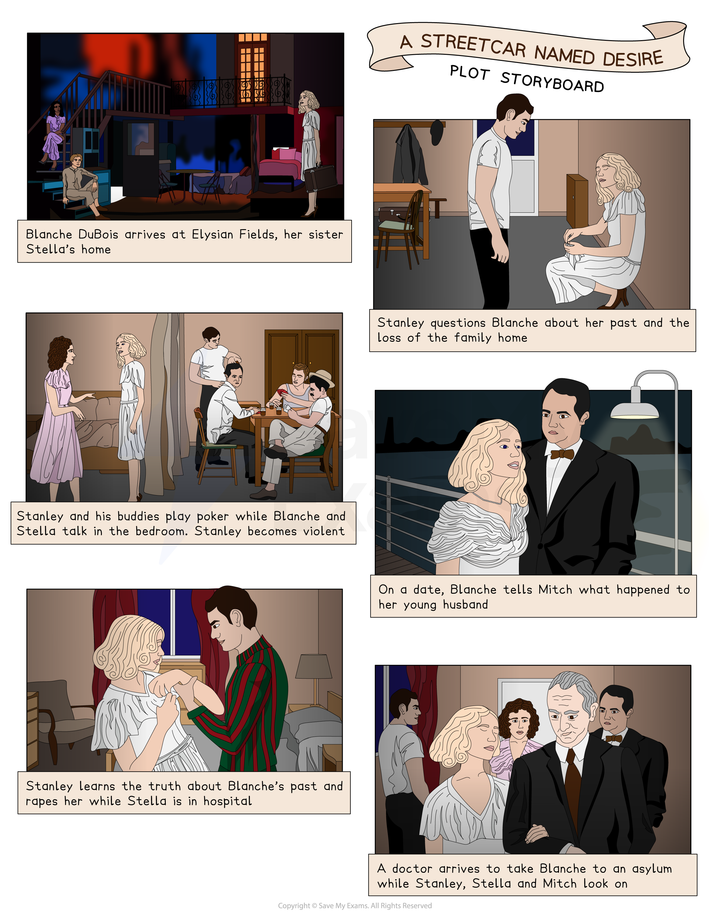

# A Streetcar Named Desire: Plot Summary

## A Streetcar Named Desire: Plot Summary

> **Spec point** — `spcpt_4QbMkw6q8b6MStP2`

## Plot Summary

Once you know the play well, you should be comfortable and familiar enough with key events that you can then link to larger ideas. Having an in-depth knowledge and understanding of the text will help you to gain confidence to find the most relevant references to support your response.

## A Streetcar Named Desire: Plot Summary: Plot storyboard

> **Spec point** — `spcpt_QBpBbfPwXnDg3wdr`

## Plot storyboard

*Plot storyboard*

## A Streetcar Named Desire: Plot Summary: Overview

> **Spec point** — `spcpt_JWFtvxg394tqJ5fg`

## Overview

A Streetcar Named Desire is set in a run-down part of New Orleans, in America’s Deep South, during the 1940s. The play opens on a warm evening outside a house split into two, grandly named Elysian Fields. Stanley and Stella Kowalski live in the downstairs apartment, and their neighbours Eunice and Steve Hubbel live on the first floor.

Stella’s sister, Blanche DuBois, arrives. Stella returns and greets her sister warmly. Blanche asks Stella for a drink of** ***liquor*** **and criticises the conditions she believes Stella to be living in. Stanley returns. He seems quite *amiable* towards Blanche at first, but questions her about her past.

The following evening, Stanley questions Stella about Belle Reve being lost. He also reveals to Blanche that Stella is pregnant. The sisters go out, and when they return, Stanley and his friends are still playing poker and drinking. Blanche catches the eye of Mitch, one of the men, and they flirt. But Stanley becomes increasingly agitated by Blanche’s presence disturbing the game, and eventually he erupts in a fit of anger. When Stella tries to stop him, he hits her. Blanche and Stella escape while the other men *douse* Stanley in a cold shower to sober him up. He is immediately wracked with guilt and remorse and yells at Stella to come back to him, which she does.

The next morning, Stella is calm and content, while Blanche cannot believe that Stella wants to stay with Stanley. Blanche and Mitch begin to date, and Blanche reveals to Stanley that she was once married to a young boy whom she later discovered with another man. Her young husband then killed himself. Mitch and Blanche come to an agreement to marry.

The action moves on to September and Stella is preparing a birthday dinner for Blanche. Stanley comes in to tell Stella that he has learnt the truth about Blanche. Stella is distraught that Stanley has also revealed all of this to Mitch, who does not turn up for Blanche’s birthday meal. Stanley cruelly gives Blanche her “birthday present” – a one-way bus ticket back to Laurel, her hometown. Stella is upset but then goes into labour and Stanley takes her to the hospital.

Alone in the apartment, Blanche is drinking when Mitch arrives and challenges her about lying to him. Blanche defends herself but does not deny it. Mitch tries to have sex with her, but she forces him to leave as she knows he will no longer marry her. Stanley returns from the hospital. He and Blanche fight and Stanley rapes Blanche.

The final scene takes place a few weeks later, after the baby is born. Stella and Eunice are helping Blanche pack, while Stanley plays poker with his friends in the front room. A doctor arrives with a nurse to take Blanche away. The doctor treats Blanche gently and convinces her to accompany him, and he leads her away, leaving Stanley, Stella and their new baby.

> **Exam Hint**
> Knowing the plot of the play very well is important, but it is equally important that you pay attention to the stage directions Williams uses to convey the dramatic developments of the story. These give extra information about the action and the characters, which will help you to develop your own insights and interpretations about the play.

## A Streetcar Named Desire: Plot Summary: Scene-by-Scene Plot Summary

> **Spec point** — `spcpt_5N2fyVypbsY8dZQv`

## Scene-by-Scene Plot Summary

### Scene 1

- Eunice Hubbel and Negro Woman are sitting on the steps of Elysian Fields
- Stanley Kowalski and Harold Mitchell (Mitch) enter, toss a package to Stella Kowalski and go bowling, with Stella following them
- Blanche DuBois comes around the corner, looking out of place and carrying a suitcase:

  - She is looking for her sister, Stella
- Stella returns and the sisters embrace:

  - Blanche reveals she needs a drink to calm her nerves, and is surprised at Stella’s *impoverished*** **surroundings
  - She also reveals that she is taking a leave of absence from her job as a school teacher, and that Belle Reve, the family home, is “lost”
- Stanley returns and asks Blanche about her marriage

### Scene 2

- The following evening, the sisters are preparing to go out while Stanley is playing poker with his friends
- Stella reveals to Stanley that Belle Reve is lost, and he demands to know more details:

  - He believes that, under Louisiana law, any property belonging to his wife also belongs to him
- Stanley demands to see the papers from the sale of Belle Reve:

  - Stanley finds letters belonging to Blanche’s dead husband
  - Blanche gives him all of the papers and reveals that the property was lost on *remortgages*** **stretching back generations
  - Stanley reveals that Stella is going to have a baby

### Scene 3

- The sisters return in the early hours of the morning and the poker game is still going on
- Blanche meets Mitch and flirts with him
- Stanley is drunk and starts to get angry at the noise the sisters are making, as well as Mitch’s interest in Blanche
- Blanche aggravates Stanley
- Stanley erupts in a violent rage and throws a radio out of the window:

  - Stella tries to interject and Stanley hits her
- The other men rush forward to intervene while Blanche and Stella escape
- The men force Stanley under the shower to sober him up:

  - Stanley emerges, soaked and *repentant*** **, crying out for Stella
  - After a while, Stella emerges and returns to him

### Scene 4

- The next morning, Stella lies in bed and Blanche is horrified at Stanley’s behaviour and that Stella went back to him:

  - She appeals to Stella to leave Stanley, but she refuses
- Stella explains that Stanley is sometimes violent, but that is the way she likes it as it gives her a thrill
- Blanche rages against Stanley, calling him “*bestial*”, “like an animal”, “ape-like” and “sub-human”:

  - The sisters do not realise that Stanley has returned and overhears

### Scene 5

- Stella and Blanche are in the bedroom
- Stanley begins to question Blanche about her past:

  - It is clear that Stanley has begun to make some enquiries about Blanche
- Blanche is shaken
- She seems nervous and almost hysterical:

  - She reveals she is going on a date with Mitch, and has not been honest with him about her age
- Stella leaves to join Stanley
- As Blanche waits for Mitch, a Young Collector appears at the door, collecting subscriptions for a newspaper
- Blanche flirts with the young boy, attempting to seduce him:

  - She kisses him on the mouth, but then sends him on his way, saying that she has got to be good and keep her “hands off children”
- Mitch arrives with roses

### Scene 6

- Blanche and Mitch return from their date
- Mitch asks if he can kiss Blanche:

  - She invites him in for a *night-cap*
- As they talk, Mitch reveals to Blanche about his sick mother and her desire to see Mitch settled down before she passes away
- Blanche tells Mitch about her young husband:

  - They were both very young, and she says she loved him passionately, but he was unhappy
  - One day, she discovered him in bed with an older man
  - They both pretended nothing had happened, and drove out to a casino
  - Blanche told him that he disgusted her
  - The boy then rushed out and committed suicide
- Mitch suggests that they both need somebody and they embrace

### Scene 7

- The action moves on to mid-September
- Stella is preparing a birthday meal for Blanche, while she is taking another bath
- Stanley enters and reveals all he has found out about Blanche:

  - He tells her that Blanche had been living in a disreputable hotel
  - She developed such a *scandalous*** **reputation for *promiscuous* behaviour that the hotel had kicked her out
  - He also reports that Blanche actually lost her job as a teacher for having an affair with a 17-year-old student
- At first, Stella doesn’t believe Stanley:

  - Stanley also reveals that he has told Mitch the truth about Blanche
- Blanche comes out of the bathroom and realises that something is different

### Scene 8

- Stanley, Stella and Blanche are finishing their birthday dinner without Mitch, who did not show
- Stanley tells Blanche that he has a birthday present for her, and hands her a bus ticket back to Laurel, her hometown
- Stella tells Stanley that what he did was cruel, but then she goes into labour and instructs Stanley to take her to the hospital

### Scene 9

- Blanche is alone in the apartment, drinking
- Mitch arrives, unshaven and *dishevelled*:

  - He accuses her of lying about her age and her innocence
- A Mexican woman comes to the door, selling “flores para los muertos” (flowers for the dead):

  - Blanche is frightened and slams the door
- Mitch tries to embrace Blanche, but she tells him that he must marry her first:

  - Mitch replies that she is not clean enough to bring home to his mother
- Blanche screams at him and he leaves

### Scene 10

- Blanche is still in the apartment, and has been drinking since Mitch left
- Stanley returns from the hospital
- He is in high spirits and puts on his silk pyjamas from his wedding night
- Blanche tells Stanley that Mitch also visited to beg her forgiveness:

  - Stanley then confronts Blanche, attacking her verbally and accusing her of lying
  - *Grotesque*** **shadows start to surround Blanche on the walls
- Stanley advances towards Blanche:

  - She smashes a bottle on the table and waves it at him
  - Stanley grabs her, picks her up and carries her to the bed

### Scene 11

- Some weeks later, Stella is packing Blanche’s things while she is in the bathroom
- The men are playing poker in the kitchen
- Stella reveals to Eunice that Blanche told her about Stanley raping her, but she could not believe it and went on living with him
- Blanche emerges from the bathroom:

  - She seems dazed and confused
- A doctor and a nurse arrive:

  - When Blanche sees the doctor, she panics
- Stanley and the nurse begin to advance on Blanche, who becomes hysterical:

  - The nurse asks the doctor if they will need a *straitjacket*
  - The doctor thinks that won’t be necessary, and leads Blanche gently out
- Stella is distraught, but Eunice places her baby in her arms:

  - She joins Stanley on the porch, who holds her in his arms

#### Sources

Williams, Tennessee. A Streetcar Named Desire. Edited by Elliott Martin Browne, Penguin, 2009. Accessed 11 April 2026.
